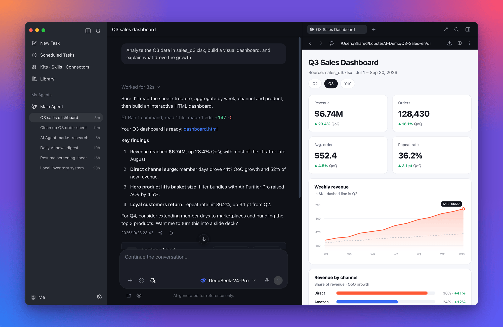
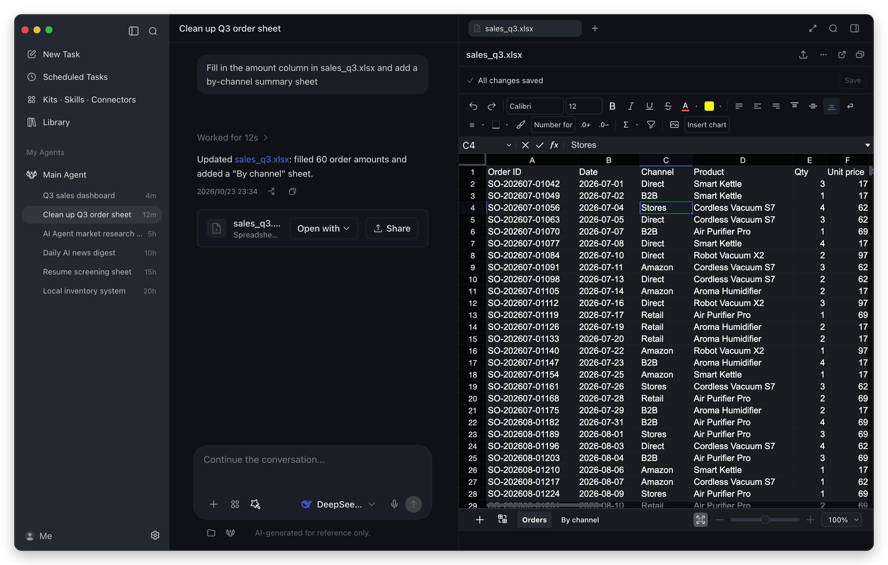
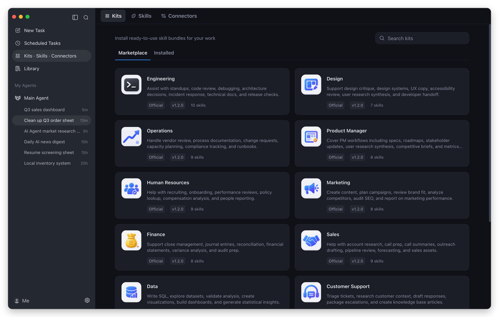
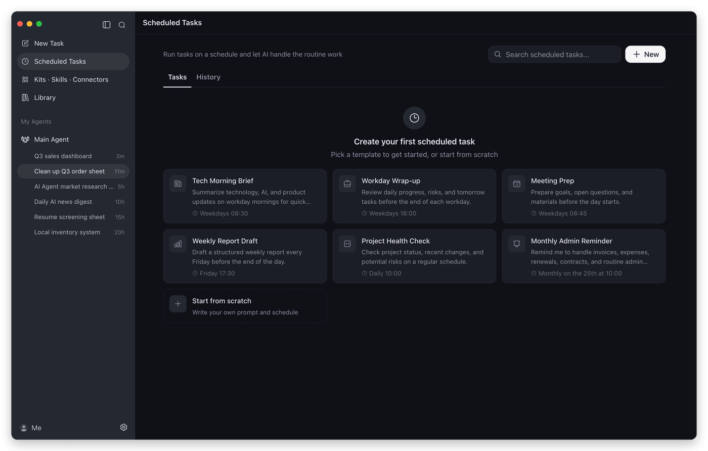
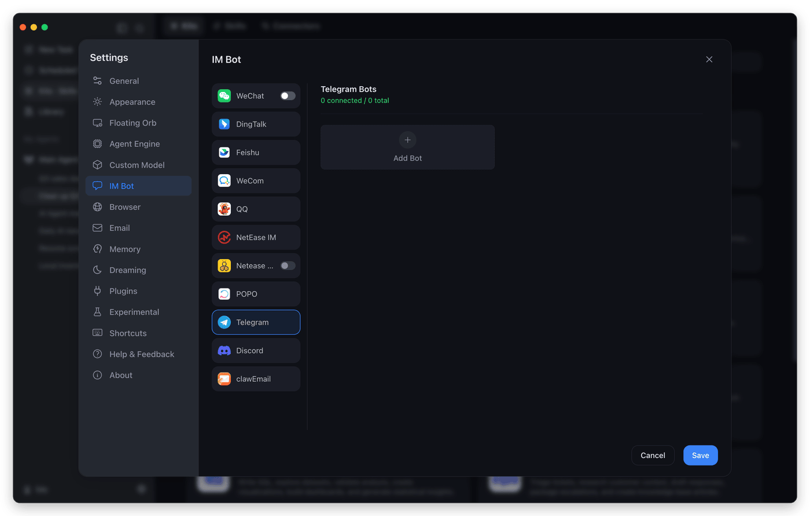
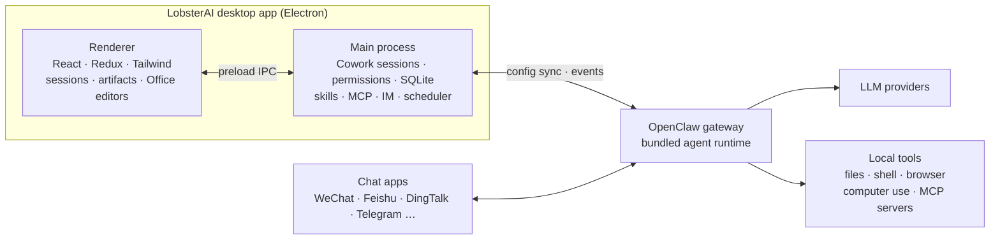

<div align="center">


# LobsterAI

**The open-source desktop AI agent that does real work on your computer.**

Describe a task in plain language. LobsterAI reads your files, runs tools, drives a browser,<br/>
edits Office documents, and hands back finished work — at your desk or from your phone.

<p>
  <a href="https://github.com/netease-youdao/LobsterAI/releases/latest"></a>
  <a href="https://github.com/netease-youdao/LobsterAI/stargazers"></a>
  <a href="LICENSE"></a>
  
  <a href="https://x.com/LobsterAIYoudao"></a>
  <a href="#community"></a>
</p>

**English** · [简体中文](README_zh.md)

<h3>
  <a href="https://lobsterai.youdao.com/#/download-list">Download</a>
  &nbsp;·&nbsp;
  <a href="#quick-start">Quick start</a>
  &nbsp;·&nbsp;
  <a href="#features">Features</a>
  &nbsp;·&nbsp;
  <a href="#build-from-source">Build from source</a>
  &nbsp;·&nbsp;
  <a href="#community">Community</a>
</h3>



</div>

## Why LobsterAI

Most AI assistants stop at an answer. LobsterAI is built to finish the job.

- **It works where your work lives.** Point it at a folder and it reads spreadsheets, writes documents, runs scripts, and browses the web, asking before anything sensitive.
- **You see the result, not just a reply.** Web pages, charts, images, videos, PDFs, and Word, Excel, and PowerPoint files open in a side panel, ready to edit or share.
- **It keeps working when you step away.** Schedule recurring jobs, or message your desktop agent from WeChat, Feishu, DingTalk, Telegram, and more.
- **It's yours.** MIT-licensed, with sessions stored locally. Sign in to use the built-in models, or bring your own API keys.

Built by [NetEase Youdao](https://www.youdao.com/), LobsterAI is the first open-source desktop-grade agent from a major Chinese tech company.

## Features

<table>
  <tr>
    <td width="50%" valign="top">
      
      <p><b>Native Office editing</b><br/>Open Word, Excel, and PowerPoint files right in the app. Edit by hand, or let the agent make changes live alongside you.</p>
    </td>
    <td width="50%" valign="top">
      
      <p><b>Kits, skills, and connectors</b><br/>Install role-based kits for engineering, design, finance, sales, and more, pick individual skills, or connect MCP servers.</p>
    </td>
  </tr>
  <tr>
    <td width="50%" valign="top">
      
      <p><b>Scheduled tasks</b><br/>Turn any prompt into a recurring job: morning briefs, end-of-day wrap-ups, weekly reports, and health checks.</p>
    </td>
    <td width="50%" valign="top">
      
      <p><b>Message it from anywhere</b><br/>Connect a chat app once, then send tasks to your desktop agent from your phone.</p>
    </td>
  </tr>
</table>

### Everything in the box

| Capability | What you get |
| --- | --- |
| **Cowork sessions** | Long-running tasks on local projects with streaming progress, a tool timeline, session forks, and approval prompts before file, shell, or network actions. |
| **Artifacts and sharing** | Live previews for HTML, SVG, Mermaid, images, video, Markdown, code, PDF, and Office files. Edit images in place and share results as a link. |
| **Built-in browser** | An in-app browser the agent can drive, with tabs, saved logins, and passkey support, for research and web workflows. |
| **Computer use** | Let the agent operate desktop apps on Windows x64 and macOS 13 or later. |
| **Multiple agents** | Create agents with their own identity, model, skills, and working folder, add ready-made experts from the Expert Plaza, and bind agents to chat channels. |
| **Skills** | Built-in skills for documents, spreadsheets, slides, PDFs, web search, browser automation, image and video generation, stock research, writing, email, and more. See [`SKILLs/`](SKILLs). |
| **MCP connectors** | Add local or remote MCP servers from the marketplace, sign in with OAuth, and choose which tools each server exposes. |
| **IM channels** | WeChat, WeCom, DingTalk, Feishu/Lark, QQ, NetEase IM, NetEase Bee, POPO, Telegram, Discord, and email. Multi-instance platforms can route each bot to a different agent. |
| **Desktop companion** | A floating orb for quick tasks, screenshots, and actions on selected text, such as translating or reading aloud. |
| **Memory and Dreaming** | Durable memory files, plus optional scheduled "Dreaming" runs that consolidate what the agent learned, so preferences carry across sessions. |
| **Models** | Built-in models (DeepSeek, GLM, Kimi, Qwen, MiniMax, and more) after sign-in, or your own keys for OpenAI, Anthropic, Gemini, xAI, OpenRouter, Ollama, LM Studio, and any OpenAI-compatible endpoint. |
| **Library** | Every file your agents create, collected in one place across sessions, both local and shared. |

## Things to try

| Scenario | Example prompt |
| --- | --- |
| Build a local tool | "I still track inventory and sales in Excel. Build a local inventory system that records purchases and sales, calculates stock and profit, and opens in my browser." |
| Analyze local data | "Use `product-growth.xlsx` to build a visual dashboard and summarize the main growth drivers." |
| Make a deck | "Research the AI agent market and turn the findings into a presentation." |
| Check a web dashboard | "Open the ads dashboard every morning, check spend and conversion anomalies, and summarize likely causes." |
| Screen documents | "Turn the resumes in this folder into a screening sheet and shortlist the strongest candidates against the JD." |
| Run scheduled work | "Every weekday at 9 AM, collect yesterday's AI news and send me a concise digest." |

## Quick start

1. **Install LobsterAI.** Download it from the [official website](https://lobsterai.youdao.com/#/download-list), or get the latest release directly:
   [macOS (Apple Silicon)](https://github.com/netease-youdao/LobsterAI/releases/latest/download/LobsterAI--mac-arm64.dmg) ·
   [macOS (Intel)](https://github.com/netease-youdao/LobsterAI/releases/latest/download/LobsterAI--mac-x64.dmg) ·
   [Windows x64](https://github.com/netease-youdao/LobsterAI/releases/latest/download/LobsterAI--win-x64.exe)
2. **Choose a model.** Sign in to use the built-in models, or add your own API key under **Settings → Custom Model**.
3. **Give it a task.** Pick a working folder, describe what you want, and approve actions as it works. Generated files open in the side panel.
4. **Go further.** Install kits from **Kits · Skills · Connectors**, set up recurring work in **Scheduled Tasks**, or connect a chat app under **Settings → IM Bot**.

## How it works



- **Cowork** is LobsterAI's product layer. It owns sessions, messages, permissions, artifacts, agents, and IM bindings, and stores them locally in SQLite.
- **[OpenClaw](https://github.com/openclaw/openclaw)** is the agent runtime underneath. LobsterAI ships a pinned build, renders its config from app state, and translates its events into the Cowork stream.
- The renderer is sandboxed with context isolation and talks to the main process only through the preload IPC bridge.

## Build from source

Requirements: Node.js `>=24.15.0 <25`, npm `>=11.17.0 <12`, git, and pnpm.

```bash
git clone https://github.com/netease-youdao/LobsterAI.git
cd LobsterAI
npm install

# First run: fetches the pinned OpenClaw version into ../openclaw, builds the runtime, and starts the app
npm run electron:dev:openclaw

# Later runs, once the runtime exists
npm run electron:dev
```

[CONTRIBUTING.md](CONTRIBUTING.md) covers tests, linting, runtime options, packaging installers, and the project layout.

## Security and privacy

- Sessions, messages, and settings are stored locally in `lobsterai.sqlite` under the app's user data directory. Agent memory and runtime state live alongside it under `openclaw/`.
- File operations, shell commands, and network access are permission-gated, and the agent asks before it acts.
- Renderer windows run with context isolation, sandboxing, and no Node.js integration.

## Community

Join the WeChat group for help, feedback, and release news. You can also follow [@LobsterAIYoudao](https://x.com/LobsterAIYoudao) on X.


Report bugs and request features through [GitHub Issues](https://github.com/netease-youdao/LobsterAI/issues/new/choose).

## Contributing

Contributions are welcome. Read [CONTRIBUTING.md](CONTRIBUTING.md) to set up your environment, and look for [good first issues](https://github.com/netease-youdao/LobsterAI/issues?q=is%3Aissue%20state%3Aopen%20label%3A%22good%20first%20issue%22) to get started.

## Star history

<a href="https://www.star-history.com/#netease-youdao/lobsterai&Date">
  <picture>
    <source media="(prefers-color-scheme: dark)" srcset="https://api.star-history.com/svg?repos=netease-youdao/lobsterai&type=Date&theme=dark" />
    
  </picture>
</a>

## License

[MIT](LICENSE) © NetEase Youdao
