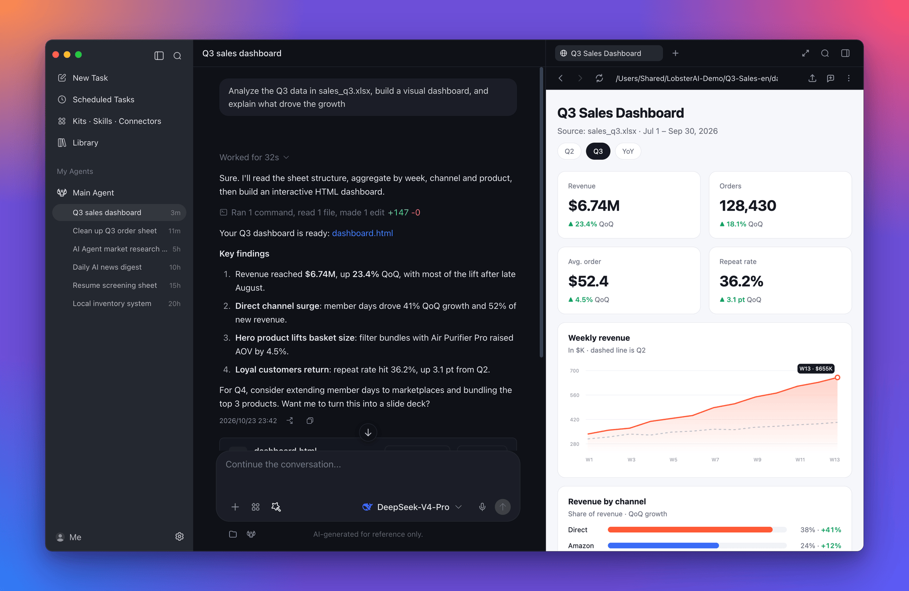
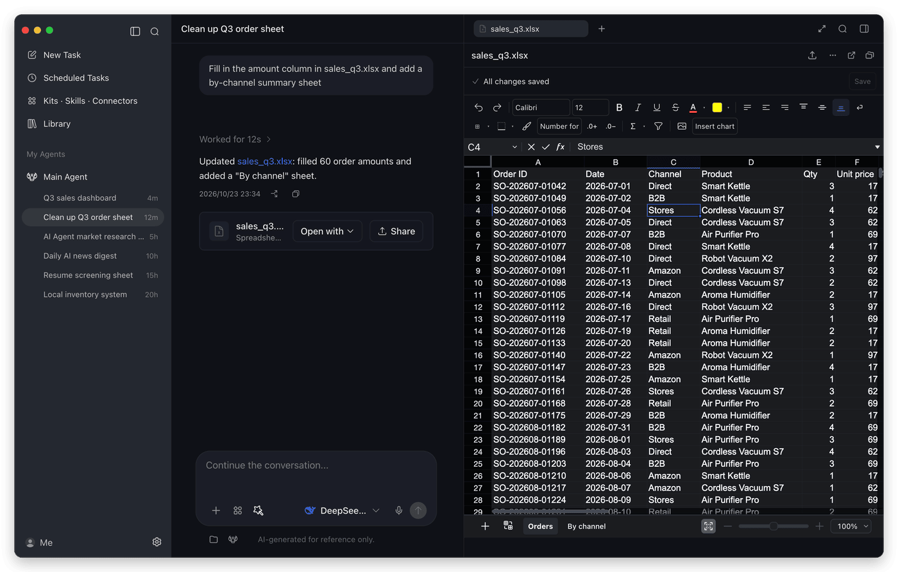
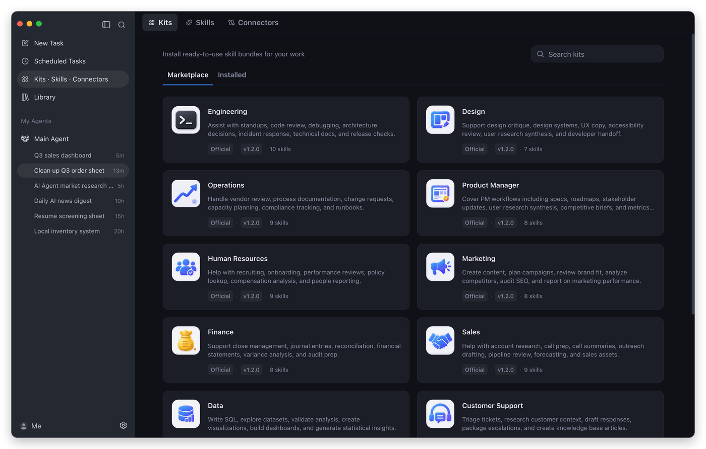
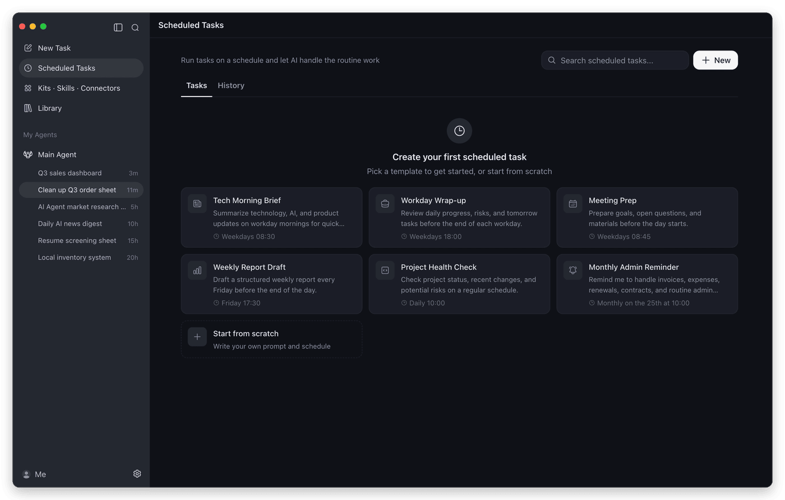
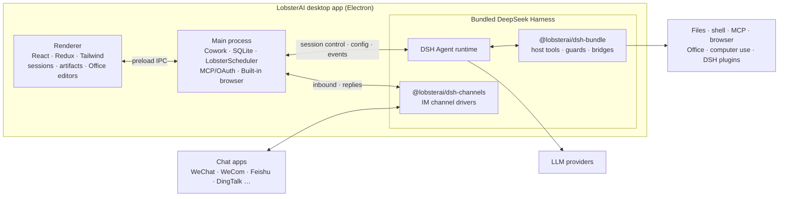

<div align="center">


# LobsterAI

**The open-source desktop AI agent that does real work on your computer.**

Describe a task in plain language. LobsterAI reads your files, runs tools, drives a browser,<br/>
edits Office documents, and hands back finished work — at your desk or from your phone.

<p>
  <a href="https://github.com/netease-youdao/LobsterAI/releases/latest"></a>
  <a href="https://github.com/netease-youdao/LobsterAI/stargazers"></a>
  <a href="LICENSE"></a>
  
  <a href="https://x.com/LobsterAIYoudao"></a>
  <a href="#community"></a>
</p>

**English** · [简体中文](README_zh.md)

<h3>
  <a href="https://lobsterai.youdao.com/#/download-list">Download</a>
  &nbsp;·&nbsp;
  <a href="#quick-start">Quick start</a>
  &nbsp;·&nbsp;
  <a href="#features">Features</a>
  &nbsp;·&nbsp;
  <a href="#how-it-works">How it works</a>
  &nbsp;·&nbsp;
  <a href="#build-and-package">Build &amp; package</a>
  &nbsp;·&nbsp;
  <a href="#community">Community</a>
</h3>



</div>

## Why LobsterAI

Most AI assistants stop at an answer. LobsterAI is built to finish the job.

- **It works where your work lives.** Point it at a folder and it reads spreadsheets, writes documents, runs scripts, and browses the web under configurable permission presets and interactive approvals.
- **You see the result, not just a reply.** Web pages, charts, images, videos, PDFs, and Word, Excel, and PowerPoint files open in a side panel, ready to edit live alongside the agent or share as a link.
- **It keeps working when you step away.** Schedule recurring jobs with the built-in SQLite scheduler, or message your desktop agent from WeChat, WeCom, Feishu/Lark, DingTalk, QQ, Telegram, and Discord.
- **Open, extensible, and yours.** MIT-licensed, powered by a bundled [DeepSeek Harness (DSH)](https://github.com/deepseek-ai/deepseek-harness) runtime with local storage and disabled upstream telemetry. Sign in to use built-in models, bring your own API keys, or extend it with Kits, Skills, MCP servers, and DSH plugins.

Built by [NetEase Youdao](https://www.youdao.com/), LobsterAI is the first open-source desktop-grade agent from a major Chinese tech company.

## Features

<table>
  <tr>
    <td width="50%" valign="top">
      
      <p><b>Native Office live editing</b><br/>Open Word (<code>.docx</code>), Excel (<code>.xlsx</code>), and PowerPoint (<code>.pptx</code>) right in the app. Edit by hand, or let the agent modify documents live alongside you.</p>
    </td>
    <td width="50%" valign="top">
      
      <p><b>Kits, skills, connectors &amp; DSH plugins</b><br/>Install role-based kits for engineering, design, finance, sales, and more; pick individual skills, connect OAuth MCP servers, or install DeepSeek Harness ecosystem plugins.</p>
    </td>
  </tr>
</table>

<table>
  <tr>
    <td width="55%" valign="top">
      
    </td>
    <td width="45%" valign="middle">
      <p><b>Scheduled tasks &amp; remote IM control</b></p>
      <p>Turn any prompt into a recurring job — morning briefs, end-of-day wrap-ups, weekly reports, and project health checks — with run history and automatic delivery to chat apps.</p>
      <p>Connect WeChat, WeCom, DingTalk, Feishu/Lark, QQ, Telegram, or Discord once, then assign tasks to your desktop agent from your phone.</p>
    </td>
  </tr>
</table>

### Everything in the box

| Capability | What you get |
| --- | --- |
| **Cowork sessions** | Long-running tasks on local projects with streaming progress, tool timelines, session forks, automatic context compaction, and configurable permission presets (`read-only`, `workspace-write`, full access) with interactive approvals. |
| **Office & creative workflows** | Native in-app editing for `.docx`, `.xlsx`, and `.pptx` via live agent bridges, plus guided PPT creation, image generation and in-place editing, and Remotion video workflows. |
| **Artifacts and sharing** | Live side-panel previews for HTML, SVG, Mermaid, images, video, Markdown, code, PDF, Office files, and local web services, with one-click link sharing. |
| **Built-in browser & search** | An in-app browser the agent can drive, with tabs, saved logins, passkey (WebAuthn) support, visual annotations, and built-in web search. |
| **Computer use** | Desktop GUI automation so the agent can operate native apps on Windows x64 and macOS 13 or later. |
| **Multi-agent & delegation** | Create agents with independent personas, models, skills, and working directories; add ready-made experts from the Expert Plaza; spawn subagents or delegate across agents with visible subagent sessions in the sidebar; bind agents to IM channels. |
| **Skills & Kits** | Role-based kits plus built-in skills for Word, Excel, PowerPoint, PDF, web search, Remotion video, frontend design, stock research, content writing, IMAP/SMTP email, Youdao Note, and more. See [`SKILLs/`](SKILLs). |
| **DSH plugins & ecosystem** | Install, toggle, or remove DeepSeek Harness plugins from **Settings → Plugins** (using bundled `pnpm`), open the DSH Ecosystem View, use official bundles (AgentTeam, Worktree, LiveShare, DeepSeek Chat Import), and access the built-in `dsh` CLI shim. |
| **MCP connectors** | Add local (`stdio`) or remote (`Streamable HTTP` / `SSE`) MCP servers from the marketplace, sign in with OAuth, and filter which tools each server exposes. |
| **IM channels** | WeChat, WeCom, DingTalk, Feishu/Lark, QQ, Telegram, and Discord via LobsterAI's bundled DSH channels driver. Multi-instance platforms can route each bot to a different agent. |
| **Scheduled tasks** | Built-in SQLite scheduler (`LobsterScheduler`) with templates, run logs, per-task working directories, and automatic IM result delivery. |
| **Desktop companion & voice** | A floating orb for quick prompts, screenshots, and actions on selected text (translate, read aloud, and more), plus built-in voice input (ASR). |
| **Memory** | Local Markdown workspace files (`AGENTS.md`, `MEMORY.md`, `SOUL.md`, `USER.md`, daily notes) carry preferences across sessions. Legacy Dreaming diaries remain readable in memory settings. |
| **Models** | Built-in models (DeepSeek, Kimi, Qwen, GLM, MiniMax, and more) after sign-in, or bring your own API keys for OpenAI, Anthropic, Gemini, xAI, OpenRouter, Doubao, Qianfan, StepFun, MiMo, Ollama, LM Studio, and any OpenAI-compatible endpoint. |
| **Library** | Unified workspace view of every local artifact and shared file your agents generate across sessions. |

## Things to try

| Scenario | Example prompt |
| --- | --- |
| Build a local tool | "I still track inventory and sales in Excel. Build a local inventory system that records purchases and sales, calculates stock and profit, and opens in my browser." |
| Analyze local data | "Use `product-growth.xlsx` to build a visual dashboard and summarize the main growth drivers." |
| Make a deck | "Research the AI agent market and turn the findings into a presentation." |
| Check a web dashboard | "Open the ads dashboard every morning, check spend and conversion anomalies, and summarize likely causes." |
| Screen documents | "Turn the resumes in this folder into a screening sheet and shortlist the strongest candidates against the JD." |
| Run scheduled work | "Every weekday at 9 AM, collect yesterday's AI news and send me a concise digest." |

## Quick start

1. **Install LobsterAI.** Download it from the [official website](https://lobsterai.youdao.com/#/download-list), or get the latest release directly:
   [macOS (Apple Silicon)](https://github.com/netease-youdao/LobsterAI/releases/latest/download/LobsterAI--mac-arm64.dmg) ·
   [macOS (Intel)](https://github.com/netease-youdao/LobsterAI/releases/latest/download/LobsterAI--mac-x64.dmg) ·
   [Windows x64](https://github.com/netease-youdao/LobsterAI/releases/latest/download/LobsterAI--win-x64.exe)
2. **Choose a model.** Sign in to use the built-in models, or add your own API key under **Settings → Custom Model**.
3. **Give it a task.** Pick a working folder, choose a permission preset, describe what you want, and approve actions as it works. Generated files open in the side panel.
4. **Go further.** Install kits from **Kits · Skills · Connectors**, manage DSH plugins in **Settings → Plugins**, set up recurring work in **Scheduled Tasks**, or connect a chat app under **Settings → IM Bot**.

> [!NOTE]
> **Upgrading from legacy OpenClaw versions:** On first launch after upgrading, LobsterAI runs an offline atomic migrator before DSH starts. It snapshots `lobsterai.sqlite`, migrates your agent workspaces, memories, sessions, scheduled tasks, permissions, and MCP OAuth tokens, safely archives retired or incompatible modules under `userData/legacy-openclaw-backup/`, rolls back automatically on failure, and displays a migration summary.

## How it works



- **Cowork** is LobsterAI's desktop product layer. It owns sessions, messages, permission presets, artifacts, Office editor bridges, SQLite scheduling (`LobsterScheduler`), MCP OAuth, and IM bindings.
- **[DeepSeek Harness (DSH)](https://github.com/deepseek-ai/deepseek-harness)** runs the agent as an offline-complete bundled runtime (`@deepseek-ai/dsh`, pinned in [`package.json`](package.json)). LobsterAI layers two first-party Cordis bundles under [`dsh-bundles/`](dsh-bundles):
  - `lobsterai-host` (`@lobsterai/dsh-bundle`): model/web-search/MCP bridges, persona and workspace scoping, progressive tool disclosure, approval guards, multi-agent delegation, ops RPC, and privacy/telemetry disabling.
  - `lobsterai-channels` (`@lobsterai/dsh-channels`): native drivers for WeChat, WeCom, DingTalk, Feishu/Lark, QQ, Telegram, and Discord.
- The renderer is sandboxed with context isolation and talks to the main process only through the preload IPC bridge.

## Build and package

### Prerequisites

- Node.js `>=24.15.0 <25`
- npm `>=11.17.0 <12`
- Git and `tar`
- `better-sqlite3@13.0.3` ships prebuilt N-API binaries, so Windows builds do not require Visual Studio C++ Build Tools.

### Run from source

```bash
git clone https://github.com/netease-youdao/LobsterAI.git
cd LobsterAI
npm install

# First run: build the pinned DSH runtime for the current platform and start Electron
npm run electron:dev:dsh

# Daily development once vendor/dsh-runtime/current is prepared
npm run electron:dev
```

Useful runtime options and checks:

- `DSH_NPM_REGISTRY=<url>` overrides the npm registry when fetching `@deepseek-ai/dsh`; `DSH_FORCE_BUILD=1` forces a runtime rebuild.
- Verify the runtime and privacy guard after runtime or patch changes:
  `npm run dsh:runtime:verify` · `npm run dsh:upgrade-check` · `npm run dsh:e2e`.

### Package installers

Build on a host matching the target operating system and architecture so native dependencies match. Outputs are written to `release/`.

```bash
# Clean install and clear stale main-process build output
npm ci
npx rimraf dist dist-electron

# Build the installer for your target
npm run dist:mac:arm64   # macOS Apple Silicon (.dmg)
npm run dist:mac:x64     # macOS Intel (.dmg)
npm run dist:win         # Windows x64 full offline NSIS installer (.exe)
```

Windows distribution variants (channel builds and CDN web installers):

```bash
# Full offline installer tagged for a distribution channel
npm run dist:win:channel -- --keyfrom <channel> [--silent]

# Lightweight web installer stub that downloads the .nsis.7z app payload from your CDN
npm run dist:win:web -- --keyfrom <channel> [--silent] [--pkg-base-url <cdn-dir> | --pkg-url <package-url>]
```

### How the packaging pipeline works

- **Self-contained DSH runtime:** `scripts/build-dsh-runtime.cjs` fetches the pinned `@deepseek-ai/dsh` npm package (no sibling source checkout required), installs platform/arch production dependencies plus a pinned `pnpm` (`package-manager/pnpm`) for end-user plugin installs, applies version-scoped patches from `scripts/dsh-patches/<dsh.version>/`, prunes redundant heavy native packages (`libreoffice-kit-*`, `sherpa-onnx-*`) that LobsterAI replaces natively, and caches the result under `vendor/dsh-runtime/<target>` (reused automatically when target, versions, and patch hashes match).
- **macOS (`.dmg`):** Ships `dsh-runtime/`, `dsh-bundles/`, `SKILLs/`, and optional `computer-use/` under `Contents/Resources/`. `afterPack` strips `node_modules/.bin` symlinks inside packaged DSH trees for codesign compatibility, and `dist:mac:arm64` runs `dsh:upgrade-check` before packaging.
- **Windows (NSIS `.exe` & `nsis-web`):** Runs `predist:win` (`dsh:runtime:win-x64`), enforces the `verify:installer-patches` gate (`patches/app-builder-lib+*.patch`), builds `selection-hook`, prepares the embedded Windows Python 3.11 runtime (`setup:python-runtime`), and packs `dsh-runtime/`, `dsh-bundles/`, `SKILLs/`, and `python-win/` into a single `win-resources.tar` unpacked by `unpack-dsh-resources.cjs` during installation for faster installs. Run `npm run setup:mingit` if you also want bundled PortableGit for Git-sourced DSH plugin installs without system Git.
- **Standalone runtime archives:** Maintain CDN-hosted runtime tarballs in `package.json` (`dsh.runtimes`) with `npm run dsh:runtime:pack`, `npm run dsh:runtime:url`, and `npm run dsh:runtime:verify-urls`.

See [CONTRIBUTING.md](CONTRIBUTING.md) for offline/private-mirror environment variables, upgrading DSH versions, tests, linting, and the full project map.

## Security and privacy

- **Local-first, isolated storage:** Desktop sessions, messages, scheduled tasks, and settings live locally in `lobsterai.sqlite`. Under the same user data directory, `dsh-profile/` holds LobsterAI's isolated DSH state and `workspaces/<agentId>/` holds agent instructions and memory — completely separate from any standalone DSH installation.
- **Upstream telemetry disabled:** [`dsh-bundles/lobsterai-host/cordis.patch.yml`](dsh-bundles/lobsterai-host/cordis.patch.yml) explicitly disables upstream DSH telemetry and DeepSeek account plugins, verified automatically by `npm run dsh:upgrade-check`.
- **Permission controls & sandboxing:** Tool actions follow each session's permission preset (`read-only`, `workspace-write`, or full access) and interactive approval prompts. Renderer windows run with context isolation, sandboxing, and no Node.js integration.

## Community

Join the WeChat group for help, feedback, and release news. You can also follow [@LobsterAIYoudao](https://x.com/LobsterAIYoudao) on X.


Report bugs and request features through [GitHub Issues](https://github.com/netease-youdao/LobsterAI/issues/new/choose).

## Contributing

Contributions are welcome. Read [CONTRIBUTING.md](CONTRIBUTING.md) to set up your environment, and look for [good first issues](https://github.com/netease-youdao/LobsterAI/issues?q=is%3Aissue%20state%3Aopen%20label%3A%22good%20first%20issue%22) to get started.

## Star history

<a href="https://www.star-history.com/#netease-youdao/lobsterai&Date">
  <picture>
    <source media="(prefers-color-scheme: dark)" srcset="https://api.star-history.com/svg?repos=netease-youdao/lobsterai&type=Date&theme=dark" />
    
  </picture>
</a>

## License

[MIT](LICENSE) © NetEase Youdao
