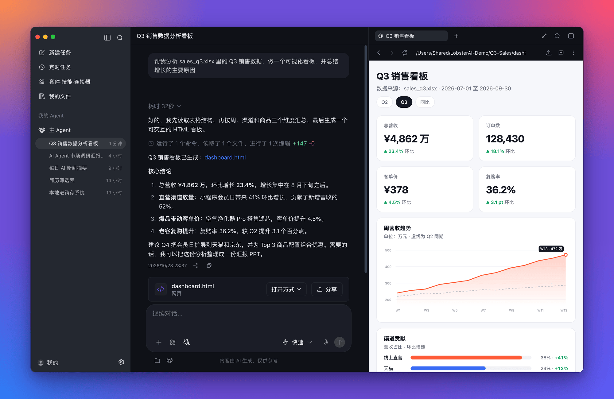
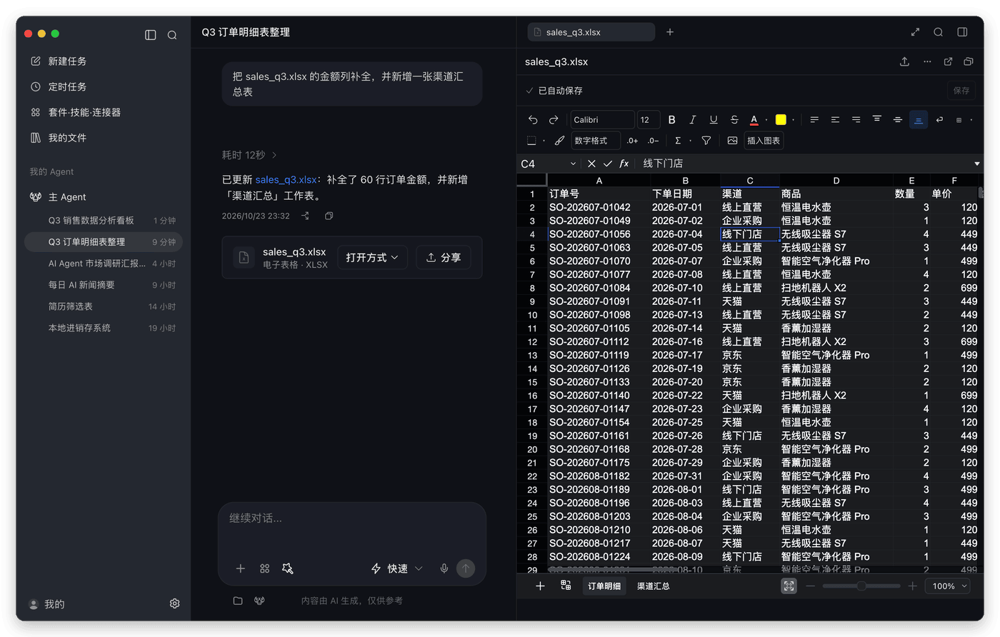
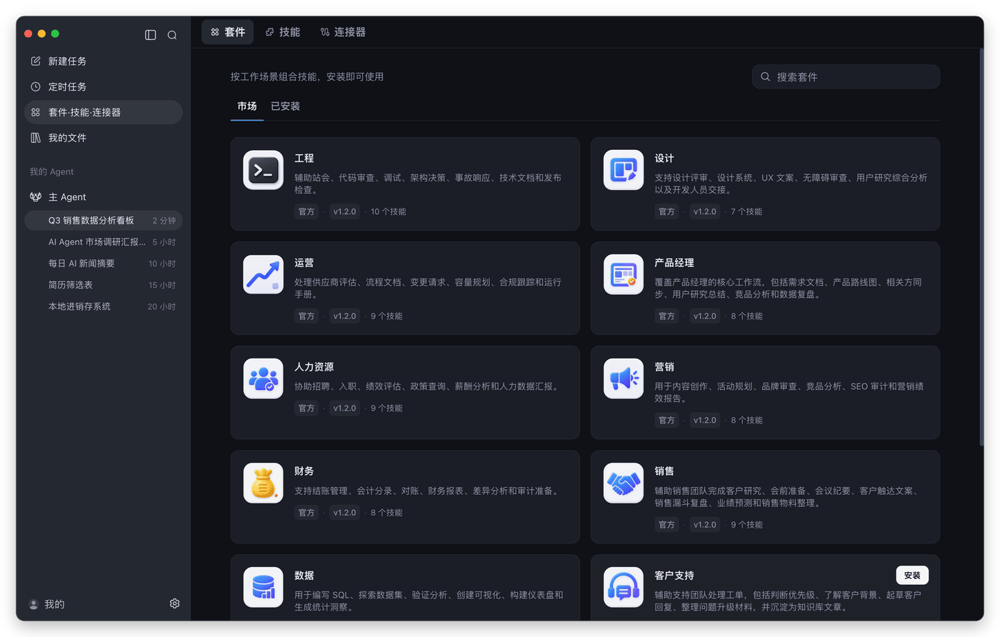
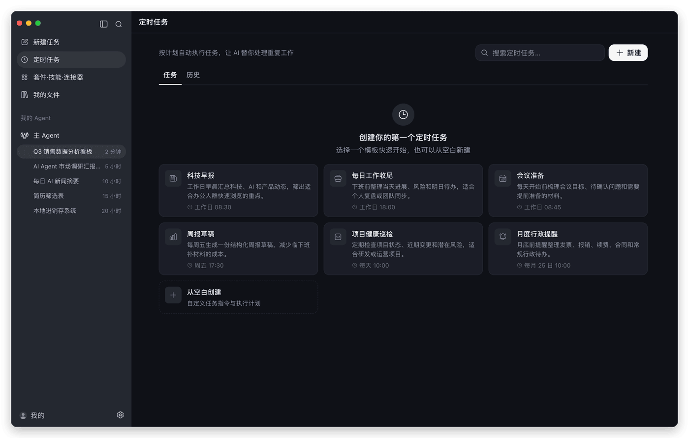
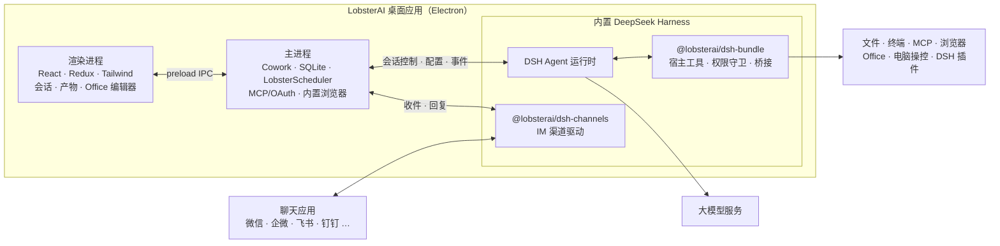

<div align="center">


# LobsterAI

**开源的桌面级 AI Agent，在你的电脑上把活真正干完。**

用一句话描述任务，LobsterAI 会读取文件、调用工具、操作浏览器、编辑 Office 文档，<br/>
最后把做好的成果交给你。坐在电脑前可以用，出门在外也能用手机远程指挥。

<p>
  <a href="https://github.com/netease-youdao/LobsterAI/releases/latest"></a>
  <a href="https://github.com/netease-youdao/LobsterAI/stargazers"></a>
  <a href="LICENSE"></a>
  
  <a href="https://x.com/LobsterAIYoudao"></a>
  <a href="#社区"></a>
</p>

[English](README.md) · **简体中文**

<h3>
  <a href="https://lobsterai.youdao.com/#/download-list">下载</a>
  &nbsp;·&nbsp;
  <a href="#快速上手">快速上手</a>
  &nbsp;·&nbsp;
  <a href="#功能">功能</a>
  &nbsp;·&nbsp;
  <a href="#工作原理">工作原理</a>
  &nbsp;·&nbsp;
  <a href="#构建与打包">构建与打包</a>
  &nbsp;·&nbsp;
  <a href="#社区">社区</a>
</h3>



</div>

## 为什么选择 LobsterAI

大多数 AI 助手只给你一个回答，LobsterAI 的目标是把事情做完。

- **直接在你的工作环境里干活。** 指定一个文件夹，它就能按你设置的权限预设和审批规则读表格、写文档、跑脚本、查网页。
- **给你看得见的成果，而不只是一段回复。** 网页、图表、图片、视频、PDF 以及 Word、Excel、PPT 文件都会在侧边栏打开，支持与 Agent 同步实时编辑或一键生成分享链接。
- **你离开时，它也在继续工作。** 通过内置 SQLite 调度器运行定时任务，或者通过微信、企业微信、飞书/Lark、钉钉、QQ、Telegram、Discord 给桌面上的 Agent 远程派活。
- **开源、可扩展且数据归你所有。** MIT 开源协议，内置 [DeepSeek Harness（DSH）](https://github.com/deepseek-ai/deepseek-harness) 运行时，数据本地隔离存储且默认禁用上游遥测。登录即可使用内置模型，也可填入自己的 API Key，并通过套件、技能、MCP 连接器与 DSH 插件持续扩展。

LobsterAI 由[网易有道](https://www.youdao.com/)出品，是国内大厂首个开源的桌面级 Agent。

## 功能

<table>
  <tr>
    <td width="50%" valign="top">
      
      <p><b>Office 原生实时编辑</b><br/>Word（<code>.docx</code>）、Excel（<code>.xlsx</code>）、PPT（<code>.pptx</code>）直接在应用内打开。可以自己动手改，也可以让 Agent 和你同步实时协作编辑。</p>
    </td>
    <td width="50%" valign="top">
      
      <p><b>套件、技能、连接器与 DSH 插件</b><br/>按岗位安装工程、设计、财务、销售等套件，按需挑选单个技能，接入支持 OAuth 的 MCP 服务，或安装 DeepSeek Harness 生态插件。</p>
    </td>
  </tr>
</table>

<table>
  <tr>
    <td width="55%" valign="top">
      
    </td>
    <td width="45%" valign="middle">
      <p><b>定时任务与多端 IM 远程派活</b></p>
      <p>任何指令都能变成周期任务——科技早报、每日工作收尾、周报草稿、项目巡检——保留完整运行记录，并可将结果自动投递到聊天应用。</p>
      <p>绑定一次微信、企业微信、钉钉、飞书/Lark、QQ、Telegram 或 Discord，出门在外也能用手机直接给桌面 Agent 派活。</p>
    </td>
  </tr>
</table>

### 完整能力一览

| 能力 | 说明 |
| --- | --- |
| **Cowork 会话** | 围绕本地项目执行长任务，实时展示进度和工具调用过程，支持会话分叉、上下文自动压缩，以及可配置的会话权限预设（`read-only`、`workspace-write`、完全访问）与交互审批。 |
| **Office 与内容创作** | 原生实时编辑 `.docx`、`.xlsx`、`.pptx` 并支持 Agent 同步修改；同时提供向导式 PPT 创作、图片生成与原地编辑、Remotion 视频创作流程。 |
| **产物预览与分享** | 侧边栏实时预览 HTML、SVG、Mermaid、图片、视频、Markdown、代码、PDF、Office 文档与本地 Web 服务，支持一键生成分享链接。 |
| **内置浏览器与联网搜索** | Agent 可直接操控的应用内浏览器，支持多标签页、保存登录状态、通行密钥（Passkey / WebAuthn）、页面批注，并内置联网搜索能力。 |
| **电脑操控** | 桌面 GUI 自动化，让 Agent 操作原生桌面应用，支持 Windows x64 和 macOS 13 及以上版本。 |
| **多 Agent 与子 Agent 委派** | 创建拥有独立人设、模型、技能和工作目录的 Agent；从专家广场添加现成专家；支持派生子 Agent 与跨 Agent 委派（侧边栏可查看子 Agent 会话）；支持按渠道绑定不同 Agent。 |
| **技能与套件** | 提供岗位套件以及 Word、Excel、PPT、PDF、联网搜索、Remotion 视频、前端设计、股票研究、写作、IMAP/SMTP 邮件、有道云笔记等内置技能，详见 [`SKILLs/`](SKILLs)。 |
| **DSH 插件与生态中心** | 在 **设置 → 插件** 中直接安装、启停或卸载 DeepSeek Harness 插件（由内置 `pnpm` 驱动），打开 DSH 生态视图，兼容官方实验能力（AgentTeam、Worktree、LiveShare、DeepSeek 对话导入）与内置 `dsh` CLI。 |
| **MCP 连接器** | 从市场添加本地（`stdio`）或远程（`Streamable HTTP` / `SSE`）MCP 服务，支持 OAuth 登录，并可为每个服务单独筛选开放的工具。 |
| **IM 渠道** | 通过 LobsterAI 内置的 DSH 渠道包支持微信、企业微信、钉钉、飞书/Lark、QQ、Telegram 和 Discord；多实例平台可将不同机器人路由给不同 Agent（Telegram 和 Discord 在英文界面下显示）。 |
| **定时任务** | 内置 SQLite 调度器（`LobsterScheduler`），提供开箱即用的任务模板、执行历史、独立工作目录，并支持将执行结果推送到 IM 渠道。 |
| **桌面悬浮球与语音输入** | 桌面常驻悬浮球，支持快速发起任务、截图提问以及划词翻译/朗读等快捷操作，同时内置语音输入（ASR）。 |
| **记忆** | Agent 通过本地 Markdown 工作区文件（`AGENTS.md`、`MEMORY.md`、`SOUL.md`、`USER.md` 及每日笔记）跨会话延续偏好；历史梦境日记可在记忆设置中查阅。 |
| **模型** | 登录后可使用 DeepSeek、Kimi、通义千问、GLM、MiniMax 等内置模型；也可填入 OpenAI、Anthropic、Gemini、xAI、OpenRouter、豆包、千帆、阶跃星辰、MiMo、Ollama、LM Studio 或任意 OpenAI 兼容接口的 API Key。 |
| **我的文件** | 跨会话汇总所有 Agent 生成的本地产物与已分享文件，在一处统一检索与管理。 |

## 试试这些任务

| 场景 | 示例指令 |
| --- | --- |
| 本地工具 | "我还在用 Excel 记录库存和销售，帮我做一个本地进销存系统，可以录入进货和销售，自动计算库存和利润，并能在浏览器打开。" |
| 数据分析 | "基于 `product-growth.xlsx` 做一个可视化看板，并总结主要增长原因。" |
| 汇报 PPT | "调研 AI Agent 市场格局，并把结论整理成一份演示文稿。" |
| 网页巡检 | "每天早上打开广告后台，检查消耗和转化是否异常，并总结可能原因。" |
| 文档筛选 | "把这个文件夹里的简历整理成筛选表，对照 JD 选出最匹配的人。" |
| 定时任务 | "每个工作日早上 9 点收集昨天的 AI 新闻，并发我一份简洁摘要。" |

## 快速上手

1. **安装 LobsterAI。** 从[官网](https://lobsterai.youdao.com/#/download-list)下载，或直接获取最新版本：
   [macOS（Apple 芯片）](https://github.com/netease-youdao/LobsterAI/releases/latest/download/LobsterAI--mac-arm64.dmg) ·
   [macOS（Intel 芯片）](https://github.com/netease-youdao/LobsterAI/releases/latest/download/LobsterAI--mac-x64.dmg) ·
   [Windows x64](https://github.com/netease-youdao/LobsterAI/releases/latest/download/LobsterAI--win-x64.exe)
2. **选择模型。** 登录后即可使用内置模型，也可以在 **设置 → 自定义模型** 中填入自己的 API Key。
3. **布置任务。** 选择工作目录与权限预设，描述你想要的结果，并在执行过程中审批关键操作。生成的文件会在侧边栏打开。
4. **更进一步。** 在 **套件·技能·连接器** 中安装套件，在 **设置 → 插件** 中管理 DSH 插件，在 **定时任务** 中设置周期任务，或在 **设置 → IM 机器人** 中绑定聊天应用。

> [!NOTE]
> **从旧版 OpenClaw 升级：** 升级后首次启动时，LobsterAI 会在 DSH 启动前自动执行纯离线原子迁移：先对 `lobsterai.sqlite` 做快照备份，迁移原有 Agent 工作区、记忆、会话、定时任务、权限配置与 MCP OAuth 凭证，将已下线或不兼容模块安全归档到 `userData/legacy-openclaw-backup/`，异常时自动回滚，并在启动后展示迁移报告。

## 工作原理



- **Cowork** 是 LobsterAI 的桌面产品层，负责会话、消息、权限预设、产物预览、Office 编辑器桥接、SQLite 定时调度（`LobsterScheduler`）、MCP OAuth 和 IM 绑定。
- **[DeepSeek Harness（DSH）](https://github.com/deepseek-ai/deepseek-harness)** 以离线完整的内置运行时运行 Agent（`@deepseek-ai/dsh`，版本锁定在 [`package.json`](package.json)）。LobsterAI 在 [`dsh-bundles/`](dsh-bundles) 下叠加了两个自研 Cordis Bundle：
  - `lobsterai-host`（`@lobsterai/dsh-bundle`）：模型 / 联网搜索 / MCP 桥接、人设与记忆作用域隔离、渐进式工具披露、权限审批守卫、多 Agent 委派、运维 RPC 以及遥测禁用保护。
  - `lobsterai-channels`（`@lobsterai/dsh-channels`）：微信、企业微信、钉钉、飞书/Lark、QQ、Telegram、Discord 渠道驱动。
- 渲染进程启用了上下文隔离和沙箱，只能通过 preload IPC 桥与主进程通信。

## 构建与打包

### 环境要求

- Node.js `>=24.15.0 <25`
- npm `>=11.17.0 <12`
- Git 和 `tar`
- `better-sqlite3@13.0.3` 已自带预编译 N-API 二进制文件，Windows 下安装与打包不需要 Visual Studio C++ Build Tools。

### 本地源码运行

```bash
git clone https://github.com/netease-youdao/LobsterAI.git
cd LobsterAI
npm install

# 首次运行：为当前平台构建锁定版本的 DSH 运行时并启动 Electron
npm run electron:dev:dsh

# vendor/dsh-runtime/current 准备好后，日常开发直接使用
npm run electron:dev
```

常用运行时变量与检查：

- 可用 `DSH_NPM_REGISTRY=<地址>` 覆盖拉取 `@deepseek-ai/dsh` 的 npm registry，用 `DSH_FORCE_BUILD=1` 强制重建运行时。
- 调整运行时或补丁后，可依次执行验证：
  `npm run dsh:runtime:verify` · `npm run dsh:upgrade-check` · `npm run dsh:e2e`。

### 打包安装程序

请在与目标操作系统和架构一致的机器上打包，确保原生依赖匹配；构建产物输出到 `release/`。

```bash
# 按 lock 文件干净安装依赖，并清理可能残留的主进程旧编译产物
npm ci
npx rimraf dist dist-electron

# 按目标平台选择打包命令
npm run dist:mac:arm64   # macOS Apple 芯片（.dmg）
npm run dist:mac:x64     # macOS Intel 芯片（.dmg）
npm run dist:win         # Windows x64 完整离线 NSIS 安装包（.exe）
```

Windows 渠道包与在线安装器（基于同一条 `dist:win` 链路）：

```bash
# 指定渠道的完整离线安装包
npm run dist:win:channel -- --keyfrom <渠道> [--silent]

# 轻量在线安装器（stub，安装时从 CDN 下载 .nsis.7z 主包）
npm run dist:win:web -- --keyfrom <渠道> [--silent] [--pkg-base-url <CDN 目录> | --pkg-url <主包地址>]
```

### 打包方案说明

- **自包含 DSH 运行时：** `scripts/build-dsh-runtime.cjs` 直接拉取 `package.json` 锁定的 `@deepseek-ai/dsh` npm 包（无需再维护同级源码仓库），按目标平台和架构安装生产依赖及锁定版本的 `pnpm`（`package-manager/pnpm`，供用户安装 DSH 插件），应用 `scripts/dsh-patches/<dsh.version>/` 下的版本化补丁，裁剪 LobsterAI 已原生替代的重型依赖（`libreoffice-kit-*`、`sherpa-onnx-*`），并缓存在 `vendor/dsh-runtime/<target>`（目标、版本与补丁哈希一致时自动复用）。
- **macOS（`.dmg`）：** 将 `dsh-runtime/`、`dsh-bundles/`、`SKILLs/` 及可选的 `computer-use/` 打入 `Contents/Resources/`；`afterPack` 会清理运行时目录中的 `node_modules/.bin` 软链接以兼容代码签名，`dist:mac:arm64` 打包前还会自动执行 `dsh:upgrade-check`。
- **Windows（NSIS `.exe` 与 `nsis-web`）：** 先经 `predist:win` 构建 `win-x64` 运行时，执行 `verify:installer-patches` 门禁（校验 `patches/app-builder-lib+*.patch`），构建 `selection-hook` 与便携版 Windows Python 3.11 运行时（`setup:python-runtime`），再将 `dsh-runtime/`、`dsh-bundles/`、`SKILLs/`、`python-win/` 合并打包为单个 `win-resources.tar`，安装阶段由 `unpack-dsh-resources.cjs` 高速解压。如需在无系统 Git 的环境下支持 Git 源 DSH 插件安装，可额外准备便携 Git（`npm run setup:mingit`）。
- **独立运行时分发包：** 可通过 `npm run dsh:runtime:pack`、`npm run dsh:runtime:url` 和 `npm run dsh:runtime:verify-urls` 生成并登记 `package.json` 中的 `dsh.runtimes` CDN 分发包。

更多细节（离线/私有源环境变量、升级 DSH 版本、测试与 Lint、完整项目目录地图）请参阅 [CONTRIBUTING_zh.md](CONTRIBUTING_zh.md)。

## 安全与隐私

- **本地优先、数据隔离：** 桌面会话、消息、定时任务与配置保存在应用数据目录的 `lobsterai.sqlite` 中；同目录下的 `dsh-profile/` 保存 LobsterAI 专用的 DSH 状态，`workspaces/<agentId>/` 保存 Agent 指令与记忆，与用户独立安装的 DSH 完全隔离。
- **默认禁用上游遥测：** [`dsh-bundles/lobsterai-host/cordis.patch.yml`](dsh-bundles/lobsterai-host/cordis.patch.yml) 显式禁用了所有上游 DSH 遥测与 DeepSeek 账号插件，并由 `npm run dsh:upgrade-check` 自动门禁校验。
- **权限控制与沙箱隔离：** 工具调用遵循会话权限预设（`read-only`、`workspace-write`、完全访问）及审批确认；渲染进程窗口启用上下文隔离和沙箱，并禁用 Node.js 集成。

## 社区

扫码加入微信交流群，获取帮助、反馈问题、了解最新版本动态。也欢迎在 X 上关注 [@LobsterAIYoudao](https://x.com/LobsterAIYoudao)。


Bug 反馈和功能建议请通过 [GitHub Issues](https://github.com/netease-youdao/LobsterAI/issues/new/choose) 提交。

## 参与贡献

欢迎参与贡献。请先阅读 [CONTRIBUTING_zh.md](CONTRIBUTING_zh.md) 搭建开发环境，也可以从 [good first issue](https://github.com/netease-youdao/LobsterAI/issues?q=is%3Aissue%20state%3Aopen%20label%3A%22good%20first%20issue%22) 开始上手。

## Star 趋势

<a href="https://www.star-history.com/#netease-youdao/lobsterai&Date">
  <picture>
    <source media="(prefers-color-scheme: dark)" srcset="https://api.star-history.com/svg?repos=netease-youdao/lobsterai&type=Date&theme=dark" />
    
  </picture>
</a>

## 许可证

[MIT](LICENSE) © 网易有道
