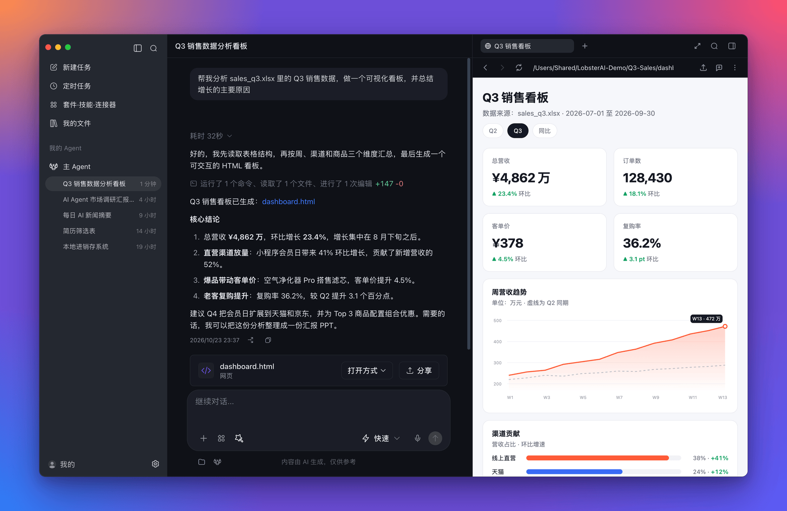
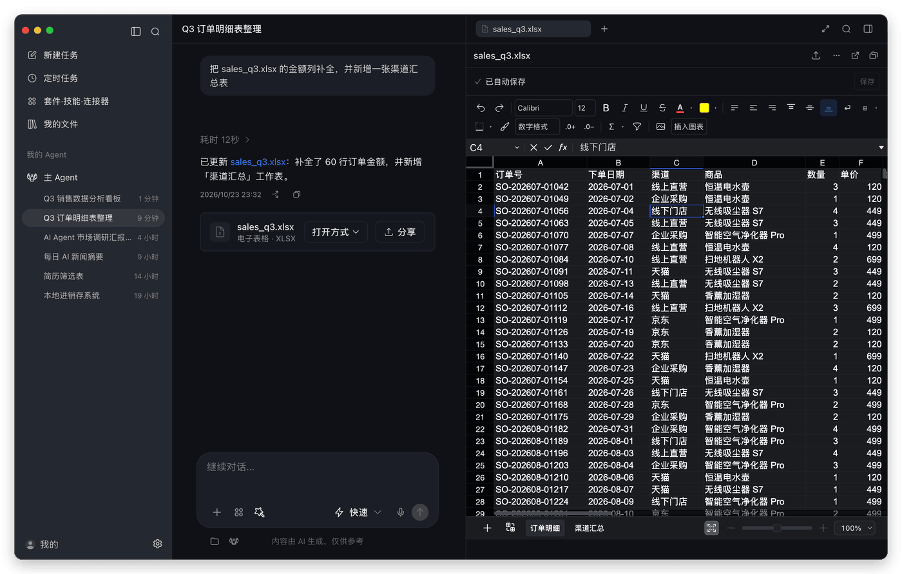
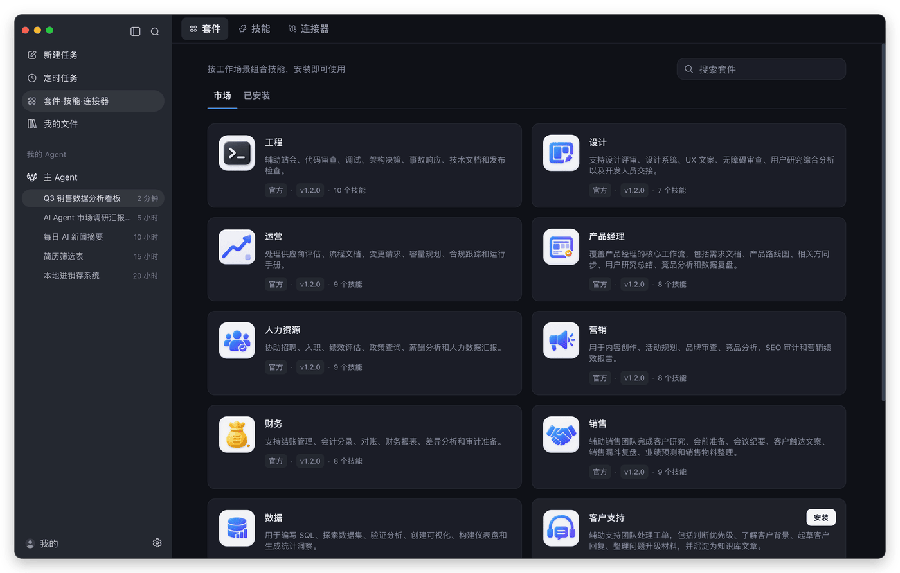
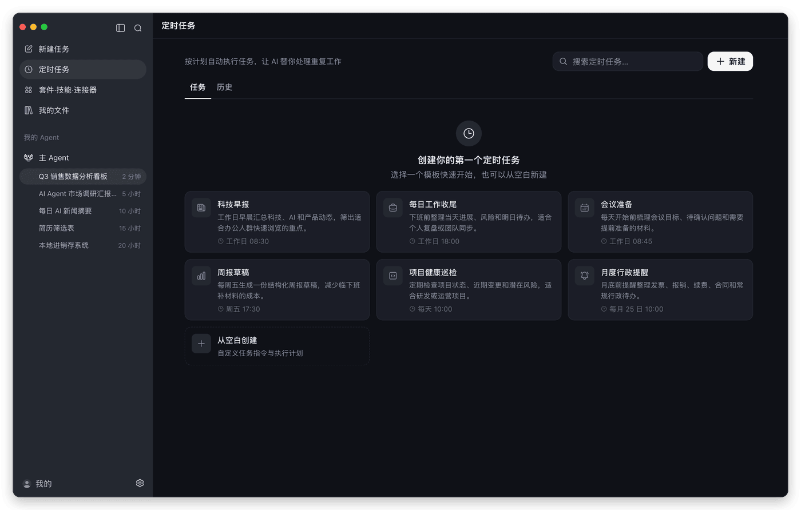
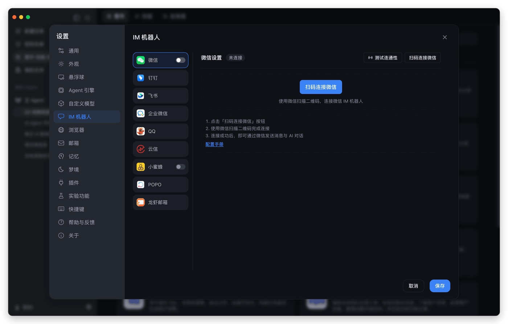
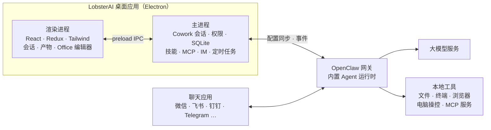

<div align="center">


# LobsterAI

**开源的桌面级 AI Agent，在你的电脑上把活真正干完。**

用一句话描述任务，LobsterAI 会读取文件、调用工具、操作浏览器、编辑 Office 文档，<br/>
最后把做好的成果交给你。坐在电脑前可以用，出门在外也能用手机远程指挥。

<p>
  <a href="https://github.com/netease-youdao/LobsterAI/releases/latest"></a>
  <a href="https://github.com/netease-youdao/LobsterAI/stargazers"></a>
  <a href="LICENSE"></a>
  
  <a href="https://x.com/LobsterAIYoudao"></a>
  <a href="#社区"></a>
</p>

[English](README.md) · **简体中文**

<h3>
  <a href="https://lobsterai.youdao.com/#/download-list">下载</a>
  &nbsp;·&nbsp;
  <a href="#快速上手">快速上手</a>
  &nbsp;·&nbsp;
  <a href="#功能">功能</a>
  &nbsp;·&nbsp;
  <a href="#从源码构建">从源码构建</a>
  &nbsp;·&nbsp;
  <a href="#社区">社区</a>
</h3>



</div>

## 为什么选择 LobsterAI

大多数 AI 助手只给你一个回答，LobsterAI 的目标是把事情做完。

- **直接在你的工作环境里干活。** 指定一个文件夹，它就能读表格、写文档、跑脚本、查网页，遇到敏感操作会先征求你的同意。
- **给你看得见的成果，而不只是一段回复。** 网页、图表、图片、视频、PDF 以及 Word、Excel、PPT 文件都会在侧边栏打开，可以直接修改或分享。
- **你离开时，它也在继续工作。** 设置定时任务，或者通过微信、飞书、钉钉等聊天应用给桌面上的 Agent 派活。
- **完全属于你。** MIT 开源协议，会话数据保存在本地。登录即可使用内置模型，也可以填入自己的 API Key。

LobsterAI 由[网易有道](https://www.youdao.com/)出品，是国内大厂首个开源的桌面级 Agent。

## 功能

<table>
  <tr>
    <td width="50%" valign="top">
      
      <p><b>Office 原生编辑</b><br/>Word、Excel、PPT 直接在应用内打开。可以自己动手改，也可以让 Agent 和你同步实时编辑。</p>
    </td>
    <td width="50%" valign="top">
      
      <p><b>套件、技能与连接器</b><br/>按岗位安装工程、设计、财务、销售等套件，按需挑选单个技能，或接入 MCP 服务。</p>
    </td>
  </tr>
  <tr>
    <td width="50%" valign="top">
      
      <p><b>定时任务</b><br/>任何指令都能变成周期任务：科技早报、每日工作收尾、周报草稿、项目巡检。</p>
    </td>
    <td width="50%" valign="top">
      
      <p><b>随时随地派活</b><br/>绑定一次聊天应用，之后就能用手机给桌面上的 Agent 发任务。</p>
    </td>
  </tr>
</table>

### 完整能力一览

| 能力 | 说明 |
| --- | --- |
| **Cowork 会话** | 围绕本地项目执行长任务：实时展示进度和工具调用过程，支持会话分叉；文件、终端、网络等敏感操作执行前会请求审批。 |
| **产物预览与分享** | 实时预览 HTML、SVG、Mermaid、图片、视频、Markdown、代码、PDF 和 Office 文件；支持直接编辑图片，并把成果以链接形式分享出去。 |
| **内置浏览器** | Agent 可以直接操作的应用内浏览器，支持多标签页、保存登录信息和通行密钥（Passkey），适合网页调研和自动化流程。 |
| **电脑操控** | 让 Agent 操作桌面应用，支持 Windows x64 和 macOS 13 及以上版本。 |
| **多 Agent** | 创建拥有独立身份、模型、技能和工作目录的 Agent，从专家广场添加现成的专家，并把 Agent 绑定到不同的聊天渠道。 |
| **技能** | 内置文档、表格、幻灯片、PDF、联网搜索、浏览器自动化、图片和视频生成、股票研究、写作、邮件等技能，详见 [`SKILLs/`](SKILLs)。 |
| **MCP 连接器** | 从市场添加本地或远程 MCP 服务，支持 OAuth 登录，并可为每个服务单独选择开放的工具。 |
| **IM 渠道** | 微信、企业微信、钉钉、飞书/Lark、QQ、网易云信、网易小蜜蜂、POPO、Telegram、Discord 和邮件。支持多实例的平台可以把不同机器人路由给不同 Agent。（Telegram 和 Discord 在英文界面下显示。） |
| **桌面悬浮球** | 桌面上的悬浮入口，可以快速发起任务、截图提问，或对选中的文字执行翻译、朗读等操作。 |
| **记忆与梦境** | 持久化的记忆文件，加上可选的定时"梦境"整理，让偏好和上下文在会话之间延续。 |
| **模型** | 登录后可使用 DeepSeek、GLM、Kimi、通义千问、MiniMax 等内置模型；也可以填入 OpenAI、Anthropic、Gemini、xAI、OpenRouter、Ollama、LM Studio 或任意 OpenAI 兼容接口的 Key。 |
| **我的文件** | 所有 Agent 生成的文件按会话汇总在一处，本地文件和已分享的文件都能统一管理。 |

## 试试这些任务

| 场景 | 示例指令 |
| --- | --- |
| 本地工具 | "我还在用 Excel 记录库存和销售，帮我做一个本地进销存系统，可以录入进货和销售，自动计算库存和利润，并能在浏览器打开。" |
| 数据分析 | "基于 `product-growth.xlsx` 做一个可视化看板，并总结主要增长原因。" |
| 汇报 PPT | "调研 AI Agent 市场格局，并把结论整理成一份演示文稿。" |
| 网页巡检 | "每天早上打开广告后台，检查消耗和转化是否异常，并总结可能原因。" |
| 文档筛选 | "把这个文件夹里的简历整理成筛选表，对照 JD 选出最匹配的人。" |
| 定时任务 | "每个工作日早上 9 点收集昨天的 AI 新闻，并发我一份简洁摘要。" |

## 快速上手

1. **安装 LobsterAI。** 从[官网](https://lobsterai.youdao.com/#/download-list)下载，或直接获取最新版本：
   [macOS（Apple 芯片）](https://github.com/netease-youdao/LobsterAI/releases/latest/download/LobsterAI--mac-arm64.dmg) ·
   [macOS（Intel 芯片）](https://github.com/netease-youdao/LobsterAI/releases/latest/download/LobsterAI--mac-x64.dmg) ·
   [Windows x64](https://github.com/netease-youdao/LobsterAI/releases/latest/download/LobsterAI--win-x64.exe)
2. **选择模型。** 登录后即可使用内置模型，也可以在 **设置 → 自定义模型** 中填入自己的 API Key。
3. **布置任务。** 选择工作目录，描述你想要的结果，并在执行过程中审批相关操作。生成的文件会在侧边栏打开。
4. **更进一步。** 在 **套件·技能·连接器** 中安装套件，在 **定时任务** 中设置周期任务，或在 **设置 → IM 机器人** 中绑定聊天应用。

## 工作原理



- **Cowork** 是 LobsterAI 的产品层，负责会话、消息、权限、产物、Agent 和 IM 绑定，并把它们保存在本地 SQLite 中。
- **[OpenClaw](https://github.com/openclaw/openclaw)** 是底层的 Agent 运行时。LobsterAI 内置一个锁定版本，根据应用状态生成它的配置，并把它的事件转换成 Cowork 的消息流。
- 渲染进程启用了上下文隔离和沙箱，只能通过 preload IPC 桥与主进程通信。

## 从源码构建

环境要求：Node.js `>=24.15.0 <25`、npm `>=11.17.0 <12`、git 和 pnpm。

```bash
git clone https://github.com/netease-youdao/LobsterAI.git
cd LobsterAI
npm install

# 首次运行：把锁定版本的 OpenClaw 拉取到 ../openclaw，构建运行时，然后启动应用
npm run electron:dev:openclaw

# 运行时构建好之后，日常开发使用
npm run electron:dev
```

测试、Lint、运行时选项、安装包打包和项目结构，请参阅 [CONTRIBUTING_zh.md](CONTRIBUTING_zh.md)。

## 安全与隐私

- 会话、消息和设置保存在应用数据目录下的本地文件 `lobsterai.sqlite` 中；Agent 记忆和运行时状态保存在同目录的 `openclaw/` 下。
- 文件操作、终端命令和网络访问都受权限控制，Agent 会先征求你的同意再执行。
- 渲染进程窗口启用上下文隔离和沙箱，并禁用 Node.js 集成。

## 社区

扫码加入微信交流群，获取帮助、反馈问题、了解最新版本动态。也欢迎在 X 上关注 [@LobsterAIYoudao](https://x.com/LobsterAIYoudao)。


Bug 反馈和功能建议请通过 [GitHub Issues](https://github.com/netease-youdao/LobsterAI/issues/new/choose) 提交。

## 参与贡献

欢迎参与贡献。请先阅读 [CONTRIBUTING_zh.md](CONTRIBUTING_zh.md) 搭建开发环境，也可以从 [good first issue](https://github.com/netease-youdao/LobsterAI/issues?q=is%3Aissue%20state%3Aopen%20label%3A%22good%20first%20issue%22) 开始上手。

## Star 趋势

<a href="https://www.star-history.com/#netease-youdao/lobsterai&Date">
  <picture>
    <source media="(prefers-color-scheme: dark)" srcset="https://api.star-history.com/svg?repos=netease-youdao/lobsterai&type=Date&theme=dark" />
    
  </picture>
</a>

## 许可证

[MIT](LICENSE) © 网易有道
