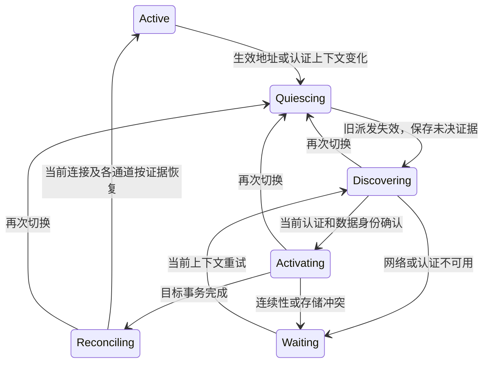

# 远程同步使用当前生效服务的设计

基础方案日期：2026-09-22。基础实现及验证状态按第 7 节历史记录保留，不代表当前部署状态。

2026-10-27 增量状态：**客户端修复已实现，测试／线上与手机联合验收待执行**。第 8 节记录删除兼容、目标隔离、认证及异步代次和恢复要求，第 8.14 节记录本轮实现与验证。仅修改桌面代码和文档，未修改服务端业务代码、HTTP API 或 MySQL 结构，也未改写真实用户数据库。

桌面始终使用当前生效 API 地址同步当前账号有权同步的本地会话。域名和客户端线上／测试模式不再决定会话能否同步；当前服务确认已有数据后续传，权威确认的独立数据集建立新映射并上传完整快照。

本次评估收敛为：**一套活动同步工作集，加旧服务的必要恢复档案；扩展现有注册／状态／导入接口。** 不新增绑定预留接口，不为每个服务长期运行独立同步器，不后台访问已经切离的地址。服务数据身份只用于正确保存进度，不是地址白名单。

## 1. 背景和边界

历史 `sync_environment` 保存 URL，后来过渡修复改存 `production/test`。两者都无法判断实际数据是否连续：同一服务可以有多个域名，同一模式可能连到不同数据库，同一域名也可能发生数据库恢复。

新的规则是请求跟随当前 endpoint resolver，进度跟随服务确认的数据身份。账号归属、远控开关、文件发布范围和本地执行权限保持现有规则。同步不会重跑 Agent，也不会上传原始工作区或凭据。

| 场景 | 行为 |
| --- | --- |
| A、B 两个域名访问同一数据集 | 地址变化使旧请求失效；重新注册确认后保留映射及 ACK |
| 线上／测试开关改变，最终地址未变 | 同步不因模式名变化而失效 |
| 当前地址访问独立新数据集 | 自动归档旧传输状态，建立独立映射、序列和快照 |
| A → B → A | 恢复 A 的原映射、回执及未决操作；根据本地变化补快照 |
| 同数据集 generation 变化、进度回退或 epoch 不一致 | 保留本地记录并报连续性冲突，不当作新空库 |
| 401、超时、普通 404、HTML 响应 | 按认证／网络／协议故障处理，不能触发清零 |
| 服务端会话已删除 | 保留删除状态，不通过快照复活 |
| 切换时本地 Agent 正在执行 | 本地执行继续；旧许可失效，结果只归属原目标，历史可向当前服务同步 |

当前服务的账号必须通过已有可信认证体系，且与会话 confirmed owner/userId/scope 一致。`dataSpaceId` 不是认证凭据；不能凭昵称、邮箱或恰好相同的非统一身份数字 ID 跨账号认领数据。本项目沿用现有统一认证体系，不新增第二套 principal 协议。

## 2. 身份与不变量

- `effectiveApiBaseUrl`：唯一请求地址，沿用现有 endpoint resolver。
- `routeEpoch`：客户端地址或账号上下文变化时推进的进程内版本，含 A → B → A；可复用现有 `accountGeneration`。地址检查还覆盖发送后尚未收到切换通知的窗口。
- `syncTarget = {version:1,dataSpaceId,dataGeneration}`：注册返回并由当前认证服务确认的数据身份；所有同库节点共享，不能从域名、模式或 Pod 推导。
- `targetId`：客户端对数据身份、owner/userId/scope 的稳定散列。旧无此能力的服务使用受状态证据约束的兼容标识。
- 会话绑定：某 target 上的 `localSessionId → deviceId/sessionId/epoch/seq`，存放在活动工作集或恢复档案。不增加独立 binding reservation 或全局 binding 表。

必须保持：

1. 一次只有一个活动目标；旧请求、worker、缓存发布回包不能写入新上下文。
2. 新目标不继承旧目标的 ACK、连接配额、移除状态、文件 ID 或执行许可。
3. 已发 import/batch 的 ID、body、hash 和签名证据保持原样；未知结果先核对原操作。
4. GET state 不是 ACK；NOT_FOUND 不是删除数据或重跑命令的授权。
5. 本地会话、消息、真实执行记录、执行锁、账号归属、安全 journal 是全局事实，不随目标切换撤销。
6. 客户端线上／测试模式与协议 `mode=online/recovery` 无关；后者保留现有语义。

## 3. 最小服务端契约

### 3.1 发现与写入保护

现有 `GET /api/remote/v1/capabilities` 公告 `sync_target_v1`，现有 v1/v2 `POST /devices/register` 增量返回同一 `syncTarget`：

```json
{"syncTarget":{"version":1,"dataSpaceId":"f31c126d-25a6-4571-a4e3-e756da9d918d","dataGeneration":"1"}}
```

客户端从已认证注册确认身份；发现与注册结果不一致时重试发现，不能写入。新客户端后续请求成对携带：

```text
X-Remote-Data-Space-Id: f31c126d-25a6-4571-a4e3-e756da9d918d
X-Remote-Data-Generation: 1
```

服务端在业务操作前验证共享数据库的当前身份。不匹配返回 HTTP 409、code `47039`、reason `SYNC_TARGET_CHANGED` 和当前 `syncTarget`。覆盖远控 HTTP、文件请求、连接票据及 WebSocket 握手；旧客户端不带新头继续按旧契约运行，不改现有请求体白名单或 import requestHash。

服务端通过 singleton 数据表持久保存身份；正常发布、扩容和多域名入口不改变它。独立可写副本生成新 dataSpaceId；原数据集回滚恢复须在排空旧写入后把 generation 提升至所有历史已发行值之上，不能只对旧备份里的数字加一。即使运维错误未更新世代，逐会话水位和 epoch 核验仍拦截已观察到的回退。

新能力开关默认开启。关闭时旧客户端兼容，新客户端携带身份头的请求不能静默降级；返回协议升级错误。迁移及混部顺序见配套集成文档。

### 3.2 沿用 state 与 import

不新增 `/sync/session-bindings/resolve`。

- `GET /sync/state?localSessionId=...` 读取当前设备映射、protocol/epoch、水位、活动导入和 deleted。
- 独立新 target 的 sessionId 在客户端持久生成，source/ACK/serverSeq 独立初始化。
- 现有 online `POST /sync/imports` 在服务端 owner/device 锁内按 localSessionId 查重并创建映射，使用 expectedSourceSeq/expectedServerSeq CAS；manifest/parts/commit 和回执保持原协议。
- 新建 import 的不可变 ID、sessionId、请求及 manifest 在网络发送前落盘。重复请求返回同一结果，不能重新生成操作绕过冲突。
- recovery transport 不创建新映射；未知活动导入、服务端墓碑和待删除状态不能被空快照覆盖。

## 4. 客户端活动工作集和恢复档案

### 4.1 存储范围

保留一套现有 `remote_sync`、outbox、projection 及工作 KV；只对当前 target 产生同步事件。新增小型目标登记和档案存储由 `remoteSyncTargetStore` 管理，并在 SQLite 事务内切换。

档案包含恢复所需的映射、source/ACK/server 高水位、protocol/epoch、清理水位、投影版本及 revision 边界、不可变未决 import/part 索引、待确认传输状态、删除证明及必要文件引用。为保证首版无损恢复，可保留尚未确认的 outbox 和相关投影字节；它们是恢复材料，不是后台并行工作的第二套同步器。可重建缓存按需刷新，不引入永久多目标完整缓存架构。清理档案必须另有已验证终态依据，不能按切换次数直接丢弃。availability 接入后的 sidecar 和删除证据分类、恢复时的失效规则见第 8 节，不能仅交换本节最初列出的 legacy 表。

核心会话和消息、全局 run/runHistory、inbox 中真实执行结果、inputFence、安全 journal、ownership 和本地删除事实不搬成新目标的执行状态。无论旧目标是否在线，它们都保留。

### 4.2 切换流程

1. 地址或账号上下文变化：推进 epoch，断开旧连接，取消旧快照工作，冻结旧许可，暂停传输。
2. 向当前地址发现能力并注册；校验账号及服务数据身份，不沿用旧连接 removed/quota 状态阻断发现。
3. 同一已知 target 恢复原工作集；不同已知 dataSpace 归档旧工作集并创建新工作集。同 dataSpace 的 generation 改变不能当作新目标清零。
4. 切换事务完成后设置新投影身份、刷新模型／agent/workspace 缓存、获取新连接许可；逐会话核对原未决操作与状态。
5. 新目标仅从本地安全投影建立全量快照；切回旧目标先核对原 import 回执，再根据本地更新补事件或快照。
6. 任何步骤失败都不影响本地聊天，不能删除恢复档案或重跑执行。

档案包含完整性清单（条目数及 SHA-256）；合法空档案也必须有清单。已知 target 的档案丢失或损坏时阻断恢复，不能重新生成映射冒充首次同步。

工作集交换前应停止旧投影发布；已启动 worker 的结果必须同时匹配会话、设备、target 及本地 revision。切换事务使旧 publication 失效，迟到结果不能覆盖新映射。

### 4.3 缓存、输入与历史投影

模型、agent catalog、workspace、输入准备及连接状态按 target 隔离。在途缓存任务还校验 epoch，防止 A → B → A 接受第一轮 A 的迟到结果。新目标重新发布模型和 agent 目录，旧 workspace/model/asset ID 不能自动作为新服务引用。

历史消息保留文本，但旧服务的 commandId/runId 外键、远程资产 ID 和未决 approval/question 不携带执行权投影到新服务。仍可从本地安全读取的文件按新服务上传规则重新发布；不可读取的远程附件只保留可说明的历史内容，不伪造新资产已上传。旧服务原映射和未决操作仍在档案中恢复。已验证的 legacy target 升级为权威身份时，同时迁移 scoped settings、inbox 和输入操作的路由键，保留原操作正文和哈希。

inbox 去重使用 `(targetId, commandId)`，真实执行记录及本地运行锁保持全局。切换后旧运行结束可记录原 inbox 结果，但不向新服务发送旧 ACK。旧 prepared/executing/unknown 命令不会因为新服务发现相同本地会话而自动再执行。

GC 和 import spool 清理必须同时查看活动与档案引用；有未决 import、输入、文件任务、删除证据引用的文件不能因目标非活动而删除。

## 5. 连续性与恢复判定

记 H 为本地 source 上界、A 为持久 ACK、S 为服务端 lastSourceSeq、Q 为本地已确认 serverSeq、T 为服务端 lastSeq、P 为源事件清理水位。

同一流要求设备／会话／owner 相符、protocol/epoch 有原始回执支持，且 `A ≤ S ≤ H`、`T ≥ Q`。GET 状态不推进 A；batch 仍按原事件重放获得 ACK，import 按原 ID 查询终态回执。

| 证据 | 处理 |
| --- | --- |
| 原未决 import 已 committed | 验证原 ID、manifest、epoch、source 边界后原子确认；先于流 epoch 比较 |
| 原 import uploading | 继续原操作或取得已验证 abort/expired 终态后重建 |
| 事件仍完整且 A+1 > P | 按原事件顺序增量发送 |
| 源窗口已清理，但已证明同一流 | 保持 epoch，按 S/T CAS 上传当前快照；边界 N 满足 S ≤ N ≤ H |
| 同一绑定 S<A、S>H、T<Q 或 epoch 无回执支持 | 冲突，保留 outbox/档案，不能假造 ACK |
| 从未发布、无未决 import，v1/ACK=0，精确 HTTP404/code47038 | 允许首次 online import |
| 已知绑定丢失、v2 映射404、普通404 | 不清零；需恢复原流 |
| 权威确认的独立新 dataSpace | 使用新的独立工作集和首次快照 |
| deleted 或待删除 | 走原删除核对，不能重建复活 |

新建删除操作的 target 增量携带可选 syncTarget，客户端按当前已验证的数据身份核对同服务新域名下的删除请求；原 serviceScope 保留，旧操作不补写字段，终态回执仍与原证明严格匹配。删除许可、签名回执、serviceScope 不改写。旧环境字符串仅可经账户、设备、会话及服务端状态证据建立本地别名关系，不能借域名归类给新目标授予删除权。本地删除事实全局有效，切回旧目标时也不能恢复本地已删会话。全局执行禁令仍有效；只关闭已经取得删除证明的那条远端映射。切回尚未收到删除的旧映射时，先核对原未决操作，再按该映射已经采用的协议补送删除：legacy 沿用原 epoch/CAS 的 session.deleted 事件或仅删除快照，已接管映射使用原 writer/controlEpoch 的删除 fact；不复制其他服务的删除 ACK。详细证据与分流规则见第 8 节。

## 6. 旧数据与旧服务兼容

迁移覆盖 URL、production/test 和尚未绑定的空环境记录。不按域名白名单或客户端模式批量推断身份。

- 首次认领已发布 legacy 工作集，逐会话验证服务端 device/session/epoch/水位；先处理原 pending import 回执。只改变可变路由索引及本地证据别名，不重写不可变操作体和签名。
- 未发布本地会话可直接绑定。已知未发布需无设备绑定、ACK/serverSeq 为零、v1、无 epoch 和无 pending import；本地已生成 projection/source 事件不等于服务端已经收到。
- 首次升级先在原有服务完成状态核验与数据身份认领，再自动切换到其他已确认的独立 dataSpace。若原服务尚无身份记录、设备映射丢失或设备变更，保留原工作集并要求恢复；新 deviceId 本身不能证明是独立新库。
- 无 `sync_target_v1` 的旧服务：已存在映射经原 state/receipt 证据可继续；无法可靠识别独立新库时保持原记录并报告需升级。已知权威目标不能静默降级成无身份服务。
- 历史安全日志、全局执行事实和删除凭据不按 URL 或模式迁移成新的执行许可。

## 7. 验收与交付

客户端自动化至少覆盖：

1. 同库多域名、同模式不同库、仅模式变化但地址相同。
2. A → B → A 和 response body 延迟；旧 epoch 不能写入。
3. 新库独立快照、不继承 ACK；回旧库恢复原未决 import 的原字节。
4. 同库 generation 变化、state 回退、server ahead、epoch 冲突不清零。
5. 404/401/网络失败不触发错误 bootstrap，远端 deleted 不复活。
6. 旧命令不向新目标 ACK、不重新执行；真实本地运行事实保留。
7. 缓存／输入／文件引用按 target 隔离，历史投影无旧执行外键。
8. URL/mode 数据认领需要证据，账号不同不能认领。
9. 档案 import spool／文件引用受 GC 保护，切换事务失败完整回滚。

服务端验证：新增字段向后兼容、头成对验证、错库/世代拒绝、票据握手保护、同库多节点身份一致、原 import CAS/删除保护不回归。遵循服务端仓库约定默认只编译及编译测试源码，不运行依赖外部 MySQL/Redis 的测试。

交付顺序：显式关闭服务端身份能力 → 服务端迁移及全部入口受控部署 → 确认 writer 身份一致后开启能力 → 桌面发布 → 多域名/独立库/切回/删除/活动运行跨端验收。能力默认开启，混部前必须显式关闭，详见[接入与发布说明](../../../docs/server-integration/2026-09-22-remote-sync-target.md)。开发完成不等于已部署；未升级服务器只使用上文兼容路径。任何实际迁移、部署和用户数据库修复操作需按发布流程执行，开发验证使用隔离数据库副本。

### 7.1 本次实现与验证记录

- 客户端：目标身份与路由 epoch 校验、单活动工作集及事务归档恢复、legacy 证据认领、目标内缓存与输入隔离、旧执行结果归属、附件独立重传、删除传播和档案 GC 保护均已实现。
- 服务端：持久身份表、现有 capabilities/register 扩展、HTTP 目标头校验、票据与 WS 握手校验、删除 target 增量身份字段均已实现。未新增 resolve 接口。
- 自动回归：`npm test -- src/main/remote src/shared/remote --maxWorkers=2`，51 套、786 个用例通过；42 个修改的 TypeScript 文件通过 CI 同规则 ESLint；`npm run compile:electron` 通过。
- 隔离数据库演练：对当前桌面数据库的只读备份执行 legacy 认领及 A → B → A，11 个会话的核心内容、outbox/projection 字节和原设备／会话／ACK／epoch／清理水位完整恢复。演练发现的 `sha256` 列名校验问题已修复，并补充包含中文、emoji 和换行正文的回归。演练中的服务端状态来自副本夹具，仅验证存储不变量，不冒充真实服务器连续性证明。
- 服务端：`./gradlew compileJava compileTestJava -x test --offline` 通过；按仓库约定未运行服务端测试。测试库 V102 已按下述记录执行；未执行生产 SQL、部署或身份轮换。
- 尚待验收：Mac 锁屏导致开发版 UI 操作未完成；真实多服务、手机端及数据库迁移后的端到端验收须按发布步骤进行。自动测试和副本演练不替代这些验收。

### 7.2 测试库迁移执行记录

2026-09-22 19:36（Asia/Shanghai），按用户授权在 `application-test.properties` 指定的 writer `test-lunadb-writer.corp.yodao.com:13306`、数据库 `lobsterai_server` 执行 `V102__remote_sync_target.sql`。执行前确认节点可写、目标表不存在；仅创建身份表并初始化记录，没有修改既有业务表。

- 脚本 SHA-256：`82e36fa4adecd88d2570d1e11987b77b0c3d2f8e4b60365adeaeda55b32ff6a8`。
- 执行后唯一记录：`singleton_id=1`、`dataSpaceId=e94fd9f2-b679-11f1-9d04-246e966b55e0`、`dataGeneration=1`，`updated_at=2026-09-22 19:36:54.681`。
- 四列类型、非空约束、主键、InnoDB 引擎及字符排序规则均与迁移一致；`SHOW WARNINGS` 为空。
- 此记录仅证明测试库 V102 已落地；未部署服务、变更功能开关、操作生产库或旋转已有身份，亦未重复执行 DDL 验证幂等性。

<a id="frequent-service-switching"></a>

## 8. 2026-10-27 增量设计：频繁切换测试／线上服务

### 8.1 现场问题与证据边界

开发过程中允许在同一安装、同一本地数据库中反复切换测试服务、线上服务及开发地址覆盖。用户不应为切换清空数据库、删除同步记录、反复重新登录或重新创建任务。恢复正确性的单位是服务确认的数据身份和具体会话流，不是开关名称。

本次只读调查确认了一条确定的失败路径：

1. 当前账号的 `remote_sync` 中有本地已删除任务；ownership 仍有效，目标与设备匹配，未冻结、未隔离，故仍被 `controlBindings()` 选中。
2. 该任务保留旧协议 tombstone，已有 `ackAt/ackSourceSeq`；脱敏最小夹具为删除前上界 `116`、删除 ACK `117`、当前 `source_seq=ack_seq=117`、`needs_snapshot=1`。无 `deletionClosed`、availability binding 或当前 scope 的 availability session。
3. `RemoteAvailabilityPublisher.controlSession()` 在 `!state` 分支先检查 tombstone，直接抛出 `REMOTE_DELETION_BINDING_UNRESOLVED`，甚至早于新协议 capability 判断。这发生在构造持久请求及访问网络之前。
4. 失败进入内存 control backoff，设备页显示“远程控制状态同步失败”；WebSocket 仍可在线，其他会话的历史 import 仍可成功。
5. `RemoteSyncTargetStore.activateInternal()` 恢复工作集后会给所有所属 `remote_sync` 行置 `needs_snapshot=1`，包括已删除行。capability 改变触发的 `requireSnapshot()` 和旧 projectionMode 清理也会置此标记；现场还保存了 `snapshotReason=question_projection_changed`。当前 legacy GC 又依赖 `!needs_snapshot`，故不能只修工作集恢复那一条 UPDATE；未逐次追踪现场所有历史切换来断言唯一写入来源。

同批日志还存在 HTTP 500；日志缺少完整的端点类别和局部错误定位，不能证明它与上述本地错误属于同一请求。实现后必须分别核查，不能以本修复为理由忽略仍存在的服务端故障。

现场证据来自只读数据库及源码条件核验，未执行用户数据库修复，也未从运行进程获取逐次异常堆栈。spec 和回归夹具不保存真实账号、设备、任务 ID、凭据或任务正文。

### 8.2 目标、范围及选定方案

采用“**单活动同步目标 + 按目标保存恢复和删除证据 + 单调切换代次**”方案，沿用第 2–6 节的服务端身份及权限契约。

- 正常切换自动完成发现、注册、目标恢复及续传；旧删除记录自动分流并在证据充分时收尾，不能长期污染当前控制健康状态。
- 同一数据集换域名只重新建立路由，不重新创建设备映射或全量历史；独立数据集分别保存 ACK、协议、未决操作、删除确认。
- 不删除本地任务历史，不复活已删除任务，不重跑旧远控命令；只向当前生效服务发送新请求。
- 不把删除故障统一转成成功，不把已接管的 availability 会话退回 legacy writer，不补造 `writerGeneration/controlEpoch`。
- 已确认的修复代码范围是桌面客户端、桌面 SQLite 增量结构及测试；当前设计复用既有 HTTP API，不预设新增 MySQL DDL、Portal、Admin 或手机协议。**服务端属于必须核验和联调的项目，不能提前排除服务端业务修复**：测试／线上部署的身份配置、旧删除回执、原操作幂等和现场 HTTP 500 均须核查。发现后端缺陷时补充对应代码／测试及兼容约束；若现有服务不能提供必要证据，保留明确阻塞，不能由客户端推断成功。
- 继续兼容旧服务，但“可任意切换未知旧服务且自动建立映射”不在支持范围。无 `sync_target_v1` 时仍遵守第 6 节；401、离线、身份冲突也不能承诺自动切换成功。

不采用只移动 `if (!context.supported)`、看到 tombstone 就跳过、清空所有 backoff、删除旧同步数据库或手工设 ACK 的补丁。它们无法同时覆盖已接管删除、未知结果和多目标往返。

### 8.3 身份与切换生命周期

区分以下三类代次，不相互替代：

| 字段 | 用途 | 变化条件 |
| --- | --- | --- |
| 本地 `routeEpoch` | 拒绝过期请求、刷新、worker、计时器和 UI 回包 | 生效 URL 或认证 owner/scope 上下文变化；A→B→A 每步递增 |
| 持久 `targetId` / target activation epoch | 恢复正确工作集及事务恢复 | 已验证目标被激活；以现有目标表为基础 |
| 服务端 `connectionGeneration`、stream/control epoch | 现有连接许可和流协议 | 服务端协议决定；不能当成本地切换代次 |

为异步工作捕获不可变上下文 `{ effectiveApiBaseUrl, routeEpoch, authGeneration, owner, targetId, deviceId, activationEpoch }`；尚未注册阶段允许目标和设备为空。同 URL、同 owner 的 A 第一轮和 A 第二轮仍须由 `routeEpoch` 区分。仅改变模式名且 resolver 最终地址、认证上下文都未变时，不换数据目标、不清进度。

切换流程如下；全部步骤可重入，最后一次用户选择决定待连接地址：



1. 主进程串行提交配置变化并推进 `routeEpoch`；在任何新派发前暂停旧授权、连接、投影和上传。已经发送到旧服务的请求可能已被处理，取消不是“未执行”的证据。
2. 旧 context 的 HTTP 队列、retry timer、worker 发布和显示采样失效。原请求字节与未决操作保留，切回原目标再查询原回执。旧真实本地执行可以完成并写原执行事实，但不得使用旧上下文向新服务 ACK。
3. 只在当前 route 上发现和注册；capabilities、注册、身份头及响应均校验同一 epoch。旧注册结果不能保存成当前注册或推进 active target。
4. 复用原目标事务和 admission journal 恢复／建立工作集。同库多域名保留进度；新 dataSpace 初始化独立映射；同 dataSpace generation 改变仍走恢复冲突，不能清零。
5. 事务提交前核对 epoch，提交期间无 `await`；若随后再次切换，将刚提交的完整目标作为下一次归档输入。增量 admission 未完成时保留持久游标和原 owner gate，串行完成本地恢复步骤后处理最新选择，不并行改写活动表。
6. 恢复时先核对未决操作，再分类存活任务与删除任务；仅存活且需要内容追赶的任务生成新快照。错误只阻塞其适用通道／任务，不能阻塞无关任务或本地聊天。

关闭进程后无需恢复内存 routeEpoch 的旧数值；进程重启会销毁旧回调，但必须恢复持久 activation/admission 与未决操作证据。不得把“重启”当作清除未知副作用的依据。

### 8.4 认证、设备与异步发布的隔离

**认证。** 修复前 `getAuthSessionKey()` 只有 owner 与 `authAccountGeneration`，而 refresh URL 可在刷新时动态读取；现已补入生效路由的代次。`AuthSessionManager` 在原请求、401 后刷新、刷新响应体读取、token 保存、原请求重试前分别核对捕获上下文：

- 原请求 URL、refresh URL、账号 headers 和认证上下文在本次派发时固定；不允许 A 的 401 在切到 B 后用 B 的 refresh endpoint 再重试 A。
- 过期 refresh 不得保存 token、清除当前登录态、广播当前账号登录失效或触发当前 token 同步；返回明确的上下文取消结果，由当前调用重新派发，不当作认证失败。
- refresh single-flight 按认证上下文及 routeEpoch 合并；不同代次不加入同一刷新 promise。取消后也不能返回新上下文 token 给旧请求续跑。
- 保留统一认证体系的已有登录能力，不新建多账号 token 仓库；是否需要重新登录由当前服务的真实认证结果决定。

**注册与连接。** 复用安全存储和当前注册身份恢复逻辑，不因每次切换重新生成 installation/device key。按已验证 target 与 owner 核对设备；新目标不继承旧目标 quota、removed、workspace 或 ticket。同数据集别名只在服务证据确认后复用，不能靠域名后缀推断。

**Publisher。** 给 `AvailabilityContext` 增加本地 route/context epoch，并提供显式的上下文失效入口。所有 `controls/live/history` 的成功、异常、`finally`、timer 和 worker 回调都校验 epoch，而不只比较 scope/device/server generation。

- 失效时停止旧派发、取消可取消的工作，释放旧代次的调度等待，不再让旧 `controlWork/liveWork` 阻挡新目标；保留原持久请求和 sidecar。
- 进程／网络槽位必须等实际退出或完成才释放；需要等待清理时显示切换中，不通过无界启动新 child 绕过槽位限制。
- 清理旧代次内存失败键与扫描游标，不清持久 fault/receipt。旧 promise 的 `finally` 只能释放它自己占用的槽位，不能清除新任务引用；旧 catch 不能在切回 A 后重新添加第一轮 A 的错误。
- 文件上传、prepared input、目录／模型缓存、历史 import、内容 worker、显示快照与 UI 重试复用同一上下文判定。已开始的旧业务副作用按原目标持久核对，不能重复执行。

### 8.5 删除事实与目标内证据的存储

本地“任务已删除”是全局事实；“某远端映射已经确认删除”是目标内事实。保留现有 `localGcDeleted:<localId>` 及执行禁令，不再用其中一组可变 target/ACK 字段承载全部目标的删除进度。

新增小型核心表 `remote_session_deletion_sync`，由独立模块管理；它是删除证据与路由索引，不是第二套会话绑定表或同步器。推荐列如下，迁移使用 `CREATE TABLE IF NOT EXISTS` 与版本检查：

| 列／约束 | 含义 |
| --- | --- |
| `target_id, local_session_id, binding_key` 联合主键 | 同一目标、任务、具体远端流的删除进度；binding_key 对规范完整身份散列 |
| `owner_user_id, owner_scope_key, device_id, remote_session_id` | 精确匹配已验证归属和映射 |
| `binding_json, protocol, schema_version` | 原 streamEpoch 或 writerGeneration/controlEpoch；协议为 legacy_sync / control_facts / remote_execution / unknown |
| `state` | pending / reconciling / acknowledged / blocked；未知证据不能写 acknowledged |
| `local_delete_id, local_delete_revision` | 仅关联全局删除意图；legacy wire eventId、control fact eventId 分别保存在原协议 evidence 中，缺失时不补造 |
| `pre_delete_source_seq, deletion_source_seq, deletion_fact_seq` | 此绑定自己的删除前上界和实际删除序号；不适用字段为空，不能沿用另一目标的水位 |
| `evidence_json, evidence_digest, evidence_version` | 原回执或经验证的本地 ACK 记录及其来源；规范 JSON 摘要只校验完整性，不当作服务器签名 |
| `reason, validated_at` | 固定原因码和验证时间；不存原始异常、任务内容或凭据 |

`binding_key` 必须覆盖 owner、target、device、remoteSessionId、实际流身份；nullable epoch 用规范编码，不依赖 SQLite 复合主键中 NULL 的相等行为。增加 `(target_id,state,local_session_id)` 索引；按页最多 32 条、单条证据读取上限 64 KiB，超限进入明确阻塞。

该表保留各目标的少量证明，活动调度只读取当前 target。表不参与“清空活动工作集”，也不被恢复档案覆盖；归档清单和 GC 引用检查必须包含它所引用的原操作／回执。已确认的证据不因切换变回 pending，改变绑定身份则使用独立行。未决请求字节继续存放于原 import/outbox/control ledger，避免双写第二份操作状态机。

删除发起时在原本地删除事务中保存全局事实、当前映射证据；其他已知目标的映射在激活或有界归档扫描时补登记，不联网访问非活动目标。一个从未承载该任务的新 target 不创建远端会话来“同步删除”。

在 B 删除后恢复 A 时，A 的 `pre_delete_source_seq` 必须从 A 原映射及未决操作核对结果冻结，不能使用 B 的全局 tombstone 水位；A 的 source/fact 删除序号按 A 原协议产生。旧 tombstone 的水位保留为原目标证据，不因给 A 补送删除而覆盖。各目标确认各自落盘，即使 localSessionId 相同也不得合并证明。

现有 `deletionClosed` 继续表示原执行删除协议的关闭凭证，不能用普通同步 ACK 伪造。新增删除分类只决定同步分流与恢复，不能授予执行、取消、审批或跨目标删除权限。

### 8.6 统一删除分类与通道分流

新增纯分类器 `classifyRemoteDeletionSync(evidence, context)`；证据由有界读取器构造。返回值采用集中常量，并给出固定原因码。控制 Publisher、legacy 历史调度、目标恢复、GC 与健康采样共享其含义，不各自用 tombstone 有无猜测协议。

| 分类 | 必要条件 | 调度行为 |
| --- | --- | --- |
| live | 无本地删除事实，本地会话与归属有效 | 按已协商协议同步存活任务 |
| settled | 当前精确绑定存在有效删除确认 | 不新建控制接管／内容快照；清该任务适用瞬时退避，保留证明 |
| legacy_delete | 当前流从未被 availability 接管，删除待确认或需补核对 | 从 control/live 排除，交由原 legacy 删除同步路径继续 |
| control_delete | 当前流已有接管 fence、原 writer/controlEpoch 与恢复证据 | 沿用原 activation/bootstrap/fact 操作核对及删除 fact；不能退回 legacy |
| blocked | 已接管但绑定／回执丢失、身份冲突、不可判定协议或原操作结果未知且无可用恢复入口 | 保留对应目标的明确故障，不补造绑定，不影响其他健康任务 |
| not_applicable | 当前目标从未有此任务映射，或记录属于其他 owner/target | 不创建映射、不派发；不据此清除其他目标的未决证据 |

分流顺序：验证当前身份和 admission → 核对全局删除事实 → 核对本目标确认 → 检查接管／未决 activation 证据 → 选择 legacy/control 恢复 → 才进入普通任务接管。仅检查 `availability_sessions` 不够：还要检查历史迁移 fence、未决 activation、档案里的 writer 证据；sidecar 缺失不能解释为“从未接管”。

新服务是否公告 capability 决定能否首次接管存活任务，不决定旧删除记录的证明种类。已经接管的任务在能力撤回时保留 fence 和未知操作；未接管的旧删除任务即使新服务支持 control，也不通过 activation 重建已删会话。

`sourceHighWatermark` 是删除前源上界。legacy 删除事件占用后续序号，因此 `ackSourceSeq > sourceHighWatermark` 可以是正常确认；control fact 删除不追加 legacy source，因此继续按原协议要求相等。分类器不得混用这两种水位判断，也不能修改上界使校验通过。

### 8.7 旧协议已确认删除的迁移与恢复

本次夹具需要自动恢复，不能因 `needs_snapshot=1` 永远阻塞。迁移采用“先验证证据，再记录目标内终态，最后修复派生调度标记”的顺序；不直接清除 tombstone 或提高 ACK。

可迁移为 `acknowledged/legacy_sync` 的充分条件必须同时成立：

1. 本地会话确实不存在；全局删除事实存在且结构合法，owner 与 confirmed ownership 一致，无相同 localId 被重新创建的情况。
2. 当前已验证 target 与 tombstone 原 environment 可通过现有持久身份／已验证 alias 对应；device、remoteSessionId、streamEpoch 精确一致，且 admission 有效。协议类别由原映射、ACK writer 语义和接管证据核对；旧 tombstone 没有 protocol 字段，不能因缺少此字段拒绝迁移，也不能在存在协议冲突时猜测为 legacy。
3. tombstone 含由旧 ACK 提交流程保存的 `ackAt` 和安全整数 `ackSourceSeq`；当前或经完整性校验恢复的同一流有 `source_seq = ack_seq = ackSourceSeq > sourceHighWatermark`。不能从服务端 GET 水位或新的环境别名生成这些本地 ACK 字段。
4. 有原 `session.deleted` 投影／删除事件证据，按下述旧格式规则关联同一任务及删除过程；没有覆盖该边界的矛盾映射、额外未确认 source、未决 import、未知 activation 或协议接管证据。
5. 证据读取、分类、写入新终态记录在同一核心数据库事务中核对版本；跨页或查询远端期间发生 route/target/绑定/源版本变化时重读，不能提交旧判断。

旧格式兼容必须遵守：

- 旧 deleted projection 可能只有 `eventType/payload.deletedAt`，没有 eventId；wire eventId、全局 tombstone.deleteEventId 不属于同一生成过程，不能要求相等或补造字段。
- projection 对象 revision 与 tombstone 的全局 deleteRevision 含义不同，不能要求相等。本次脱敏回归应包含对象 revision=1、删除 revision=287。
- 旧 `project()` 可能晚于本地删除事务生成 deletedAt，不能要求时间逐字相等；校验时间格式合法并保留原字节及摘要。本次夹具包含晚 406ms。壁钟区间只作诊断，不能单独授予确认，也不能仅因时钟回拨就推翻完整的同流 ACK 证据；逻辑顺序以原 ACK writer 提交语义和源序列为准。
- 若存在 control/remote_execution 类型证明，优先严格验证原类型；损坏的新协议证明不能被降级成 legacy ACK。缺失证据不能通过重新调用 `project()` 生成新删除时间／事件来“修复”。

`needs_snapshot` 只是工作集重建标记，不是删除证明。上述条件充分时允许在它为 1 的情况下恢复原删除确认，记录 `proofKind=legacy_ack_compat`，并只将该绑定的派生快照／dirty 标记收尾；不改 `source_seq/ack_seq/server_seq`，不伪造服务端新 ACK，不生成 `deletionClosed`。若只有 ackAt、缺事件证据或存在未决操作，则不得用这一分支。这是对旧 ACK 提交函数持久语义的兼容，不要求全部旧数据额外联网确认，亦不宣称数据库摘要具有服务端签名效力。

证据不全时按当前绑定的原协议核对：先查询／重放原 import 或 operation；可连续重放的 legacy 删除事件使用原字节，原事件窗口缺失时只有同流连续性及 S/T CAS 已证实才使用仅含删除的快照。GET `deleted` 可用于决定“不复活”，但不能单独增加 source ACK；普通 404、500、超时均不能证明删除已确认。

取得新有效回执后，核心库中的删除 ACK 与新删除证明在同一事务提交；control sidecar 的 receipt/intent 完成按现有可重放顺序独立提交，不假定跨库事务。原封存请求及回执在两边提交完成前持续可查；核心业务已 settled 仍须补完原 sidecar 操作的本地收尾，不能被 settled 短路过滤或被 GC 删除。两步间崩溃后核对同一操作并幂等收尾，不再次产生删除副作用。

原操作无法恢复且无协议允许的连续性证据时进入 `blocked`，输出具体原因并只影响该流；不能自动创建新 sessionId、变造 binding 或重置序号。

迁移只新增可验证记录，保留旧字段供兼容和审计；按 `(schemaVersion,binding_key,evidence_digest)` 幂等。记录“已确认删除”的事务失败时不清旧退避。迁移游标和失败原因持久化或复用现有任务恢复状态，重启不反复消耗无限预算。

### 8.8 工作集恢复、sidecar 与 GC

新增共用 `isRemoteDeletionSettled(context, binding)` 或等义入口，供目标恢复、`requireSnapshot()`、capability 切换、旧 mode KV 清理、dirty/project、control/live/history 与 GC 使用。这个入口只读已验证证据，不在显示读取中做迁移，也不改写专用执行关闭凭证。将 `activateInternal()` 的统一 `needs_snapshot=1`、统一 dirty 插入及其他重投影入口改为按分类处理；必须在重新 `project()` 生成事件之前完成分类：

| 恢复对象 | 要保留／执行的操作 |
| --- | --- |
| 存活任务 | 恢复原映射与未决请求，核对本地 revision 后按需追赶内容 |
| 本目标删除已确认 | 保留终态和原水位；不再标普通快照或派发 activation |
| 本目标删除未确认 | 恢复该目标的原操作，进入对应删除队列，保留重试和 CAS |
| 在 B 删除，A 曾有映射 | 激活 A 后按 A 的原协议补送删除；B 的 ACK 不能关闭 A |
| 在 B 删除，A 从未有映射 | 不创建 A 映射，不上传空会话，不产生无意义删除任务 |
| 删除事实存在但绑定未知／档案损坏 | 保留全局删除禁令，阻塞受影响流的恢复；不能恢复成存活任务 |

对 availability 接入后的全部存储明确归属：

- 核心 `remote_sync/outbox/projection` 等活动表仍事务交换；目标登记、归档 manifest、admission gate 继续使用原流程。
- `remote-control.sqlite` 中 session/request/receipt/object/fault/progress 及 `remote-sync.sqlite` 历史操作按原 scope 保留，不因切换删除或复制到新 scope；scope 必须覆盖 target、owner 和 device。
- sidecar 不与核心库假装跨库原子提交。先使旧调度失效，再提交核心 target 指针，再绑定新 scope；重启使用核心已提交目标恢复。未知 sidecar 身份／完整性走原阻塞，不新建空库冒充正常。
- 核心里仅以 localId 为键的 control/live revision 和 pending 索引需逐项审计：真实来源 revision 全局单调，ACK／writer 归属按 scope；派生 pending 可从真实核心事实重建。外目标的 run/approval/question 必须先按 origin target 过滤，再检查 required evidence；不能把合法的外目标历史当作当前目标缺失控制事实，也不能将其变成当前可执行对象。
- 文件、输入、历史恢复、模型／目录缓存、删除证明以及所有 archive GC 引用按各自目标核验；单条删除在 A 完成不能释放 B 尚需的原请求或文件。

切回 A 必须安排一次**以 A 原控制回执为基线的有界核心事实对账**，不依赖全局 `remote_control_pending` 是否还有条目，也不依赖历史通道恰好触发 recovery checkpoint。B 可能已消费该派生索引，但 A 尚未收到自己原 run 的终态、approval/question 的关闭结果。

实现时为本目标持久记录对账 revision、游标和完成边界，复用现有 scoped KV／checkpoint 恢复机制；在原请求核对后逐页比较 A 保存的对象哈希／版本与属于 A 的当前核心事实，按原 writer/controlEpoch 发布差异。页提交前核对捕获核心 revision；期间有新变化则继续对账，不能把旧页结果标成完整。其他目标的可执行 run/决定不被引入；缺失 A 必需证据时保持该流阻塞。对账受原控制调度预算约束，不能用全量同步主线程扫描替代。

GC 与调度使用同一“当前流删除已确认”判定，但 **调度 settled 不等于立即物理清理**。仍须通过宽限期、未决 run/input/approval/question/import、执行安全 journal、档案和其他目标引用检查。删除后的最小全局事实及各目标必要证明须保留，直到能证明所有相关恢复引用已终结；不得按切换次数或后台清理时间丢弃未知证据。

### 8.9 重试、健康状态与 UI

瞬时失败键采用结构化上下文 `{routeEpoch,targetId,deviceId,lane,localSessionId,operation/objectId}`，避免字符串前缀误清理。按以下证据清理：

- 该操作的有效回执已落盘，或该任务经过验证已迁移为 `settled`：清对应操作／任务旧退避。
- 该记录经当前身份核验被转交 legacy 删除路径：清它不再适用的 control 退避，同时保留 legacy 路径真实 pending/error；不能将其显示为删除已确认。
- routeEpoch 已结束：撤销旧代次内存调度和显示状态，持久故障仍留在原 target。切回时重新采样和核对，不能照搬旧内存 backoff，也不能抹去原未知结果。
- 任务暂时未出现在分页、退避截止、另一任务成功、连接恢复或用户点击重试：都不是清除该任务故障的依据。

设备“在线”继续只反映连接事实；控制故障、内容故障和删除恢复待确认分别采样。当前目标没有控制任务或旧删除已验证收尾时，不显示陈旧控制失败；真实 control fence/证据缺失仍提示故障。已删除任务没有可打开的详情时，设备页提供简短的“已删除任务同步待确认”说明及当前环境诊断入口，不伪造任务条目或要求恢复已删任务。

连接重试只重新连接；删除恢复重试只安排当前绑定的核对，携带 `expectedAccountEpoch` 并由主进程校验。旧回包不能清除新环境提示。新文案与状态字段须补中英文，并沿用现有设置页的样式和无障碍反馈；不把协议名、序号、target 散列直接放入普通产品流程。

### 8.10 诊断与 HTTP 500 的独立处理

当前 `task_deferred` 缺 lane/localSessionId，内部错误消息经 allowlist 后可能只剩空值；`remote.request.completed` 又按过宽的键限流。补齐固定、无正文的诊断字段：

- routeEpoch、target 指纹、lane、localSessionId、协议类别、操作类别、requestId、阶段、固定原因码、attempt/backoff、迁移结果和 evidence 版本。
- HTTP 请求记录 method、API 版本、规范 route template、status/business code；不记录完整 URL query、token、deviceKey、headers、请求体或服务器任意原始错误。
- 将 `REMOTE_DELETION_BINDING_UNRESOLVED` 及新分类失败原因纳入固定枚举；本地构造失败明确 `stage=local_classification`，与网络／响应／持久化失败区分。
- 日志限流至少按 epoch/target/lane/route template/任务与原因分组，保留 suppressedCount 和有界键数量。不能让一个命令轮询 500 遮蔽所有 control 错误；也不能改成每轮打印成功日志。
- 补全 `commands/unresolved` 等既有路径的 route template 覆盖。500 保留 requestId 供服务端关联；仅对应端点恢复才能清其错误，不用其他历史上传成功抵消。

实际接口返回 500 的后端根因仍需其 requestId 对应的服务端日志。本 spec 不预设其为环境切换、旧删除或鉴权错误，也不包含未经证据支持的后端修复。

### 8.11 实施拆分与代码边界

以下保留实施拆分与责任边界；实际落点和验证状态见第 8.14 节。P1–P6 已接入桌面，P7 的本地验证已执行，P8 的真实部署联合验收尚未执行。

| 步骤 | 模块 | 改动与验证重点 |
| --- | --- | --- |
| P1 | 新 `remoteDeletionSyncPolicy.ts`、`remoteDeletionSyncState.ts` | 纯证据分类／校验与小型持久表；先补旧 ACK、缺证明及跨目标用例 |
| P2 | `remoteSyncTargetStore.ts`、`remoteSyncAdmission.ts`、`remoteEnvironmentMigration.ts` | 目标恢复分类、删除证明迁移、存活任务按需快照；保持档案完整性和 alias 证据规则 |
| P3 | `remoteLocalGc.ts`、`remoteAvailabilityDeletion.ts`、`remoteStore.ts` | 原 ACK 事务写入目标内证明；legacy/control/执行删除分别验证；GC 共享判定但保留全部清理约束 |
| P4 | `remoteAvailabilityPublisher.ts`、`remoteBridge.ts`、历史恢复路径 | 调度前分类与删除分流，精确清退避，切换上下文失效；已接管 writer 不降级 |
| P5 | `main.ts`、`libs/endpoints.ts` 接入点、`libs/authSessionManager.ts`、transport/worker | 统一 routeEpoch 捕获，认证刷新与迟到响应防护，当前注册及新队列的槽位管理；不替用户改测试域名 |
| P6 | `remoteDisplayHealth.ts`、相关 settings state、`remoteSyncLog.ts`、共享常量/i18n | 只读健康分类、删除恢复说明、可关联诊断；显示读取不迁移或扫描大 payload |
| P7 | 定向回归、假服务切换、副本演练、Electron 手工验收 | 按下表执行并记录证据，最后核对真实环境的旧错误是否恢复 |
| P8 | `lobsterai-server` 的目标身份、认证入口、同步／删除服务及异常日志 | 核验测试／线上实际部署、同库多入口身份一致／独立库身份不同、旧请求拒绝及删除幂等；用requestId查明500，按发现补服务端修复和回归，不能以客户端恢复替代 |

新增逻辑放在上述职责明确的小模块，大型 `main.ts/RemoteBridge/RemoteStore` 只加入调用及现有事务挂接，不顺带拆分全文件。新分类、协议、状态和原因使用 `as const` 集中定义；跨进程字段放共享目录。为存量表增加的迁移必须幂等、可恢复，不在 UI/getState/getDetail 中触发写入。

P1–P4 修复确定的删除兼容问题；P5 是“频繁切换”完整支持的必要部分，不能仅完成 P4 就宣称该场景已解决。P6–P8 属于完整发布验收要求；本轮客户端代码交付不替代尚未完成的部署联合验收。当前服务端源码已有 `RemoteSyncTargetService` 的身份头校验、注册身份返回和 ticket 校验；这是复用协议的依据，不是部署一致、全部恢复分支正确或 HTTP 500 已解决的证明。

### 8.12 回归与验收矩阵

所有新增测试使用脱敏夹具、临时 SQLite 和可控假服务，不读写开发者真实配置，不访问真实线上服务。验证行为和持久不变量，不仅匹配实现分支。

| 编号 | 场景 | 必须观察到的结果 |
| --- | --- | --- |
| E01 | 本次最小夹具：H=A=117、删除前116、ACK存在、needs_snapshot=1、无availability binding | 迁移证据充分时自动 settled；不 activation、不构造控制绑定、不增加任何 ACK，当前control旧退避消失 |
| E02 | E01分别缺事件、错owner/device/target/epoch、localId重建、ACK超界 | 不误判已确认；原证据不变，有精确固定原因 |
| E03 | 仅ackAt、GET水位相同、普通404或500 | 不生成删除ACK；重放／恢复或明确阻塞 |
| E04 | legacy删除尚未ACK，服务支持／不支持新control能力 | 只进入原legacy删除路径，不抛无关control binding异常 |
| E05 | v3删除fact丢响应后切走再切回 | 查询原operation，原body/hash/ID不变；有效回执落盘后确认 |
| E06 | 已接管但sidecar/binding缺失、activation结果未知或control/执行删除证明损坏 | 不降级为legacy ACK、不造writer；只阻塞该映射并保留证据 |
| E07 | 两个独立dataSpace A→B→A | 各自session/device/epoch/ACK/未决操作恢复；不能串用资产、模型、目录或配额状态 |
| E08 | 同数据集两个域名；仅testMode变化但生效地址不变 | 不重复建立数据映射；没有无证据的全量重置 |
| E09 | 快速A→B→A，故意固定相同server connectionGeneration | 第一轮A的成功、失败、finally、timer、worker和显示结果全部失效；仅最新A可发布 |
| E10 | A请求401时切B；A刷新响应在切B后返回 | 不向B刷新A请求，不重试旧URL，不保存／清除B令牌和登录态 |
| E11 | A刷新single-flight未完再次进入A | 不复用第一轮A promise；旧响应不返回当前token给旧请求 |
| E12 | 发现、注册、读取body、核心事务前后分别切换或退出 | 旧epoch不提交新目标；重启恢复唯一完整active工作集及journal |
| E13 | 100轮A↔B，其中插入故障、延迟、离线和应用重启 | 无新同身份设备堆积、无跨目标写入；内存失败键/worker不随轮次增长，档案只因新增必要证据增长 |
| E14 | 同dataSpace generation改变、回滚、已知target档案损坏 | 不清零、不换sessionId冒充首次；本地任务仍可使用 |
| E15 | 不同账号、个人／企业scope、切换时token失效 | 不跨owner认领；过期认证失败不污染新账号 |
| E16 | B中删除，切回曾持有该任务的A | A用自己的绑定及协议补删除；不复制B的ACK，不恢复本地任务 |
| E17 | B中删除，A从未持有该任务 | A不创建映射／空任务／无意义删除请求 |
| E18 | A/B同一localId但各自legacy/control协议不同 | 按各目标真实接管证据分流，各自水位校验正确 |
| E19 | 原未决import、旧删除操作存在，恢复时普通内容已缺失 | 先核对原操作；只在协议许可时发送仅删除快照，不复活正文 |
| E20 | 一条settled旧删除与另一真实control故障并存 | 只清前者；后者继续显示，其他健康任务仍推进 |
| E21 | 故障任务离开分页、退避到期、连接重试成功 | 不凭这些事件清故障；验证移交legacy后才清不适用control键 |
| E22 | migration提交失败、重复执行、分页中切换、核心ACK与sidecar完成两次提交之间进程被杀 | 核心ACK/证明同事务；sidecar intent不提前丢弃，按原操作幂等收尾，不无限重试或重复副作用 |
| E23 | availability/history sidecar跨目标保留、身份错误、文件丢失 | 不复制旧ACK到新scope，不建空账本遮盖错误，恢复顺序正确 |
| E24 | 外目标run/approval/question残留在派生pending | 不授予当前执行权；合法历史不造成假缺证据，真正缺失仍阻塞 |
| E25 | 删除已确认，但另一目标archive仍引用import／文件／未知执行 | 不物理GC；所有原恢复材料保持可用 |
| E26 | device已移除／quota满与另一个目标健康 | 仅影响其所属目标；切回恢复原政策，不能借切换绕过限制 |
| E27 | 多个端点500与本地分类失败并发 | 日志可分别定位，不被全局限流掩盖；未知服务端原因不被标为已修复 |
| E28 | 大量历史任务和删除记录、低磁盘、只读/损坏库 | 有界分页、保持原worker和IPC预算；UI不阻塞，存储失败不假成功 |
| E29 | 请求已发送旧服务后切换，旧服务实际提交但回包丢失 | 不声称取消了远端提交；切回按原ID查回执，不产生重复副作用 |
| E30 | 模式切换时本地run正在执行且旧命令为prepared/executing/unknown | 本地事实保留，旧许可失效，运行不被新目标重新派发或误ACK |
| E31 | 旧tombstone无protocol、projection无eventId、revision不同、时间晚406ms／壁钟回拨 | 完整旧ACK证据能迁移；不混用全局与wire ID，不要求新协议字段或壁钟精确相等 |
| E32 | B已消费全部全局control pending，A原run随后终态或决定已关闭 | 切回A独立对账并发布A的真实变化，不依赖legacy快照或历史缺口补偿 |
| E33 | settled后反复开关question/approval投影能力、清理旧mode KV | 不重新置普通snapshot/dirty，不产生新的删除时间或事件，终态保持 |
| E34 | A/B不同删除前水位，B确认后A按自身流补送 | 原B水位和证明不变；A自己的pre-delete/source/fact序号独立正确 |

自动化落点：`remoteSyncTargetStore.test.ts`、`remoteEnvironmentMigration.test.ts`、`remoteAvailabilityPublisher*.test.ts`、`remoteLocalGc.test.ts`、`remoteBridge.environment.test.ts`、`remoteAccountTransition.test.ts`、`remoteRegistrationIdentity.test.ts`、`remoteDisplayHealth.test.ts`、`remoteSyncLog.test.ts`、`libs/authSessionManager.test.ts`，以及两个新增模块的 colocated `.test.ts`。补独立的双假服务集成用例，检查实际发送目标和持久证据；伪造epoch不同的单元测试不能替代 E09/E10。

代码实施后执行 touched-file 严格 ESLint、上述相关 Vitest、`npm run compile:electron`，涉及 renderer 时补类型／构建检查与 `npm run electron:dev` 手工验收。手工至少覆盖测试→线上→测试、同库换域名、切换中重试、已有已删记录、手机新消息及正在运行任务；使用专门测试账号和可控数据，不拿真实生产数据做故障注入。

服务端联合验收至少覆盖：capabilities/register的数据身份一致；HTTP与WebSocket对错误target/generation按既有业务错误拒绝且无写入；独立库不能误共享dataSpaceId；旧legacy删除与已接管control删除均可幂等核对且不复活；切回后的原设备/会话映射和原操作回执可恢复。部署能力开关及writer readiness需从实际环境验证，源码默认值不能代替。HTTP 500须关联具体端点及后端堆栈，确认与本场景的关系并修复相关缺陷。服务端本地按其AGENTS默认仅编译与编译测试源码、不执行依赖外部服务的测试；真实环境验收结果另行记录。

### 8.13 发布、恢复与完成条件

1. 先完成纯分类与迁移夹具，再接入真实ACK事务和目标恢复；最后加入routeEpoch及诊断，完整跑 E01–E34。阶段提交只表示开发进度，不表示频繁切换已验收。
2. 在隔离数据库副本演练旧版本升级、重复启动、切回原目标及中断恢复；报告记录目标数、待核对／已确认／阻塞数、核心内容与原证据摘要、恢复前后水位，不能带凭据或正文。
3. 新 SQLite 结构为增量，不删除旧字段；发布前验证旧构建能否读取新库。若旧构建不理解目标内删除证明和新调度规则，使用已补兼容逻辑的构建回滚，不能靠删新表强行回退。发布前备份不等于安全联网状态：如需恢复，先保留当前库和未决操作证据，再核对备份之后的远端提交、本地删除及执行事实；通过现有连续性／安全恢复检查前禁止远程派发，缺证据时保持阻塞，不能丢弃上线后的事实来回滚。
4. 不手工清理现场库。实现版本启动后通过同一迁移器恢复现有异常；恢复日志必须能说明哪条绑定依据什么证明被收尾，并验证没有恢复已删任务。本轮只在隔离副本和独立 Electron 测试目录验证。
5. 完成标准：E01现场等价记录可自动恢复；E07–E13频繁切换无串写和旧状态滞留；真实控制／认证／服务端故障仍可见；全部回归和真实Electron验收留有记录。HTTP 500 若仍存在，需单独定位并记录其影响，不能宣称整个实例已健康。

### 8.14 2026-10-27 实现与验证记录

本轮代码范围为 `LobsterAI`。`lobsterai-server`、手机、Portal、Admin 无代码改动；沿用已有认证、目标身份和删除回执协议。原有测试服务地址配置保留，不因修复替换用户配置。

| 落点 | 实际实现 |
| --- | --- |
| 删除证明与迁移 | `remoteDeletionSyncPolicy.ts`、`remoteDeletionSyncState.ts` 新增有界证据校验和 `remote_session_deletion_sync` 表；区分 legacy、control、执行删除，按 target/owner/device/stream 绑定持久化。旧格式 ACK 兼容不依赖新协议字段或壁钟相等，不增加 source/ACK 水位。 |
| 工作集与投影 | `RemoteSyncTargetStore` 恢复时分类；`RemoteStore` 的快照、dirty、投影能力变更和生成入口复用判定。settled 删除不重新进入普通快照；其他目标只继承删除意图，保留自己的水位和原请求。原 admission/目标迁移机制继续复用。 |
| 删除回执与清理 | 既有 ACK 事务保存目标内证明；`RemoteLocalGc` 同时检查其他目标的未决证据和只读 control sidecar。核心已确认但 sidecar 未完成、丢失或身份不符时，保留原请求及核心／文件恢复材料。 |
| 控制发布与恢复 | Publisher 显式失效旧上下文且保留实际在途槽位；`remoteAvailabilityReconcile.ts` 持久分页对账 run、approval、question 和删除消息，不依赖已被另一目标消费的全局 pending。只清有原始证据的外目标派生提示，不改变执行许可。核心 ACK 后仍能按原操作收尾 sidecar。 |
| 路由与认证 | `ServerRouteContextTracker` 捕获生效 URL、账号上下文及单调代次，显示读取仅取缓存代次；初始化在数据库和 endpoint 配置就绪之后。认证刷新固定地址和账号头，过期成功、401、响应体、重试及企业成员资格错误不影响新上下文。文件和执行删除也校验捕获代次。 |
| 显示与诊断 | 后台只读健康采样使用同一证据规则；设备管理新增“已删除任务同步待确认”和诊断日志入口，不生成不存在任务的链接，不隐藏独立控制错误。诊断按端点模板、target、代次和错误类型限流，保留 requestId，过滤凭据与任意 URL。 |

**自动化与构建结果。** 使用 Node 24.17.0 执行，历史测试数量不与本轮累计：

- 直接相关的 21 个测试文件共 **527 项通过**，覆盖认证、路由、删除证明、发布／对账、目标恢复、文件与执行删除、GC、只读健康采样、响应性、日志和设备管理。此数去重包含最终补充的 3 个同 URL ABA 直接失败回包用例；该文件最终为 21/21 通过。
- 扩展命令 `npm test -- remote authSessionManager serverRouteContext --maxWorkers=2`：122 文件、2,304 项，**2,263 通过、41 失败**。该轮之后只补了上述 3 个 API catch 隔离用例及相应守卫，已单独通过。41 项失败均在 `git archive HEAD` 的临时源码副本用相同 Node、依赖复现，不作为本轮通过项，也未顺带改写无关旧夹具。
- 已确认的原有失败分布：main 初始化／启动／隔离 VM 夹具 16 项，Agent 目录 1 项，Bridge environment/polling/settings 共 9 项，retention 6 项，run publication 5 项，task isolation 3 项，打包 worker 的 `REMOTE_IMPORT_CONTEXT_CHANGED` 1 项。修改前基线还有部分计时敏感失败，本轮最终未复现，不累计为新增失败。
- 全部 44 个改动 TypeScript/TSX 文件严格 ESLint 通过；`npm run compile:electron`、`npm run build`（含 renderer 类型检查与主界面／缩略图生产构建）、`git diff --check` 通过。未创建提交。

扩大回归中发现并修复了无注册 target/device 时最小数据库统计退化、同 URL 代次变化时显示旧连接，以及 16 条待发记录挤掉显式要求的删除消息却提前推进对账游标的问题。后者以分两批 ACK 的反例验证：第一批后游标不动，补齐本页删除记录后才推进；历史路径容量不足返回预算错误，真实缺证据继续阻塞。

**现场等价副本演练。** 对真实核心数据库以只读方式创建临时备份，仅在副本运行实际 Store／迁移器，不联网、不启动用户实例。副本有 2 条活动 owner-target 记录、1 条当前已删除绑定；分类为 `settled / legacy_sync`。source/ACK 保持 `117/117`，`needs_snapshot` 从 1 变为 0；原 tombstone、删除投影及其 hash/revision 摘要不变，本地已删任务仍不存在，任务／消息计数不变。重复迁移幂等。临时敏感副本已清除。

**Electron 手工检查。** 使用独立 `userData` 和现有开发 Vite 服务启动实际 Electron，发现并修复路由捕获早于 Store 初始化的冷启动错误。验证冷启动及设备管理浅色／深色显示；删除待确认与真实控制错误并存时均可见。显示状态来自隔离 renderer 的合成夹具，不能当作真实服务恢复或手机联调通过；未操作日常用户实例。

**验收覆盖边界。** 新用例覆盖旧删除证据、100 轮 A↔B 工作集切换、固定服务端 generation 的 ABA 迟到结果、40 轮发布槽位切换、两个本机 HTTP 服务的认证竞态、独立控制事实对账及核心 ACK／sidecar 收尾故障。E13 的 100 轮工作集测试不等于 100 轮真实双端重启压力验收；E22 使用事务失败及 sidecar 完成失败注入，未遍历所有进程强杀窗口；E28 校验有界证据、只读和损坏输入，未进行真实低磁盘测试。

**尚未执行的联合验收。** 测试与线上实际部署的身份／能力开关核验、同库多入口、手机新消息、运行中的任务切换及真实 HTTP 500 堆栈定位仍待受控环境验收。没有服务端代码改动不代表现场后端无缺陷；本轮不能宣称截图实例的全部故障已经恢复。发布与回滚仍遵守第 8.13 节。
