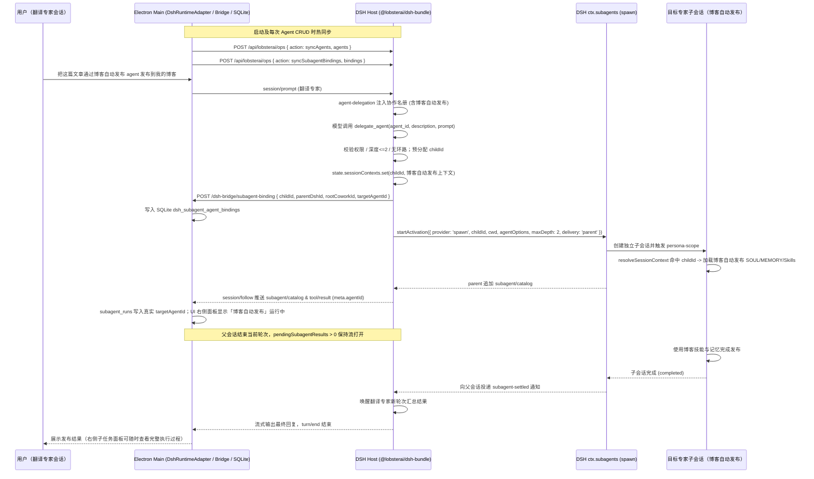

# 基于 DSH 的多 Agent 协作与专家委派设计文档

## 1. 概述

### 1.1 问题/背景

LobsterAI 将底层 Agent 运行时从 OpenClaw 迁移至 DeepSeek Harness（`@deepseek-ai/dsh@0.2.2-rc.5`）后，原有的「多 Agent 协作（跨专家委派）」功能出现断链：在一个 Agent 会话（例如「翻译专家」）中要求把任务委派给另一个已配置的 Agent（例如「博客自动发布」）时，当前 Agent 看不到目标 Agent，也无法以目标 Agent 的身份、记忆与技能执行任务。

代码核查确认了三层根因：

1. **旧协作配置未接入 DSH**：前端 Agent 设置页/创建页的「协作」Tab 与 SQLite `agents.subagent_allow_agent_ids` 字段仍保留，但迁移后仅有废弃的 `openclawAgentModels.ts` 读取它，整个 DSH 运行时栈（`src/main/libs/dsh/`、`dshRuntimeAdapter.ts`、`dsh-bundles/lobsterai-host/`）均未消费该配置，也没有将 LobsterAI 的 Agent 名册同步至 DSH。
2. **DSH 原生 `subagent` / `list_agents` 与 LobsterAI 多 Agent 语义不重合**：
   - 当前 `preset-lobsterai` 中挂载的 `list_agents`（`@deepseek-ai/dsh-tool-subagent-control`）只枚举当前会话树内**已启动**的子会话，看不到侧边栏「我的 Agent」中未激活的其他专家。
   - `dsh-bundles/lobsterai-host/plugins/shared-state.mjs` 中的 `resolveSessionContext` 会沿 `header.parentSession` 回溯，把所有原生子会话绑定为**父会话的 `agentId`**，导致子会话只能继承父 Agent 自己的人设、长期记忆（`MEMORY.md`）和技能白名单。
   - `DshSubagentSessions` 记录 `subagent_runs` 时也硬编码了 `agentId = parent.agentId`。
3. **默认白名单门禁过严**：旧 OpenClaw 设计要求每个 Agent 手动勾选 `subagentAllowAgentIds` 才开放委派（默认空），导致用户在专家 Agent 中自然提及另一位已配置专家时无法开箱协作。

#### 技术方案选型

结合内置 DSH `0.2.2-rc.5` 源码评估了四条路线：

| 候选路线 | 评估结论 |
|---|---|
| **A. 每个 LobsterAI Agent 1:1 映射为 DSH `AgentPreset`**（`dsh-agent-preset-registry` + `tool-subagent.allowedAgentPresets`） | **不采用**。每个 `AgentPreset` 会实例化整棵 Cordis 插件树（bash/fs/compaction/web 等），多 Agent 开销大；`allowedAgentPresets` 是静态 enum，无法按当前 Agent 权限动态裁剪或热更新；且不包含中文名称、职责描述、独立模型与 `workingDirectory`。 |
| **B. 仅启用 DSH `AgentTeam`**（`dsh-agent-team` + `dsh-tool-agent-team`） | **正交能力，非根因解法**。`AgentTeam` 是在已有 subagent 树之上提供持久化共享任务板（认领/依赖 DAG/写冲突提示），本身不管理预配置专家名册。可作为二期能力平滑叠加。 |
| **C. 主进程另起独立 DSH 根会话同步等待** | **不采用**。绕过 DSH `ctx.subagents` 会丧失异步并发、自动完成通知（`subagent-settled`）、`send_message` 双向多轮沟通、`drainDescendants` 级联停止、冷恢复与 `subagentCatalog` 持久化，且极易触发工具超时。 |
| **D. 复用 DSH 原生 `ctx.subagents.startActivation` + `@lobsterai/dsh-bundle` 薄宿主插件（本方案）** | **采用**。零侵入 DSH 源码，保持单一 `preset-lobsterai` 轻量化；通过热同步 Agent 名册与 `delegate_agent` 工具，在启动前预分配 `childId` 并绑定目标 Agent 上下文，完整继承 DSH 原生多智能体调度、通信、生命周期与未来 `AgentTeam` 扩展能力。 |

### 1.2 目标

1. **开箱即用的跨 Agent 协作**：默认允许任意已启用 Agent 发现并委派其他已启用 Agent（排除自身），同时在「协作」Tab 支持按需切换为「仅允许指定白名单」或「禁用跨 Agent 委派」。
2. **完整的专家身份隔离**：被委派的目标 Agent 在独立子会话中运行，使用**目标 Agent 自己**的：
   - 工作区人设与长期记忆（`<userData>/workspaces/<targetAgentId>/{SOUL,IDENTITY,USER,AGENTS,MEMORY}.md`）及 `systemPrompt`；
   - 专属技能白名单（`skillIds`）与全局技能策略；
   - 专属长期记忆读写工具（`lobster_memory_search` / `get` / `save`）；
   - 独立模型与思考强度（显式配置时生效，继承模式则沿用父会话模型）；
   - 独立工作目录（优先调用显式 `cwd` → 目标 Agent `workingDirectory` → 父会话 `cwd`）。
3. **100% 复用 DSH 原生 subagent 运行时**：支持非阻塞并行委派、完成后自动唤醒父会话汇总、通过 `send_message` 进行双向多轮追问、通过 `list_agents` / `wait_agent` 观测树内成员，以及应用重启后的冷恢复（Cold Resume）。
4. **支持 2 层链式委派与防循环**：允许如「主 Agent → 翻译专家 → 博客自动发布」的 2 层跨 Agent 委派（`maxDepth = 2`），并严格拦截循环委派（如 `A → B → A` 或 `A → A`）。
5. **收敛简洁的 UI 呈现**：委派子任务统一在父会话右侧「子任务面板」展示（含目标 Agent 名称/头像标识与完整执行轨迹，支持 2 层后代历史查看），**不向左侧栏目标 Agent 下额外物化独立会话**（避免与 DSH subagent 树状态双写冲突；预留二期「Fork 为独立会话继续对话」扩展点）。
6. **零魔改 DSH 源码**：所有运行时扩展全部收敛在 `@lobsterai/dsh-bundle` 与主进程平台层，保持 `npm run dsh:upgrade-check` 兼容。

### 1.3 非目标（Out of Scope）

- 本期不向侧边栏物化 `childCoworkSessionId` 独立会话（保留历史兼容读取逻辑）。
- 本期不默认开启 DSH `AgentTeam` 共享任务板（架构保持完全兼容，作为二期独立开关）。
- 本期不修改 DSH 上游 `dsh-subagent` / `dsh-tool-subagent` 源码。

---

## 2. 用户场景

### 场景 1：专家 Agent 直接委派另一位专家（开箱即用）

**Given** 用户在侧边栏已有「翻译专家」与「博客自动发布」两个已启用 Agent，其中「博客自动发布」拥有博客发布技能、工作区 `MEMORY.md`（记录博客仓库信息）与专属 `workingDirectory`，且「翻译专家」采用默认协作模式（`all`）。

**When** 用户在「翻译专家」会话中发送：「把这篇文章通过博客自动发布 agent 发布到我的博客吧」。

**Then** 「翻译专家」在上下文名册中直接看到「博客自动发布」及其职责，调用 `delegate_agent` 传入目标 `agent_id`、文章绝对路径与发布要求；DSH 启动独立子会话并加载「博客自动发布」的人设、记忆、技能和目录；发布完成后自动将结果回传给「翻译专家」并向用户汇报。

### 场景 2：主 Agent 并发委派多位专家并汇总

**Given** 用户拥有「产品分析」「工程实现」「QA 审查」等专家 Agent。

**When** 用户在「主 Agent」中提出需要多方调研或分步协作的任务。

**Then** 「主 Agent」可在同一轮并行发起多个 `delegate_agent` 调用并结束当前轮次；DSH 异步执行各专家子会话，并在每个专家结束后自动回推完成通知（`subagent-settled`）唤醒「主 Agent」推进下一步或最终汇总。

### 场景 3：2 层链式委派与循环阻断

**Given** 「主 Agent」委派了「翻译专家」（depth = 1）。

**When** 「翻译专家」完成翻译后，决定继续委派「博客自动发布」（depth = 2）执行发布。

**Then** `delegate_agent` 校验 `childDepth = 2 <= 2` 且「博客自动发布」不在祖先链 `[main, translator]` 中，成功拉起第 2 层专家子会话；若「博客自动发布」尝试再次委派任何专家（`depth = 3 > 2`），或「翻译专家」尝试反调「主 Agent」（环路），工具均返回明确错误提示，由当前专家直接处理或向调用方反馈。

### 场景 4：多轮追问与重启后冷恢复

**Given** 「翻译专家」刚通过 `delegate_agent` 完成了对「博客自动发布」的一次委派，用户随后补充要求：「顺便把封面图也更新一下」。

**When** 「翻译专家」调用 DSH 原生 `send_message` 给该子会话（无论是否刚刚重启过 LobsterAI）。

**Then** DSH 冷恢复该子会话时，LobsterAI 仍准确还原该子会话为「博客自动发布」的身份、人设、记忆和技能白名单，不会退化回父会话「翻译专家」的身份。

### 场景 5：按需收紧协作权限（白名单 / 禁用）

**Given** 用户希望某个涉密或专用 Agent 不随意调用其他专家。

**When** 用户在 Agent 设置页「协作」Tab 将协作模式切为「仅允许指定 Agent」（并勾选白名单）或「禁用跨 Agent 委派」。

**Then** 该配置热同步至 DSH 无需重启；在「禁用」模式下，该 Agent 看不到协作名册且不暴露 `delegate_agent` 工具（不影响其使用普通 `subagent` / `subagent_fork`）；在「白名单」模式下，仅能看到并委派已勾选且仍处于启用状态的 Agent。

### 场景 6：老用户升级兼容

**Given** 老用户从 OpenClaw 或早期 DSH 版本升级：Agent A 原先未勾选任何协作对象（`subagent_allow_agent_ids = '[]'`），Agent B 原先显式勾选了 `["writer", "reviewer"]`。

**When** 应用启动执行 SQLite 迁移。

**Then** Agent A 自动升级为 `subagent_collaboration_mode = 'all'`（开箱支持全部互通），Agent B 自动迁移为 `subagent_collaboration_mode = 'allowlist'` 并完整保留 `["writer", "reviewer"]`。

### 场景 7：普通分身与跨 Agent 委派清晰分工

**Given** 当前 Agent 需要并行读 3 个长文件做临时总结，不需要其他专家的人设和记忆。

**When** 模型决定拆分临时子任务。

**Then** 模型调用 DSH 原生 `subagent` 或 `subagent_fork` 启动同人设分身；仅当任务需要另一位已配置专家的身份/记忆/技能或用户点名某 Agent 时，才调用 `delegate_agent`。

---

## 3. 功能需求

### FR-1：协作模式数据模型与迁移

1. 在 `src/shared/agent/constants.ts` 新增常量对象与联合类型：
   ```ts
   export const SubagentCollaborationMode = {
     All: 'all',
     Allowlist: 'allowlist',
     Disabled: 'disabled',
   } as const;
   export type SubagentCollaborationMode =
     typeof SubagentCollaborationMode[keyof typeof SubagentCollaborationMode];
   ```
2. SQLite `agents` 表新增列：
   - `subagent_collaboration_mode TEXT NOT NULL DEFAULT 'all'`
3. 一次性老数据回填规则（仅在首次新增 `subagent_collaboration_mode` 列时执行）：
   - 对历史 `subagent_allow_agent_ids` 解析后非空（包含至少 1 个非自身的有效 Agent ID）的记录，回填 `subagent_collaboration_mode = 'allowlist'`；
   - 其余记录保持 `'all'`。
4. `Agent` / `CreateAgentRequest` / `UpdateAgentRequest`（主进程与渲染层）均增加 `subagentCollaborationMode?: SubagentCollaborationMode`（读取时缺省规范化为 `SubagentCollaborationMode.All`）。
5. 保留 `subagentAllowAgentIds: string[]` 存储白名单 ID 列表（去空、去重、过滤自身），切换模式时不强制清空历史勾选，方便用户在 `allowlist` 与 `all`/`disabled` 之间切换。

### FR-2：Agent 设置页与创建页「协作」Tab 升级

1. `AgentSettingsPanel.tsx` 与 `AgentCreateModal.tsx` 的「协作」Tab 提供三态模式选择（单选卡片或分段控件）：
   - **允许协作所有已启用 Agent（默认）**：自动包含所有其他已启用 Agent，新增专家后无需手动回来勾选；下方可展示只读预览或简洁提示。
   - **仅允许指定 Agent**：展示其他已启用 Agent 的多选列表（沿用现有列表组件，展示名称、ID 与简述），保存勾选到 `subagentAllowAgentIds`。当白名单为空时显示提示说明「未选择任何协作 Agent，当前不会启用跨 Agent 委派」。
   - **禁用跨 Agent 委派**：隐藏/禁用多选列表，保存 `subagentCollaborationMode = 'disabled'`。
2. 所有新增文案必须通过 `i18nService.t(...)` 提供完整 `zh` 与 `en` 词条。
3. 创建页应用预设模板或重置弹窗时，默认重置为 `SubagentCollaborationMode.All` 与 `subagentAllowAgentIds = []`。

### FR-3：LobsterAI Agent 名册热同步至 DSH

1. 在 `src/shared/dshEngine/hostConstants.ts` 的 `DshOpsAction` 新增：
   - `SyncAgents: 'syncAgents'`
   - `SyncSubagentBindings: 'syncSubagentBindings'`
2. 主进程 `syncOpenClawConfig`（`src/main/main.ts`）组装 `agents` 载荷传入 `bootstrap.syncAllConfig(...)`；因为现有 `AgentIpcChannel.Create / Update / Delete / AddPreset / UpgradePreset` 全部已触发 `syncOpenClawConfig`，任何 Agent 变更及启停都将自动热同步至 DSH，无需重启 DSH 进程。
3. 每个同步给 DSH 的 Agent 条目（`DshHostAgentSpec`）包含：
   ```ts
   export interface DshHostAgentSpec {
     id: string;
     name: string;
     description: string;
     enabled: boolean;
     presetId?: string;
     systemPrompt?: string;
     workingDirectory?: string;
     /** null 表示不限制技能（遵循全局技能策略）；string[] 表示该 Agent 的技能白名单 */
     allowedSkillIds: string[] | null;
     /** 仅当 Agent 显式配置了独立模型时下发；继承模式省略，由子会话继承父模型 */
     modelSelection?: {
       provider: string;
       model: string;
       reasoningEffort?: string;
     };
     collaborationMode: SubagentCollaborationMode;
     allowAgentIds: string[];
     /** 供上层 Agent 快速判断能力边界的精简技能名列表（已按全局禁用与白名单过滤） */
     skillSummaries?: Array<{ id: string; name: string; description?: string }>;
   }
   ```
4. `DshHostManager` 缓存 `lastAgentsPayload` 与 `lastSubagentBindings`，在 DSH 崩溃拉起或手动重启的 `replayCachedSyncs()` 中自动重放。

### FR-4：可协作 Agent 名册的动态计算与 Prompt 注入

1. 在 `@lobsterai/dsh-bundle` 中新增纯函数模块 `agent-delegation-helpers.mjs` 与 Cordis 插件 `agent-delegation.mjs`（`inject: ['tools', 'subagents', 'systemPrompt', 'agents']`）。
2. 对给定调用方会话，按以下规则计算当前可委派目标列表 `resolveCollaborators(state, currentAgentId, ancestorAgentIds)`：
   - 若当前 Agent 的 `collaborationMode === 'disabled'`，返回空数组；
   - 若 `collaborationMode === 'allowlist'`，从 `state.agents` 中筛选 `enabled === true` 且 `id ∈ allowAgentIds` 的条目；
   - 若 `collaborationMode === 'all'`（默认），从 `state.agents` 中筛选全部 `enabled === true` 的条目；
   - 统一排除 `id === currentAgentId` 以及已在祖先链 `ancestorAgentIds` 中的 Agent（防止自调用与 `A → B → A` 环路）。
3. 通过 `ctx.systemPrompt.context(...)` 注册紧凑的运行时上下文段落 `lobsterai:collaborators`：
   - 当可委派列表为空，或当前会话委派深度已达到 `maxDepth`（`depth >= 2`）时，返回空字符串（零 token 浪费）。
   - 非空时输出简洁结构化名册，明确告知模型：
     - 可用的专家 Agent 列表（每行：`agent_id` | 名称 | 简述 | 关键技能摘要，最多截断至合理长度避免膨胀）；
     - 区分调用原则：涉及上述专家职责或用户点名某 Agent 时调用 `delegate_agent`；只需临时同人设并行分担上下文时使用 `subagent` / `subagent_fork`；
     - 提醒传递必要文件路径与上下文，因为专家子会话不共享当前对话历史。
   - **名册体积控制**：若可协作 Agent 超过 20 个，仅内联前 20 个（按 UI 排序/置顶优先，主 Agent 靠前），并附带提示可调用只读工具 `list_collaborator_agents` 检索完整列表；常规用户（≤ 20 个 Agent）零额外发现轮次。

### FR-5：跨 Agent 委派工具 `delegate_agent`

1. 工具名常量化：在 `src/shared/cowork/subagent.ts` 的 `SubagentToolName` 新增 `DshDelegate: 'delegate_agent'`，并纳入 `isDshSubagentSpawn(name)`。
2. 工具可见性控制：通过 `ctx.tools.register(definition, { when })` 控制——仅当 `ctx.subagents.getProvider('spawn')` 存在，且当前会话对应的 Agent 存在至少 1 个可协作目标（或历史请求头已包含 `delegate_agent` 以保持 KV Cache 稳定）时暴露。
3. 工具输入参数：
   - `agent_id`（`string`, required）：目标协作 Agent 的 ID（同时支持当模型误传精确唯一匹配的目标 Agent 中文/英文 `name` 时，给出友好解析或明确纠错——优先精确匹配 `id`，若未命中且 `name` 唯一命中允许列表内某 Agent 则自动解析为对应 `id`，提升小模型容错率）。
   - `description`（`string`, required）：3–8 字任务简述（展示在子任务面板）。
   - `prompt`（`string`, required）：完整、自包含的任务说明（包含待处理文件的绝对路径、预期产出、约束条件等）。
   - `cwd`（`string`, optional）：覆盖子会话初始工作目录；省略时优先使用目标 Agent 配置的 `workingDirectory`（存在且有效时），否则继承调用方当前目录。
   - `name`（`string`, optional）：可选树内别名（遵循 DSH `^[a-z][a-z0-9-]{0,31}$` 且不为 `lead`）；省略时自动基于目标 Agent 生成合法短别名（见边界情况），冲突时自动加 `-2`/`-3` 或回退 DSH 默认 `agent-N`。
4. 工具执行流程：
   1. 校验 `exec.agent` 存在；
   2. 校验当前委派深度 `delegationDepthOf(parent) + 1 <= DELEGATE_MAX_DEPTH`（`2`）；
   3. 计算祖先链 `ancestorAgentIds`，解析并鉴权目标 Agent（必须在当前 Agent 允许列表内、已启用、非自身、不在祖先链内）；
   4. 解析 `resolvedCwd` 与 `targetAgentOptions`（目标 Agent 显式配置了独立模型时先通过 `ctx.llm` 预检路由可用性；若不可用或未配置则降级继承父模型并记 warn 日志）；
   5. 预生成 `childId = randomUUID()`；
   6. 先写入 `state.sessionContexts.set(childId, targetSessionContext)` 与 `state.delegatedChildAgents.set(childId, targetAgent.id)`；
   7. 通过 Host Bridge（`POST /dsh-bridge/subagent-binding`）持久化 `childId -> { parentDshSessionId, rootCoworkSessionId, targetAgentId }`（Bridge 不可用如纯 CLI 模式时降级跳过不阻塞）；
   8. 调用 DSH 原生 `ctx.subagents.startActivation({ provider: 'spawn', childId, parent: exec.agent, name: resolvedName, label: args.description, cwd: resolvedCwd, prompt: [{ type: 'text', text: args.prompt }], ...(targetAgentOptions ? { agentOptions: targetAgentOptions } : {}), maxDepth: DELEGATE_MAX_DEPTH, signal: exec.signal, delivery: 'parent' })`；
   9. 若 `startActivation` 抛错，在 `catch` 中回滚清理 `state.sessionContexts.delete(childId)`、`state.delegatedChildAgents.delete(childId)` 与 Bridge 绑定记录；
   10. 成功返回 `{ kind: 'activation', name: started.name, childId: started.childId, agentId: targetAgent.id, agentName: targetAgent.name }`，并在 `presentationMeta` 中透出 `{ kind: 'activation', name: started.name, childId: started.childId, agentId: targetAgent.id }`。

### FR-6：深度控制与循环防护

1. `DELEGATE_MAX_DEPTH = 2`（常量定义）：
   - 根会话（depth = 0）→ 专家 1（depth = 1）→ 专家 2（depth = 2）允许；
   - 专家 2（depth = 2）尝试再委派（depth = 3）被 `resolveChildDepth` 拒绝，同时 `lobsterai:collaborators` 在 `depth >= 2` 时不再注入协作名册并输出深度上限提示。
2. 祖先防环算法：
   - 从 `exec.agent.id` 沿 `session.header.parentSession` 向上追溯至根会话，收集每层的 `agentId`（通过 `resolveSessionContext`）；
   - 目标 `targetAgent.id` 若已存在于该集合中（包括自调用 `A → A` 与间接环路 `A → B → A`），立即拒绝并返回清晰的模型可读错误（建议直接完成任务或通过 `send_message` 联系祖先节点）。
3. 普通同人设 `subagent` / `subagent_fork` 维持 DSH 默认 `maxDepth = 1` 不变，避免不受控扇出。

### FR-7：身份持久化与冷恢复（Cold Resume）

1. SQLite 新增轻量表 `dsh_subagent_agent_bindings`：
   ```sql
   CREATE TABLE IF NOT EXISTS dsh_subagent_agent_bindings (
     child_session_id TEXT PRIMARY KEY,
     parent_dsh_session_id TEXT NOT NULL,
     root_cowork_session_id TEXT NOT NULL,
     target_agent_id TEXT NOT NULL,
     created_at INTEGER NOT NULL
   );
   CREATE INDEX IF NOT EXISTS idx_dsh_subagent_bindings_root
     ON dsh_subagent_agent_bindings(root_cowork_session_id);
   ```
2. 启动 DSH / 重启恢复（`replayCachedSyncs`）时，主进程通过 `DshOpsAction.SyncSubagentBindings` 下发最近的绑定记录到 DSH 内存 `state.delegatedChildAgents: Map<childId, targetAgentId>`。
3. 增强 `shared-state.mjs` 的 `resolveSessionContext(ctx, state, sessionId)`：
   - 第 1 步：若 `state.sessionContexts.get(sessionId)` 存在，直接返回；
   - 第 2 步：若 `state.delegatedChildAgents.get(sessionId)` 存在 `targetAgentId`，沿 `parentSession` 找到根/父上下文的 `coworkSessionId`、`traceId`、`executionMode`、`permissionPreset`，结合 `state.agents.get(targetAgentId)` **同步合成**目标 Agent 上下文并回填缓存返回（保证 `persona-scope.mjs` 的同步 `systemPrompt.section` 在冷恢复首步即可 100% 命中目标人设与记忆）；
   - 第 3 步：否则按原逻辑沿 `parentSession` 继承父上下文（兼容普通同人设 `subagent` / `subagent_fork`）。
4. 当删除父 Cowork 会话或删除某个子任务时，同步级联清理 `dsh_subagent_agent_bindings` 对应记录，避免表无限增长。

### FR-8：父会话事件流、子任务面板与 2 层历史读取

1. `src/shared/cowork/subagent.ts` 将 `delegate_agent` 纳入 `isDshSubagentSpawn`，自动打通：
   - `dshRuntimeAdapter.ts` 的 `subagentTasksByCall`、`subagentRunId`、`pendingSubagentResults`（确保父会话等待子专家完成通知时不提前结束流）；
   - `subagentWaitState.ts` 的等待态文案；
   - `messageDisplayUtils.ts` 的工具调用卡片归类展示。
2. `DshSubagentSessions` 增强：
   - `remember()` 插入 `subagent_runs` 时，优先查 `dsh_subagent_agent_bindings` 获取 `target_agent_id` 写入 `subagent_runs.agent_id`，仅未命中时回退 `parent.agentId`；
   - 收到 `tool/result` 带 `meta.agentId` 时兜底修正 `subagent_runs.agent_id`；
   - `syncCatalog()` 在扫描 depth-1 子会话的 `projection.values` 时，顺带检查其 `subagentCatalog`（递归至 depth = 2），将 depth-2 专家子会话也纳入该父 Cowork 会话的 `subagent_runs` 列表，并记录对应的 `parent_dsh_session_id`；
   - `getSubTaskHistory(parentId, runId)` 读取子会话历史时，若 `dsh_subagent_agent_bindings` 中存在 `parent_dsh_session_id`，使用该**直接父 DSH Session ID** 构造 `{ kind: 'subagent', parentSessionId: directParentDshId, childSessionId, mode }`，确保 depth-1 与 depth-2 专家的完整对话轨迹均可点击查看；
   - `getOwningSessionId(nativeChildId)` 同时查 `subagent_runs` 与 `dsh_subagent_agent_bindings.root_cowork_session_id`，确保 depth-2 子会话的归属路由正确；
   - `deleteSubagentSession` 删除前校验直接父目录并级联清理 `dsh_subagent_agent_bindings`。
3. 渲染层右侧「子任务面板」（`SubagentPanelContent.tsx` & `subagentDisplay.ts`）：
   - 当 `subagent.agentId` 与父会话 `agentId` 不同时，在子任务行与详情顶栏明确展示目标专家名称徽标（例如头像首字取目标专家、副标题/标签展示「博客自动发布」），避免仅看到通用任务标题而分不清是哪位专家执行的；
   - 不向左侧栏目标 Agent 列表创建新的 `cowork_sessions` 行（`childCoworkSessionId` 保持 `null`）。

### FR-9：与原生工具及二期演进兼容

1. 保留 `subagent`、`subagent_fork`、`list_agents`、`send_message`、`wait_agent` 的全部原生行为。
2. 因为 `delegate_agent` 创建的子会话是标准 DSH continuable subagent，二期如需开启 DSH 原生 `@deepseek-ai/dsh-agent-team` 共享任务板，或为右侧子任务面板增加「在目标 Agent 中继续对话（Fork 为独立会话）」按钮，均可直接基于同一批 DSH Session 零重构扩展。

---

## 4. 实现方案

### 4.1 总体交互时序



### 4.2 共享常量与类型层

1. `src/shared/agent/constants.ts`：新增 `SubagentCollaborationMode` 常量对象与类型。
2. `src/shared/cowork/subagent.ts`：
   - `SubagentToolName` 新增 `DshDelegate: 'delegate_agent'`；
   - `isDshSubagentSpawn` 返回 `name === DshSpawn || name === DshFork || name === DshDelegate`。
3. `src/shared/dshEngine/hostConstants.ts`：
   - `DshOpsAction` 新增 `SyncAgents: 'syncAgents'`、`SyncSubagentBindings: 'syncSubagentBindings'`；
   - 新增 `DSH_DELEGATE_AGENT_TOOL = 'delegate_agent'` 与 `DSH_DELEGATE_MAX_DEPTH = 2`。

### 4.3 数据层与存储迁移

1. `src/main/sqliteStore.ts`：
   - `CREATE TABLE IF NOT EXISTS agents` 中增加 `subagent_collaboration_mode TEXT NOT NULL DEFAULT 'all'`；
   - 启动迁移检测到 `agents` 表缺少 `subagent_collaboration_mode` 时：
     1. 执行 `ALTER TABLE agents ADD COLUMN subagent_collaboration_mode TEXT NOT NULL DEFAULT 'all';`
     2. 在同一迁移块内遍历历史 `agents`，若 `parseStringIdList(subagent_allow_agent_ids)` 过滤自身后非空，则更新为 `'allowlist'`。
   - 新增 `dsh_subagent_agent_bindings` 表及索引。
2. `src/main/coworkStore.ts`：
   - `Agent`、`CreateAgentRequest`、`UpdateAgentRequest` 及 `createAgent` / `updateAgent` / `mapAgentRow` 支持 `subagentCollaborationMode`（非法值安全兜底为 `SubagentCollaborationMode.All`）。
   - 删除会话 `deleteSession` 时级联清理 `dsh_subagent_agent_bindings`。

### 4.4 主进程同步与 Bridge 层

1. `src/main/libs/dsh/dshHostManager.ts`：
   - 新增 `DshHostAgentSpec`、`DshSubagentAgentBinding` 类型；
   - 新增 `syncAgents(agents: DshHostAgentSpec[])` 与 `syncSubagentBindings(bindings: DshSubagentAgentBinding[])`，缓存并在 `replayCachedSyncs()` 中重放；
   - 在本地回环 Bridge 路由新增 `POST /dsh-bridge/subagent-binding`（支持 `action: 'set' | 'delete'`），交给注册的回调读写 `DshSubagentSessions` / SQLite。
2. `src/main/libs/dsh/dshBootstrap.ts`：
   - `DshBootstrapSyncInput` 增加 `agents?: DshHostAgentSpec[]`；
   - `syncAllConfig` 调用 `hostManager.syncAgents(...)`；
   - 启动时从 SQLite 加载已有 `dsh_subagent_agent_bindings` 并调用 `hostManager.syncSubagentBindings(...)`；
   - 注册 `/dsh-bridge/subagent-binding` 回调到 `this.subagentSessions.recordAgentBinding(...)` / `deleteAgentBinding(...)`。
3. `src/main/main.ts`：
   - `syncOpenClawConfig` 汇总 `getAgentManager().listAgents()`，结合 `resolveModelSelectionForAgent`（解析每个显式配置模型的 Agent 为 `{ provider, model, reasoningEffort }`）、全局启用技能列表（计算 `skillSummaries`）组装 `agents: DshHostAgentSpec[]` 传入 `bootstrap.syncAllConfig(...)`。
   - 保持 `main.ts` 变更最小化：将 Agent → `DshHostAgentSpec` 的转换逻辑抽离到纯函数模块 `src/main/libs/dsh/dshAgentSync.ts`（便于单测）。

### 4.5 DSH 宿主插件层（`dsh-bundles/lobsterai-host/`）

1. `plugins/shared-state.mjs`：
   - `state` 增加：
     - `agents: new Map()`（`agentId -> DshHostAgentSpec`）
     - `agentOrder: []`（保留用户展示顺序）
     - `delegatedChildAgents: new Map()`（`childSessionId -> targetAgentId`）
   - 升级 `resolveSessionContext(ctx, state, sessionId)`：优先查 `state.sessionContexts`，其次查 `state.delegatedChildAgents` 并同步合成目标 Agent 上下文（继承最近祖先的 `coworkSessionId`、`traceId`、`executionMode`、`permissionPreset`），最后回退沿 `parentSession` 继承父上下文。
2. `plugins/ops-rpc.mjs`：
   - 新增 `case 'syncAgents'` 与 `case 'syncSubagentBindings'`，更新 `state.agents` / `state.agentOrder` / `state.delegatedChildAgents`，并在 `health` 返回 `agentsCount` 便于排查。
3. 新增 `plugins/agent-delegation-helpers.mjs`（零 DSH 依赖纯函数，直接由 Vitest 覆盖）：
   - `resolveCollaborators(agents, agentOrder, currentAgentId, ancestorAgentIds)`
   - `resolveTargetAgentInput(collaborators, rawAgentId)`（支持 `id` 精确匹配及唯一 `name` 兜底匹配）
   - `deriveDelegationChildName(targetAgent, takenNames, requestedName)`（遵循 DSH `^[a-z][a-z0-9-]{0,31}$` 且不为 `lead`）
   - `formatCollaboratorRosterPrompt(collaborators, maxInline)`
   - `collectAncestorAgentIds(ctx, state, agent)`
4. 新增 `plugins/agent-delegation.mjs`：
   - 注册 `delegate_agent`（及可选在超过 20 个协作对象时暴露 `list_collaborator_agents`）；
   - 注册 `ctx.systemPrompt.context({ name: 'lobsterai:collaborators', ... })`；
   - 在 `execute` 中完成深度/权限/防环校验、模型路由预检（失败降级继承父模型）、`childId` 预分配与上下文绑定、Bridge 持久化、调用 `ctx.subagents.startActivation(...)` 与异常回滚。
5. `cordis.patch.yml`：
   - 在底部宿主插件列表插入 `- id: lobster-agent-delegation` / `name: './plugins/agent-delegation.mjs'`。

### 4.6 子任务管理与渲染层

1. `src/main/libs/dsh/dshSubagentSessions.ts`：
   - 读写 `dsh_subagent_agent_bindings`；
   - `remember()` 优先取绑定表中的 `target_agent_id`；
   - `syncCatalog()` 递归同步至 depth = 2，合并为同一父会话的子任务列表；
   - `getSubTaskHistory()` 使用直接父 `parent_dsh_session_id` 读取 depth-1/depth-2 历史；
   - `setDelegatedAgent()` 供 `dshRuntimeAdapter` 收到 `tool/result` 时兜底补齐。
2. `src/main/libs/agentEngine/dshRuntimeAdapter.ts`：
   - `tool/result` 处理逻辑识别 `resultMeta.agentId`，若存在则调用 `subagentSessions.setDelegatedAgent(coworkSessionId, subagentRunId, resultMeta.agentId)`。
3. 渲染层（`AgentSettingsPanel.tsx`、`AgentCreateModal.tsx`、`SubagentPanelContent.tsx`、`subagentDisplay.ts`、`agent.ts`、`agentSlice.ts`、`preload.ts`、`electron.d.ts`、`i18n.ts`）：
   - 透传并编辑 `subagentCollaborationMode`；
   - 右侧子任务面板展示跨 Agent 委派的目标专家名称/头像徽标。

---

## 5. 边界情况

| 场景 | 处理方式 |
|---|---|
| 用户重启应用后通过 `send_message` 追问历史委派的专家子会话（冷恢复） | 启动 `replayCachedSyncs` 重放 `syncAgents` 与 `syncSubagentBindings`；`resolveSessionContext` 同步命中 `delegatedChildAgents`，无需异步回调即可恢复目标 Agent 的人设、记忆与技能 |
| 历史委派的目标 Agent 已被删除或禁用 | 已有子会话冷恢复时，若 `state.agents` 已无该条记录，仍按 `targetAgentId` 尝试读取残留工作区文件并回退 `allowedSkillIds: null`，不抛错崩溃；新的 `delegate_agent` 调用会明确拒绝已禁用/不存在的 Agent |
| 自定义 Agent 的 ID 是 UUID（36 字符或数字开头），不符合 DSH 子代理 `name` 规则（`^[a-z][a-z0-9-]{0,31}$`） | `deriveDelegationChildName` 优先从 `presetId` 或合法 ASCII 片段派生短名（如 `blog-publisher`），非法或为 UUID/中文时省略 `name` 交给 DSH 自动分配 `agent-1`、`agent-2`，绝不触发 `INVALID_AGENT_NAME` |
| 同一会话内多次委派同一个专家（如先后让「博客自动发布」发布两篇文章） | 派生别名若与父目录已有子名冲突，自动递增后缀 `-2`、`-3` 或交由 DSH 自动命名，避免 `DUPLICATE_AGENT_NAME` |
| 目标 Agent 配置了专属模型，但该 Provider 已被禁用或不支持所选 `reasoningEffort` | 启动前通过 `ctx.llm` 预检路由：先尝试去掉 `reasoningEffort` 复检，仍不可用则记录 warn 日志并自动降级继承父会话当前模型，避免委派直接失败 |
| 父会话处于 `workspace-write` 权限预设，目标专家需要修改位于另一目录的仓库（如本地博客仓库） | DSH 子代理固定 `approvalPolicy: 'never'` 且沙箱以子会话 `cwd` 为界。`delegate_agent` 默认将子会话 `cwd` 设为目标 Agent 的 `workingDirectory`（使目标仓库直接位于子代理可写沙箱内）；若未配置目录导致沙箱拒写，子代理会按 DSH `SUBAGENT_DELEGATION_CONTEXT` 如实汇报权限边界 |
| 模型误把目标 Agent 的中文展示名（如「博客自动发布」）当成 `agent_id` 传入 | `resolveTargetAgentInput` 先按 `id` 精确匹配，未命中且在当前允许列表内按 `name` 唯一命中时自动映射为真实 `id`；若存在重名则返回候选 ID 列表引导重试 |
| 2 层链式委派发生循环（`A → B → A` 或 `A → A`） | 沿 `parentSession` 收集祖先 `agentId` 集合，提前从名册过滤并在 `delegate_agent` 执行期二次拦截，返回清晰错误说明 |
| `collaborationMode === 'allowlist'` 但白名单为空，或全部白名单 Agent 均被禁用 | 可委派集合为空，不注入名册且通过 `when` 隐藏 `delegate_agent` 工具，普通 `subagent` 不受影响 |
| `startActivation` 启动中途失败或用户取消 | `catch` 块同步清理 `state.sessionContexts`、`state.delegatedChildAgents` 并通知 Bridge 删除临时绑定记录，不留脏数据 |
| 通过独立 `dsh` CLI 启动（无 Electron Host Bridge） | `callLobsterBridge` 返回 `{ available: false }`，跳过 SQLite 绑定写入，进程内协作仍可正常工作 |
| 用户在「协作」Tab 切换 `all` ↔ `allowlist` ↔ `disabled` | 保留原 `subagentAllowAgentIds` 不清空，避免误切丢失已勾选的白名单 |

---

## 6. 涉及文件

### 共享契约
1. `src/shared/agent/constants.ts`（新增 `SubagentCollaborationMode`）
2. `src/shared/cowork/subagent.ts`（新增 `SubagentToolName.DshDelegate` 并纳入 `isDshSubagentSpawn`）
3. `src/shared/dshEngine/hostConstants.ts`（新增 `DshOpsAction.SyncAgents` / `SyncSubagentBindings`、工具名与深度常量）

### 主进程数据与运行时同步
4. `src/main/sqliteStore.ts`（`agents.subagent_collaboration_mode` 迁移回填 + `dsh_subagent_agent_bindings` 表）
5. `src/main/coworkStore.ts`（`Agent` CRUD 支持 `subagentCollaborationMode` + 删除会话清理绑定）
6. `src/main/preload.ts`（透传 `subagentCollaborationMode`）
7. `src/main/libs/dsh/dshAgentSync.ts`（新增：Agent 到 `DshHostAgentSpec` 纯函数转换与单元测试 `dshAgentSync.test.ts`）
8. `src/main/libs/dsh/dshHostManager.ts`（`syncAgents`、`syncSubagentBindings`、重放缓存与 `/dsh-bridge/subagent-binding` 路由）
9. `src/main/libs/dsh/dshBootstrap.ts`（接入 `syncAllConfig`、启动重放绑定与注册 Bridge 回调）
10. `src/main/libs/dsh/dshSubagentSessions.ts`（绑定读写、真实 `agentId` 落库、2 层 catalog 同步与历史读取）
11. `src/main/libs/agentEngine/dshRuntimeAdapter.ts`（消费 `tool/result` `meta.agentId` 兜底写入）
12. `src/main/main.ts`（`syncOpenClawConfig` 汇总并传入 `agents`）

### DSH 宿主插件（`@lobsterai/dsh-bundle`）
13. `dsh-bundles/lobsterai-host/cordis.patch.yml`（挂载 `lobster-agent-delegation`）
14. `dsh-bundles/lobsterai-host/plugins/shared-state.mjs`（新增 `agents` / `delegatedChildAgents` 与冷恢复上下文合成）
15. `dsh-bundles/lobsterai-host/plugins/ops-rpc.mjs`（新增 `syncAgents` / `syncSubagentBindings`）
16. `dsh-bundles/lobsterai-host/plugins/agent-delegation-helpers.mjs`（新增纯函数：权限过滤、名称规范化、防环、名册渲染）
17. `dsh-bundles/lobsterai-host/plugins/agent-delegation.mjs`（新增 `delegate_agent` 工具与名册上下文注入）

### 渲染层 UI 与 i18n
18. `src/renderer/types/agent.ts`、`src/renderer/types/electron.d.ts`、`src/renderer/store/slices/agentSlice.ts`、`src/renderer/services/agent.ts`
19. `src/renderer/components/agent/AgentSettingsPanel.tsx`、`src/renderer/components/agent/AgentCreateModal.tsx`（三态协作配置 UI）
20. `src/renderer/utils/subagentDisplay.ts`、`src/renderer/components/artifacts/SubagentPanelContent.tsx`（跨 Agent 委派展示目标专家标识）
21. `src/renderer/services/i18n.ts`（补充中英文词条）

### 单元测试
22. `src/main/libs/dsh/dshAgentSync.test.ts`（新增）
23. `src/main/libs/dsh/dshSubagentSessions.test.ts`（补充绑定、真实 `agentId`、depth-2 同步与历史读取用例）
24. `src/main/libs/agentEngine/dshRuntimeAdapter.test.ts`（补充 `delegate_agent` 事件流与等待完成用例）
25. `tests/dshAgentDelegation.test.ts`（新增：测试 `agent-delegation-helpers.mjs` 权限/防环/命名与 `resolveSessionContext` 冷恢复）
26. `src/main/coworkStore.test.ts`（补充 `subagent_collaboration_mode` 迁移回填与 CRUD 用例）

---

## 7. 验收标准

1. **老数据无损迁移**：已有 `subagent_allow_agent_ids = '[]'` 的 Agent 升级后为 `all` 模式；已有显式勾选列表的 Agent 升级后为 `allowlist` 模式并保留原勾选列表。
2. **UI 协作三态完整可用**：设置页与创建页「协作」Tab 可切换 `all` / `allowlist` / `disabled`，保存后即时生效且无需重启 DSH；中英文文案完整。
3. **跨专家委派端到端闭环（截图 Case 回归）**：在「翻译专家」会话中发送「把这篇文章通过博客自动发布 agent 发布到我的博客吧」，模型能直接识别「博客自动发布」并调用 `delegate_agent`，子会话实际加载「博客自动发布」的 `SOUL.md`、`MEMORY.md`、专属技能与 `workingDirectory`，执行完成后自动唤醒「翻译专家」汇报结果。
4. **身份隔离验证**：委派子会话调用 `lobster_memory_search` 命中的是目标 Agent 的 `MEMORY.md`，技能列表为目标 Agent 的 `skillIds`，且若目标 Agent 绑定了独立模型，实际请求路由使用目标模型。
5. **2 层链式委派与防环验证**：「主 Agent → 翻译专家 → 博客自动发布」可正常完成；depth = 2 尝试第 3 层委派被拒绝；`A → B → A` 与 `A → A` 循环委派被拒绝。
6. **多轮追问与重启冷恢复验证**：重启应用后，父会话通过 `send_message` 继续向之前委派的「博客自动发布」发送指令，恢复后的子会话仍保持「博客自动发布」人设与技能，不退化为父 Agent。
7. **UI 呈现符合预期**：父会话右侧「子任务面板」正确显示目标专家名称与完整执行历史（含 depth-2 后代）；左侧栏目标 Agent 下不新增多余会话。
8. **权限禁用与白名单生效**：设为 `disabled` 时不注入协作名册且不暴露 `delegate_agent`；设为 `allowlist` 时仅暴露已勾选且启用的 Agent，且越权调用被服务端校验拒绝。
9. **质量门禁**：所有新增及关联 Vitest 单测通过、`npm run compile:electron` 与 `npx tsc` 无报错、改动文件通过 CI ESLint `--max-warnings 0` 检查、`npm run dsh:upgrade-check` 通过。
