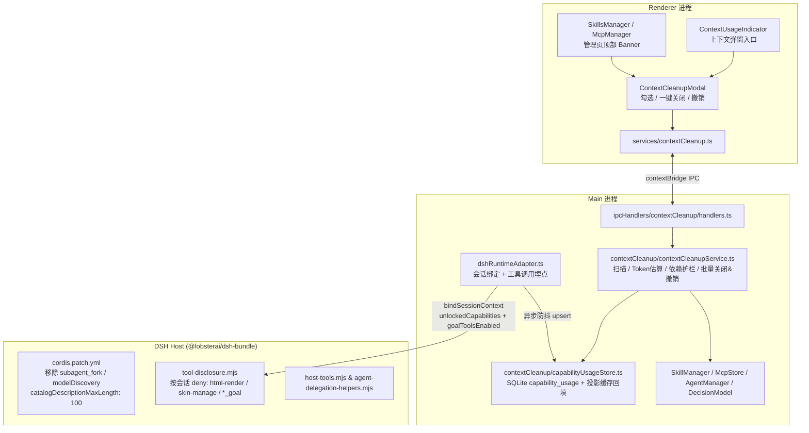

# 首轮上下文 Token 瘦身与闲置能力治理设计文档

## 1. 概述

### 1.1 问题/背景

当前 LobsterAI（DSH 引擎）新建一个空任务、用户仅发送 `"hi"` 时，首轮请求即会消耗大量输入 Token。实测某典型日常环境（启用 104 个 Skills、14 个专家 Agent、1 个未使用的 Jev 判断模型与 1 个第三方 DSH 插件，模型 `yd-fast` / `deepseek-flash`）下，单次请求体达 **76.4 KB**，实测输入 **18,267 tokens**（UI 显示 `~18.3k / 400k`），其构成如下：

| 组成项 | 实测字节 / 字符 | 折算实际 Token | 占比 | 问题根源 |
|---|---:|---:|---:|---|
| DSH 内置工具（26 个） | 21.2k 字符 / 21.3 KB | ~5.3k | 29% | 含低频/零使用编排工具：`subagent_fork`（~437t）、`list_subagent_models` + `subagent` 模型选择参数（~250–300t）、`create_goal`/`update_goal`/`get_goal`（~450t） |
| LobsterAI 宿主工具（12 个） | 17.5 KB | ~4.1k | 22% | 专家/套件专属工具（`lobsterai_render_html_to_image` ~600t、`lobsterai_skin_manage` ~500t）默认全量下发；`deferLoading: true` 在 OpenAI 路由下被 DSH 剥离失效；部分 Schema 参数重复定义 |
| 技能目录 `skill-catalog`（104 个） | 18.2k 字符 / 22.9 KB | ~5.5k | 30% | 全部启用技能的 `name + description`（每条最高 160 字符）首轮平铺注入；实测近 30 天 118 个会话仅用过 10 个，94 个零使用 |
| 系统提示词 `system/message` | 6.7k 字符 / 7.7 KB | ~1.9k | 10% | 人设/记忆/规则 + DSH 工具规范（含未启用 Goal 时附带的 Goal 规范 ~150t） |
| 运行时与时间上下文 | 3.8k 字符 / 4.6 KB | ~1.1k | 6% | 14 个协作 Agent 摘要（`lobsterai:collaborators` ~700t）+ 媒体策略 + 沙箱/时间 |
| 第三方插件工具 + 用户输入 `"hi"` | 1.9 KB + 2 B | ~0.4k | 3% | 已安装但长期未用的插件（如 `dsh-guizang-design`）与真实用户输入 |

这带来三个直接体验与成本问题：

1. **框架底噪偏高**：即便全新安装、0 自定义技能，每开新会话也会固定携带 ~11.0k tokens（37 个内置/宿主工具 + 系统提示词），拉低小上下文窗口模型的有效空间，并放大首轮未命中缓存时的积分消耗。
2. **专属工具全局泄漏**：仅服务特定专家或套件的工具（HTML 离屏出图、皮肤管理、Goal 控制）污染了所有普通会话。
3. **用户侧配置只增不减**：用户长期体验并开启大量 Skills、MCP 连接器、Jev 实验模型和专家 Agent 后缺乏感知与清理手段，大量“僵尸能力”每轮持续消耗数千至上万 tokens。

### 1.2 目标

按 **P0（框架静态瘦身）→ P1（闲置能力检测与一键关闭）→ P2（深度底噪压缩与超量兜底）** 分阶段实施：

1. **P0 — 框架层静态减重（全量用户无感受益，降 ~2.2k–2.4k tok）**
   - 精简 DSH 默认 Preset 中低频子代理配置（移除 `subagent_fork`，关闭 `tool-subagent` 的 `modelDiscovery` / `modelSelection`）。
   - 将 `lobsterai_render_html_to_image` 与 `lobsterai_skin_manage` 纳入渐进披露，默认对普通会话隐藏：小红书等声明该能力的专家与换肤 Kit 会话初始化自动预解锁，主 Agent 必要时也可通过 `lobster_enable_tools` 按需唤起；同步去除 HTML 渲染工具重复定义的参数 Schema。
   - 非 Goal 会话隐藏全部 3 个 Goal 工具（`create_goal`、`update_goal`、`get_goal`），统一通过 `/goal` 命令或输入框 Goal 按钮触发并放行。
2. **P1 — 闲置能力治理与一键关闭（重度用户收益最大，单用户可省 ~4k–8k+ tok）**
   - 轻量追踪 Skills、MCP 连接器、Jev 判断模型及第三方 DSH 插件的实际使用时间与频次，支持从历史 DSH 投影缓存冷启动回填（不把专家 Agent 列入停用候选，避免把用户侧边栏专家隐藏造成误解）。
   - 当存在**超过 30 天未使用**（且已过 **14 天新安装保护期**）的启用项，且预计可节省 **≥ 1,500 tokens/轮** 时，在「上下文进度条弹窗」与「套件·技能·连接器管理页顶部」提供低打扰提示与「一键精简」弹窗。
   - 自动识别定时任务、已启用专家 `skillIds`、核心内置技能等依赖关系，默认不勾选高风险项；关闭操作热同步生效、不卸载文件，并支持一键撤销。
3. **P2 — 深度底噪压缩与超量兜底（再降 ~1.5k–3.5k tok）**
   - 压缩 `lobsterai:collaborators` 引导文案、单行摘要上限及内联人数上限。
   - 精简低频宿主工具（媒体生成冗余别名参数、定时/规则/安装类工具描述）。
   - 下调 `catalogDescriptionMaxLength` 并在技能数量超限时提供防爆仓保护。

最终目标：全新默认用户的首轮底噪从 ~11.0k 压至 **~6.8k–7.2k**；典型重度用户（整理闲置能力后）新任务首轮从 ~18.3k 压至 **~7.5k–8.5k**（降幅 **55%+**）。

### 1.3 非目标

- **不做高频基础/通信工具的会话中途动态解锁**：明确排除对 `job_*`、`wait_agent`、`send_message`、`list_agents` 做“执行中途再解锁”，避免在 OpenAI 兼容路由下因中途变更 `tools` 列表导致 Prompt Cache 失效。
- **不直接修改 `@deepseek-ai/dsh-*` 上游源码**：不通过给 DSH 打 patch 去改写 `bash`、`ask_user_question` 等上游内置工具的描述文案。
- **不自动静默关闭用户配置**：闲置 Skill / MCP / Jev / 专家必须经用户明确确认后才关闭，且关闭仅改开关状态，不删除本地技能目录、MCP 配置或专家数据。
- **不静默卸载 npm 级第三方 DSH 插件**：对闲置的第三方 DSH 插件仅展示 Token 占用并提供跳转至插件管理页的入口。
- **不破坏历史会话回放**：移除 `subagent_fork` 工具定义后，前端与 Adapter 对历史会话中已有的 `subagent_fork` 事件解析与展示保持兼容。

---

## 2. 用户场景

### 场景 1: 普通用户使用主 Agent 新建对话
**Given** 用户在主 Agent 下新建普通对话（未开启 Goal 模式、未选择换肤 Kit 或出图技能）
**When** 用户发送 `"hi"`
**Then** 本轮下发给模型的 `tools` 中不包含 `subagent_fork`、`list_subagent_models`、`create_goal`、`update_goal`、`get_goal`、`lobsterai_render_html_to_image`、`lobsterai_skin_manage`；框架层固定底噪较改造前降低 ~2.2k–2.4k tokens。

### 场景 2: 小红书专家会话使用 HTML 离屏出图
**Given** 用户切换到小红书专家（`presetId: 'xiaohongshu-editor'` 或声明 `hostCapabilities: ['html-render']` 的专家）
**When** 用户请求生成小红书图文卡片并导出图片
**Then** 会话初始化即自动预解锁 `html-render` 能力，`lobsterai_render_html_to_image` 首轮直接可用，无需额外调用 `lobster_enable_tools`，也不增加调用轮次。

### 场景 3: 主 Agent 偶发需要 HTML 离屏出图或换肤
**Given** 用户在主 Agent 普通会话中要求“帮我把这个 HTML 渲染成长图海报”（或触发换肤 Kit / 选用 `skin-creator` 技能）
**When** 触发换肤 Kit 或 `skin-creator` 技能时，会话初始化直接预解锁 `skin-manage`；主 Agent 未选技能而自然语言请求 HTML 转图时，模型可通过 `lobster_enable_tools({ capabilities: ['html-render'] })` 按需解锁
**Then** 对应宿主工具立即可用且在当前会话剩余轮次保持开启（不反复切换工具列表）。

### 场景 4: 用户进入 Goal 模式
**Given** 用户在普通会话中处于非 Goal 状态
**When** 用户输入 `/goal <目标>` 或点击输入框的 Goal 按钮创建目标
**Then** 主进程在 `bindSessionContext` 中置 `goalToolsEnabled: true`，解除对 `create_goal`、`update_goal`、`get_goal` 的隐藏限制；目标完成后或新建普通会话时默认仍保持隐藏。

### 场景 5: 用户点开上下文圆环发现闲置能力并一键精简
**Given** 用户本地启用了 104 个 Skills、1 个闲置 MCP 和 Jev 判断模型，其中 94 个 Skill、该 MCP 和 Jev 已超过 30 天未使用（且启用均满 14 天），合计每轮约占 5.5k tokens（≥ 1,500 tokens）
**When** 用户点击输入框旁的上下文使用率圆环打开 Popover
**Then** Popover 除展示上下文占比与构成明细外，底部显示一行轻提示：`有 96 项长期未用能力，约占 ~5.5k tokens [一键精简]`；点击后弹出精简弹窗，按节省 Token 从高到低列出候选项并默认勾选安全闲置项，点击「一键关闭所选」即热同步关闭开关，无需重启引擎，同时弹出可撤销 Toast。

### 场景 6: 技能/连接器管理页顶部提示与冷却频控
**Given** 用户存在可节省 ≥ 1,500 tokens 的闲置技能/MCP，且未处于 30 天忽略冷却期
**When** 用户进入「套件·技能·连接器」管理页
**Then** 顶部显示一条可关闭的轻提示条，支持点击「一键整理」打开精简弹窗，或点击「暂不提醒」进入 30 天冷却期（冷却期内不再在管理页顶部弹出，但用户主动点开上下文圆环仍可看到入口）。

### 场景 7: 被定时任务或启用中专家依赖的能力防误关
**Given** 某 Skill `daily-trending` 虽然近 30 天未在主 Agent 手动会话中被调用，但已被某个启用中的定时任务或启用中的专家 Agent `skillIds` 引用
**When** 用户打开「一键精简」弹窗
**Then** 该项默认**不自动勾选**，并显示明确依赖标签（如“被定时任务使用”或“被「XXX」专家使用”）；若用户手动勾选，仍允许关闭但给出风险提示。

---

## 3. 功能需求

### P0 功能需求（框架层静态瘦身）

#### FR-1: DSH 子代理配置精简
- 从 `preset-lobsterai` 中移除 `tool-subagent-fork`（`subagent_fork` 工具）。
- `tool-subagent`（`subagent` 工具）配置 `modelSelection: false`、`modelDiscovery: false`，不再注册 `list_subagent_models` 工具。
- 保留 `subagent`（继承父模型）与 `delegate_agent`（走目标专家独立模型与人设）完整能力；历史会话中的 `subagent_fork` 消息渲染与统计解析继续兼容。

#### FR-2: 专属宿主工具渐进披露与 Schema 去重
- 扩展 `DshProgressiveCapability`（[hostConstants.ts](file:///Users/wangning/Dev/lobsterai/src/shared/dshEngine/hostConstants.ts)）与 `PROGRESSIVE_TOOL_GROUPS`（[tool-disclosure-helpers.mjs](file:///Users/wangning/Dev/lobsterai/dsh-bundles/lobsterai-host/plugins/tool-disclosure-helpers.mjs)），支持按精确工具名 `toolNames`（而不限于 `mcp__` 前缀）管控宿主工具：
  - 新增 `html-render` 分组：管控 `lobsterai_render_html_to_image`，默认隐藏；支持通过专家配置自动预解锁，同时纳入 `lobster_enable_tools` 可选枚举，使主 Agent 在需要时可按需唤起。
  - 新增 `skin-manage` 分组：管控 `lobsterai_skin_manage`，默认隐藏；仅当会话存在 `SkinWorkflowKind`（换肤 Kit）或选中/加载 `skin-creator` Skill 时自动预解锁，亦可通过 `lobster_enable_tools` 兜底解锁。
- 专家能力绑定：
  - 在 `PresetAgent` 与 `agents` 同步结构中支持可选 `hostCapabilities?: DshProgressiveCapability[]`（云端专家目录未来可直接声明）。
  - 兼容尚未升级的云端目录与存量已安装专家：对内置已知 `presetId`（如 `'xiaohongshu-editor'`）提供默认映射 `['html-render']`。
- `lobsterai_render_html_to_image` Schema 去重：
  - 对模型暴露的 `inputSchema` 仅保留 `items` 数组（支持 1–20 个渲染项，单文件即传 1 元素数组），移除顶层重复平铺的 8 个同名属性定义。
  - `parseHtmlRenderJobs` 运行时解析继续兼容顶层 `htmlPath` / `outputPath` 参数，避免历史提示词或旧专家指令调用失败。

#### FR-3: 非 Goal 会话隐藏全部 Goal 工具
- 普通会话未处于 Goal 模式时，默认隐藏 `create_goal`、`update_goal`、`get_goal` 全部 3 个工具。
- 满足以下任一条件时，在 `bindSessionContext` 中传 `goalToolsEnabled: true` 放行这 3 个工具：
  1. 当前会话已有历史或活跃的 `goal` 状态；
  2. 本轮用户通过输入框输入 `/goal ...` 命令；
  3. 用户通过 UI Goal 按钮触发 Goal 创建/恢复/编辑。
- 一旦会话内已放行过 Goal 工具（或恢复的会话 `requestHeader().tools` 中已存在任一 `*_goal` 工具），本会话后续轮次保持放行，确保缓存前缀稳定。

---

### P1 功能需求（闲置能力检测与一键关闭）

#### FR-4: 轻量能力使用追踪与冷启动回填
- 追踪范围覆盖 4 类可导致首轮上下文膨胀的能力（不包含专家 Agent，避免侧边栏专家被意外隐藏）：
  1. `skill`：已启用的全局 Skills（来自 `skillManager`）；
  2. `mcp_server`：已启用的用户/市场 MCP 连接器（来自 `mcpStore`，排除由 `tool-disclosure` 管控的内置重型 MCP）；
  3. `decision_model`：Jev 判断模型（`decision_model_config`）；
  4. `dsh_plugin`：已安装的第三方 DSH 插件（来自用户 profile `package.json`，排除 `@deepseek-ai/*` 与 `@lobsterai/*`）。
- 首次启用该功能时执行一次后台冷启动回填，从近 30 天 DSH 会话投影缓存（`contextTimeline.totals.skills` / `timing.tools`）填充 `last_used_at` 与 `use_count`；历史已安装项以目录/配置创建时间作为 `first_seen_at`，避免升级后被迫再等 14 天。
- 日常运行时异步增量更新 `last_used_at` 与 `use_count`，写入采用防抖合并，不阻塞消息流。

#### FR-5: 闲置判定规则、Token 估算与安全护栏
- **闲置判定默认阈值**（常量集中管理）：
  - `IDLE_DAYS_THRESHOLD = 30`：近 30 天无任何调用/使用记录（含从未使用）；
  - `GRACE_PERIOD_DAYS = 14`：启用/安装未满 14 天的新能力不计入闲置；
  - `PROMPT_SAVINGS_THRESHOLD_TOKENS = 1_500`：全部安全可关闭闲置项的预计节省 Token 总和 ≥ 1,500 tokens 时，才触发 UI 提示入口。
- **Token 估算口径**：
  - MCP：复用 `estimateMcpToolTokens()`（汇总该 Server 已启用工具的估算值）；
  - Skill：按中英文加权公式估算 `- \`{name}\`: {truncatedDescription}\n` 的单轮开销；
  - Jev：按 `DECISION_EVALUATE_TOOL_DESCRIPTOR` 实测 JSON 估算（约 680 tokens）；
  - 第三方 DSH 插件：若能从已注册工具反查则汇总工具估算值，否则标记为“未知/需在插件管理查看”。
- **依赖保护护栏**（命中任一条则 `defaultSelected = false` 并附带 `dependencyReasons` 标签）：
  1. 被任一启用中的定时任务（`lobster_scheduled_tasks`）显式引用的 `skillId`；
  2. 被任一启用中的专家 Agent（`agents.skill_ids`）显式绑定的 `skillId`；
  3. 核心基础内置技能白名单（`web-search`、`docx`、`xlsx`、`pptx`、`pdf`）。

#### FR-6: 低打扰 UI 提醒与一键关闭 / 撤销闭环
- **入口 1 — 上下文弹窗**（[ContextUsageIndicator.tsx](file:///Users/wangning/Dev/lobsterai/src/renderer/components/cowork/ContextUsageIndicator.tsx)）：
  - 当扫描存在可省 ≥ 1,500 tokens 的闲置项时，在弹窗内展示一行紧凑提示与「一键精简」按钮（不受管理页“暂不提醒”冷却影响，用户主动点击圆环时随时可用）。
- **入口 2 — 「套件·技能·连接器」管理页顶部轻 Banner**（[SkillsManager.tsx](file:///Users/wangning/Dev/lobsterai/src/renderer/components/skills/SkillsManager.tsx) 与 MCP 管理页）：
  - 当可省 ≥ 1,500 tokens 且未处于 30 天冷却期时展示顶部轻 Banner，提供「一键整理」与「暂不提醒（30 天）」两个操作。
- **「上下文瘦身」弹窗（`ContextCleanupModal`）**：
  - 支持按分组展示（技能 / MCP 连接器 / 实验功能 / 第三方插件），每组按可省 Token 降序排列。
  - 顶部动态汇总已勾选数量及预计每轮节省 Token 数；底部注明“仅关闭开关，不删除本地文件，随时可重新开启”。
  - 支持全选安全闲置项、单项勾选/取消；第三方 DSH 插件行展示「前往插件管理」外链而非勾选框。
  - 点击「一键关闭所选」：通过单次 IPC 批量热关闭，立即同步到 DSH（无需重启），返回 `undoToken` 并在页面展示 8 秒带「撤销」按钮的 Toast，点击「撤销」可一键恢复本次关闭的全部开关。

---

### P2 功能需求（深度底噪压缩与超量兜底）

#### FR-7: 协作 Agent 名单精简
- 压缩 [agent-delegation-helpers.mjs](file:///Users/wangning/Dev/lobsterai/dsh-bundles/lobsterai-host/plugins/agent-delegation-helpers.mjs) 的 `formatCollaboratorRosterPrompt` 引导说明，去除冗余英文段落，控制在 2–3 行内。
- `MAX_INLINE_COLLABORATORS` 从 `20` 下调至 `10`，`MAX_DESC_CHARS` 压缩至 `60` 字符以内；超过 10 个协作者时保持由已有的 `list_collaborator_agents` 工具按需展开。

#### FR-8: 低频宿主工具与媒体工具 Schema 精简
- 精简 [dshMediaGenerationTool.ts](file:///Users/wangning/Dev/lobsterai/src/main/libs/dsh/dshMediaGenerationTool.ts) 暴露给模型的重复别名字段（如去除 `count` 保留 `n`、去除 `output_format` 保留 `outputFormat`、精简重复描述），运行时参数解析保持对旧别名的完全向后兼容。
- 压缩 `lobster_schedule`、`lobster_agent_rules`、`lobster_skill_install` 的参数描述冗余示例文案，保持语义准确的同时降低 20%–35% Schema 字节数。

#### FR-9: 超量技能目录防爆仓兜底
- 将 [cordis.patch.yml](file:///Users/wangning/Dev/lobsterai/dsh-bundles/lobsterai-host/cordis.patch.yml#L149) 的 `catalogDescriptionMaxLength` 从 `160` 调整为 `100`（配合已有的技能简介清洗逻辑，100+ 技能场景可直接减少 ~1.5k–2k tokens 且不影响核心意图匹配）。
- 预留技能数超阈值（如 > 50 个）的分层检索扩展点（二期可选：内联常用 Top 20 + 内置核心，其余走 `lobster_skill_search`）。

---

## 4. 实现方案

### 4.1 整体数据流与分层架构



### 4.2 P0-1：DSH Preset 精简（`cordis.patch.yml`）

修改 [cordis.patch.yml](file:///Users/wangning/Dev/lobsterai/dsh-bundles/lobsterai-host/cordis.patch.yml#L146-L189)：

```yaml
- id: tool-skill
  name: '@deepseek-ai/dsh-tool-skill'
  config:
    catalogDescriptionMaxLength: 100  # P2-3 可同步或分步调整，P0 先保持 160 或一并评估

- id: tool-subagent
  name: '@deepseek-ai/dsh-tool-subagent'
  config:
    provider: spawn
    toolName: subagent
    modelSelection: false
    modelDiscovery: false
# 移除 tool-subagent-fork 段落
```

- 保持 `DSH_REQUIRED_DISABLED_TELEMETRY_IDS` 段落完全不动。
- 变更后必须执行 `npm run dsh:upgrade-check` 与相关测试。

### 4.3 P0-2：宿主工具纳入渐进披露与专家预解锁

1. **共享常量**（[src/shared/dshEngine/hostConstants.ts](file:///Users/wangning/Dev/lobsterai/src/shared/dshEngine/hostConstants.ts#L206)）：
   ```ts
   export const DshProgressiveCapability = {
     ComputerUse: 'computer-use',
     Browser: 'browser',
     Word: 'word',
     Excel: 'excel',
     Ppt: 'ppt',
     HtmlRender: 'html-render',
     SkinManage: 'skin-manage',
   } as const;
   ```
2. **宿主包规则扩展**（[dsh-bundles/lobsterai-host/plugins/tool-disclosure-helpers.mjs](file:///Users/wangning/Dev/lobsterai/dsh-bundles/lobsterai-host/plugins/tool-disclosure-helpers.mjs)）：
   - `PROGRESSIVE_TOOL_GROUPS` 每项支持可选 `prefix?: string` 与 `toolNames?: readonly string[]`：
     ```js
     {
       id: 'html-render',
       toolNames: ['lobsterai_render_html_to_image'],
       skills: [],
       label: '离屏 HTML 渲染为 PNG/JPEG 图片（封面、海报、社媒图文卡片）',
     },
     {
       id: 'skin-manage',
       toolNames: ['lobsterai_skin_manage'],
       skills: ['skin-creator'],
       label: 'LobsterAI 皮肤草稿创建、资源注册与应用',
     },
     ```
   - 更新 `resolveCapabilityForToolName(toolName)` 与 `listMountedToolsForCapability(restrictableNames, capabilityId)`：同时匹配 `group.prefix` 与 `group.toolNames`（不再硬性要求 `toolName.startsWith('mcp__')`）。
   - 保留 `collectAdmittedCapabilitiesFromTools(headerTools)`：若恢复的老会话 `requestHeader().tools` 中已包含 `lobsterai_render_html_to_image` 或 `lobsterai_skin_manage`，自动视为已解锁以保持 KV Cache 稳定。
3. **专家配置与预解锁逻辑**：
   - [src/shared/agent/presets.ts](file:///Users/wangning/Dev/lobsterai/src/shared/agent/presets.ts)：`PresetAgent` 新增可选字段 `hostCapabilities?: DshProgressiveCapability[]`。
   - [src/main/libs/agentEngine/dshRuntimeAdapter.ts](file:///Users/wangning/Dev/lobsterai/src/main/libs/agentEngine/dshRuntimeAdapter.ts)：在 `resolveInitialUnlockedCapabilities()` 中新增：
     - 若当前会话的 Agent 声明了 `hostCapabilities`（或 `presetId` 命中内置兼容映射 `EXPERT_PRESET_DEFAULT_CAPABILITIES = { 'xiaohongshu-editor': [DshProgressiveCapability.HtmlRender] }`），自动加入 `unlocked`；
     - 若本轮激活了 `skinWorkflow`（`SkinWorkflowKind`）或选中的 Skill 含 `skin-creator`，自动加入 `DshProgressiveCapability.SkinManage`。
4. **HTML 渲染工具 Schema 去重**（[src/main/libs/dsh/dshHtmlRenderTool.ts](file:///Users/wangning/Dev/lobsterai/src/main/libs/dsh/dshHtmlRenderTool.ts#L199-L242)）：
   - `dshHtmlRenderToolDescriptor.inputSchema` 仅暴露 `required: ['items']` 与 `properties: { items }`（同时去掉无效的 `deferLoading: true` 以免误导维护者）；
   - `parseHtmlRenderJobs` 保持对顶层单文件入参的兼容回退，并通过单测覆盖两种入参格式。

### 4.4 P0-3：非 Goal 会话隐藏 Goal 工具组

1. **常量定义**（[dsh-bundles/lobsterai-host/plugins/tool-disclosure-helpers.mjs](file:///Users/wangning/Dev/lobsterai/dsh-bundles/lobsterai-host/plugins/tool-disclosure-helpers.mjs)）：
   ```js
   export const GOAL_TOOL_NAMES = Object.freeze(['create_goal', 'update_goal', 'get_goal']);
   ```
2. **上下文透传**：
   - [src/main/libs/dsh/dshHostManager.ts](file:///Users/wangning/Dev/lobsterai/src/main/libs/dsh/dshHostManager.ts) 的 `DshHostSessionContext` 与 [ops-rpc-helpers.mjs](file:///Users/wangning/Dev/lobsterai/dsh-bundles/lobsterai-host/plugins/ops-rpc-helpers.mjs) 增加 `goalToolsEnabled?: boolean`（合并策略：单调或按显式布尔更新，同一会话一旦启用或历史 header 含 Goal 工具则保持开启）。
   - [src/main/libs/agentEngine/dshRuntimeAdapter.ts](file:///Users/wangning/Dev/lobsterai/src/main/libs/agentEngine/dshRuntimeAdapter.ts)：
     - 新建会话 / 普通续聊时：`goalToolsEnabled = Boolean(session.goal || isGoalCommandPrompt(prompt) || turnTriggeredViaGoalUi)`；
     - 在 `runGoalCommand(sessionId, command)` 执行前先通过 `bindSessionContext({ sessionId: dshSessionId, goalToolsEnabled: true })` 放行工具再执行 `/goal` 命令。
3. **拦截与限制**（[dsh-bundles/lobsterai-host/plugins/tool-disclosure.mjs](file:///Users/wangning/Dev/lobsterai/dsh-bundles/lobsterai-host/plugins/tool-disclosure.mjs)）：
   - 在 `reconcileAgent` 中，若 `!bound?.goalToolsEnabled` 且会话历史 `requestHeader().tools` 中未包含任一 `GOAL_TOOL_NAMES`，将存在的 `GOAL_TOOL_NAMES` 全部加入 `denyList`。
   - 同时在 `ctx.tools.guard` 中做兜底拦截（防止模型幻觉直接点名调用被隐藏的 `create_goal`）。

### 4.5 P1：闲置能力追踪与一键关闭模块设计

#### 4.5.1 共享常量与类型（`src/shared/contextCleanup/constants.ts`）

```ts
export const ContextCleanupIpcChannel = {
  Scan: 'contextCleanup:scan',
  Apply: 'contextCleanup:apply',
  Undo: 'contextCleanup:undo',
  Dismiss: 'contextCleanup:dismiss',
} as const;
export type ContextCleanupIpcChannel =
  typeof ContextCleanupIpcChannel[keyof typeof ContextCleanupIpcChannel];

export const CleanupCapabilityKind = {
  Skill: 'skill',
  McpServer: 'mcp_server',
  DecisionModel: 'decision_model',
  DshPlugin: 'dsh_plugin',
} as const;
export type CleanupCapabilityKind =
  typeof CleanupCapabilityKind[keyof typeof CleanupCapabilityKind];

export const CleanupDependencyKind = {
  ScheduledTask: 'scheduled_task',
  EnabledAgentSkill: 'enabled_agent_skill',
  CoreBuiltinSkill: 'core_builtin_skill',
} as const;
export type CleanupDependencyKind =
  typeof CleanupDependencyKind[keyof typeof CleanupDependencyKind];

export const CONTEXT_CLEANUP_DEFAULTS = {
  IdleDaysThreshold: 30,
  GracePeriodDays: 14,
  PromptSavingsThresholdTokens: 1_500,
  DismissCooldownDays: 30,
} as const;
```

#### 4.5.2 SQLite 持久化与冷启动回填（`src/main/contextCleanup/capabilityUsageStore.ts`）

- 建表逻辑在 `CapabilityUsageStore` 构造时自初始化（符合 `src/main/AGENTS.md` 特性 store 自建表约定）：
  ```sql
  CREATE TABLE IF NOT EXISTS capability_usage (
    kind TEXT NOT NULL,
    item_id TEXT NOT NULL,
    first_seen_at INTEGER NOT NULL,
    last_used_at INTEGER,
    use_count INTEGER NOT NULL DEFAULT 0,
    updated_at INTEGER NOT NULL,
    PRIMARY KEY (kind, item_id)
  );
  ```
- **冷启动一次性回填**（`backfillFromDshHistoryOnce()`，受 `kv['capability_usage_backfilled_v1']` 控制）：
  1. 读取 `userData/dsh-profile/storages/session_projcache/sessions/*.json`（仅扫描 `mtime >= now - 90d` 的文件，流式容错，坏文件跳过）；
  2. 从 `record.rows.contextTimeline.val.totals.skills` 提取技能调用次数与文件 `mtime` 作为 `last_used_at`；
  3. 从 `record.rows.contextTimeline.val.timing.tools` 提取 `mcp__<server>__*` 与 `decision_evaluate` 调用记录；
  4. 为所有已启用的 Skill（取目录 `stat.birthtimeMs / mtimeMs`）、MCP（取 `mcp_servers.created_at`）、Jev（取 `kv.updated_at`）写入 `first_seen_at`（`INSERT OR IGNORE`）。
- **运行时增量埋点**：
  - 提供纯方法 `recordUsage(kind, itemId, now = Date.now())`，内部维护 5 分钟防抖缓冲，批量 flush 到 SQLite，在 `app.on('before-quit')` 刷盘一次。
  - 在 `dshRuntimeAdapter.ts` 中通过注入可选回调 `onCapabilityUsed?: (kind, itemId) => void`（保持 adapter 低耦合）接入：
    - 收到 `tool/call`：`skill` → `('skill', args.name)`；`decision_evaluate` → `('decision_model', 'jev')`；`mcp__<normalizedServer>__*` → 映射回 `mcpServer.id` 并记 `('mcp_server', id)`；
    - 会话启动/续聊时：若本轮显式选中 `activeSkillIds`，记对应 `('skill', id)`。

#### 4.5.3 扫描、估算、依赖检查与批量关闭（`src/main/contextCleanup/contextCleanupService.ts`）

- `scan(options?: { idleDays?: number })` 返回 `ContextCleanupScanResult`：
  - `candidates: ContextCleanupCandidate[]`（字段：`kind`, `id`, `name`, `description`, `estimatedTokens`, `lastUsedAt`, `idleDays`, `enabledDays`, `dependencies`, `defaultSelected`, `actionMode: 'toggle' | 'navigate_plugins'`）；
  - `totalSavableTokens`（全部可关闭候选项合计）；
  - `recommendedSavableTokens`（`defaultSelected === true` 项合计）；
  - `shouldPromptInPopover`: `recommendedSavableTokens >= 1_500`；
  - `shouldShowBanner`: `recommendedSavableTokens >= 1_500 && !isDismissedWithinCooldown`。
- **Token 估算函数**（独立纯函数文件 `tokenEstimator.ts`，便于 Vitest 单元测试）：
  - `estimateTextTokensCjkAware(text: string): number`：复用 [mcpToolDiscovery.ts](file:///Users/wangning/Dev/lobsterai/src/main/mcp/mcpToolDiscovery.ts#L118) 的中英文加权公式（CJK 字符与 ASCII 区分权重）；
  - Skill：按 `- \`${id}\`: ${truncatedDesc}\n` 计算；
  - MCP：读取缓存工具列表汇总 `estimatedTokens`（无缓存时标注“占用未知”）；
  - Jev：常量 `estimateMcpToolTokens(DECISION_EVALUATE_TOOL_DESCRIPTOR)`。
- **批量关闭与撤销**：
  - `apply(items: Array<{ kind, id }>)`：
    1. 记录变更前状态快照存入内存 LRU（key 为随机 `undoToken`，保留最近 5 次操作）；
    2. 按类型调用现有主进程服务（`skillManager.setSkillsEnabledBatch(ids, false)`、`mcpStore.setEnabled(id, false)`、更新 `decision_model_config.enabled = false`）；
    3. 统一触发一次去重后的 DSH 同步（避免关闭 80 个技能时触发 80 次 `syncSkills` —— `setSkillsEnabledBatch(ids, false)` 仅写盘和同步 DSH 一次！）；
    4. 返回 `{ closedCount, savedTokens, undoToken, failedItems }`。
  - `undo(undoToken: string)`：按快照批量恢复开关并同步一次 DSH。

#### 4.5.4 Renderer 交互集成

1. **Preload & IPC**：按 `src/main/AGENTS.md` 六步规范在 `src/main/ipcHandlers/contextCleanup/handlers.ts`、`src/main/main.ts`、`src/main/preload.ts`（`window.electron.contextCleanup`）、`src/renderer/types/electron.d.ts`、`src/renderer/services/contextCleanup.ts` 注册。
2. **上下文圆环 Popover**（[ContextUsageIndicator.tsx](file:///Users/wangning/Dev/lobsterai/src/renderer/components/cowork/ContextUsageIndicator.tsx)）：
   - 当 Popover 打开时（懒查询，不阻塞主对话渲染），调用 `contextCleanupService.scan()`；
   - 若 `shouldPromptInPopover === true`，在构成明细与「压缩上下文」按钮之间展示紧凑提示条（文案含数量、预计节省 Token 与「一键精简」按钮）。
3. **管理页顶部轻 Banner**（[SkillsManager.tsx](file:///Users/wangning/Dev/lobsterai/src/renderer/components/skills/SkillsManager.tsx) 与 MCP 管理页）：
   - 进入页面时调用 `contextCleanupService.scan()`，若 `shouldShowBanner === true` 渲染顶部可忽略提示卡片；点击「暂不提醒」调用 `contextCleanup.dismiss()` 写入 `kv['context_cleanup_dismissed_at']`。
4. **「一键精简」弹窗**（`src/renderer/components/cowork/ContextCleanupModal.tsx`）：
   - 复用项目现有 Modal / Checkbox / Badge Tailwind 样式；
   - 关闭成功后刷新 Redux 中的 `skill` / `mcp` store，并弹出 8 秒撤销 Toast。

### 4.6 P2：深度底噪压缩实现要点

1. **[agent-delegation-helpers.mjs](file:///Users/wangning/Dev/lobsterai/dsh-bundles/lobsterai-host/plugins/agent-delegation-helpers.mjs)**：
   - `MAX_INLINE_COLLABORATORS`：`20 → 10`；
   - `MAX_DESC_CHARS`：`→ 60`；
   - 压缩 `formatCollaboratorRosterPrompt` 头部引导说明至 2 行（保留 `delegate_agent`、`send_message` 与自包含 prompt 关键语义）。
2. **[dshMediaGenerationTool.ts](file:///Users/wangning/Dev/lobsterai/src/main/libs/dsh/dshMediaGenerationTool.ts)**：
   - 移除 `imageTool.inputSchema.properties` 中的冗余别名键 `count`、`output_format`（保留 `n`、`outputFormat`），内部执行层继续兼容模型偶发传入的别名字段。
3. **[host-tools.mjs](file:///Users/wangning/Dev/lobsterai/dsh-bundles/lobsterai-host/plugins/host-tools.mjs) & [cordis.patch.yml](file:///Users/wangning/Dev/lobsterai/dsh-bundles/lobsterai-host/cordis.patch.yml)**：
   - 精简 `lobster_schedule` / `lobster_memory_*` 参数描述中的重复括号示例；
   - 将 `tool-skill.config.catalogDescriptionMaxLength` 从 `160` 调至 `100`。

### 4.7 国际化（i18n）

所有新增用户可见文案在 [src/renderer/services/i18n.ts](file:///Users/wangning/Dev/lobsterai/src/renderer/services/i18n.ts) 同时补充 `zh` 与 `en` 键，包含但不限于：
- `contextCleanupPopoverHint` / `contextCleanupPopoverAction`
- `contextCleanupBannerText` / `contextCleanupBannerAction` / `contextCleanupDismiss`
- `contextCleanupModalTitle` / `contextCleanupModalSubtitle` / `contextCleanupModalSummary` / `contextCleanupModalConfirm` / `contextCleanupSafeNote`
- `contextCleanupGroupSkills` / `contextCleanupGroupMcp` / `contextCleanupGroupExperimental` / `contextCleanupGroupPlugins`
- `contextCleanupNeverUsed` / `contextCleanupIdleDays` / `contextCleanupDepScheduledTask` / `contextCleanupDepAgentSkill` / `contextCleanupDepCoreSkill`
- `contextCleanupToastSuccess` / `contextCleanupToastUndo` / `contextCleanupToastUndone`

---

## 5. 边界情况

| 场景 | 处理方式 |
|---|---|
| 历史老会话恢复，其 `requestHeader().tools` 已包含 `lobsterai_render_html_to_image`、`lobsterai_skin_manage` 或 `create_goal` | `collectAdmittedCapabilitiesFromTools` 与 Goal 检查自动识别历史 header 工具并继续放行，不破坏既有会话的工具列表与 Prompt Cache |
| 云端专家目录尚未添加 `hostCapabilities` 字段，或用户此前已安装旧版小红书专家 | 内置 `EXPERT_PRESET_DEFAULT_CAPABILITIES` 按 `presetId === 'xiaohongshu-editor'` 自动兜底预解锁 `html-render`，用户无需重新安装专家 |
| 用户在小红书专家会话里切换模型或继续多轮对话 | `unlockedCapabilities` 在会话生命周期内单调保留，不会因续聊重新被 `deny` |
| 用户在普通会话中途点击 UI Goal 按钮或输入 `/goal` | `runGoalCommand` 与普通提交分支都会先调用 `bindSessionContext({ goalToolsEnabled: true })` 再触发本轮，确保 `create_goal`/`update_goal`/`get_goal` 立即生效 |
| 一次性批量关闭 80+ 个 Skills | 新增 `skillManager.setSkillsEnabledBatch()` 合并为单次 SQLite 写入与单次 DSH `syncSkills` + `syncAgents` RPC，防止 80 次并发同步导致 DSH 抖动或卡顿 |
| 被一键关闭的 Skill 后续被用户通过输入框 `/skill` 或 `@` 手动选中 | 关闭仅改 `enabled = false` 不删文件；若用户显式从技能页重新开启立即可用；弹窗文案明确告知“仅关闭开关，不删文件” |
| 刚安装的 Skill / MCP / Jev 还未满 14 天 | `now - first_seen_at < 14 天` 直接排除出闲置列表，不提示、不出现在默认勾选里 |
| 升级首日历史用户本地有 100 个早已装好但从没用过的技能 | 冷启动回填以技能目录 `mtime/birthtime` 和数据库 `created_at` 作为 `first_seen_at`，因此已闲置数月的旧技能升级首日即可被正确识别，不必白等 14 天 |
| DSH 投影缓存文件损坏、缺失或超过数百个 | 回填逻辑按 `mtime` 仅扫近 90 天文件、单文件 `try/catch` 跳过异常 JSON，且在启动后空闲调度，不拖慢冷启动 |
| 用户点击“一键关闭”后立刻再关闭应用或打开新弹窗，撤销快照失效 | 撤销 Toast 仅在本次应用运行期的内存快照有效；快照过期时 `undo` 返回明确错误提示，不抛未捕获异常 |
| 某闲置 MCP 当前处于离线/未启动状态，无法实时 `listTools` | 优先读取 `mcp_launch_resolutions` 持久化缓存估算 Token；若无缓存则回退展示“未知（未连接）”，不阻塞整个扫描 |
| 用户点击管理页 Banner 的“暂不提醒”后，又新装并闲置了大量技能/MCP | 30 天冷却期内管理页 Banner 静默；用户主动点开上下文圆环仍可随时进入「一键精简」 |
| 主进程与 DSH 尚未就绪时打开管理页 | 扫描基于本地 SQLite 与本地文件即可完成，不强依赖 DSH 在线；关闭写入本地后待 DSH 就绪时自动同步 |

---

## 6. 涉及文件

### P0 涉及文件
| 文件 | 变更说明 |
|---|---|
| [dsh-bundles/lobsterai-host/cordis.patch.yml](file:///Users/wangning/Dev/lobsterai/dsh-bundles/lobsterai-host/cordis.patch.yml) | 移除 `tool-subagent-fork`，设置 `tool-subagent` 的 `modelSelection: false`、`modelDiscovery: false` |
| [src/shared/dshEngine/hostConstants.ts](file:///Users/wangning/Dev/lobsterai/src/shared/dshEngine/hostConstants.ts) | `DshProgressiveCapability` 新增 `HtmlRender`、`SkinManage` |
| [src/shared/agent/presets.ts](file:///Users/wangning/Dev/lobsterai/src/shared/agent/presets.ts) | `PresetAgent` 新增可选 `hostCapabilities?: DshProgressiveCapability[]` |
| [dsh-bundles/lobsterai-host/plugins/tool-disclosure-helpers.mjs](file:///Users/wangning/Dev/lobsterai/dsh-bundles/lobsterai-host/plugins/tool-disclosure-helpers.mjs) | 支持 `toolNames` 匹配，新增 `html-render`、`skin-manage` 分组与 `GOAL_TOOL_NAMES` |
| [dsh-bundles/lobsterai-host/plugins/tool-disclosure.mjs](file:///Users/wangning/Dev/lobsterai/dsh-bundles/lobsterai-host/plugins/tool-disclosure.mjs) | 依据 `bound.goalToolsEnabled` 隐藏/放行 Goal 工具组并补充 `tools.guard` 兜底 |
| [dsh-bundles/lobsterai-host/plugins/ops-rpc-helpers.mjs](file:///Users/wangning/Dev/lobsterai/dsh-bundles/lobsterai-host/plugins/ops-rpc-helpers.mjs) | `mergeSessionContext` 透传并单调合并 `goalToolsEnabled` |
| [src/main/libs/dsh/dshHostManager.ts](file:///Users/wangning/Dev/lobsterai/src/main/libs/dsh/dshHostManager.ts) | `DshHostSessionContext` 新增 `goalToolsEnabled?: boolean` |
| [src/main/libs/dsh/dshHtmlRenderTool.ts](file:///Users/wangning/Dev/lobsterai/src/main/libs/dsh/dshHtmlRenderTool.ts) | 去重公开 `inputSchema`（仅保留 `items`），保留 `parseHtmlRenderJobs` 单文件向后兼容，移除无效 `deferLoading: true` |
| [src/main/libs/agentEngine/dshRuntimeAdapter.ts](file:///Users/wangning/Dev/lobsterai/src/main/libs/agentEngine/dshRuntimeAdapter.ts) | 预解锁专家 `html-render` 与换肤 `skin-manage`，并按 Goal 状态计算 `goalToolsEnabled` |
| [src/main/libs/dsh/dshHtmlRenderTool.test.ts](file:///Users/wangning/Dev/lobsterai/src/main/libs/dsh/dshHtmlRenderTool.test.ts) & [src/main/libs/agentEngine/dshRuntimeAdapter.test.ts](file:///Users/wangning/Dev/lobsterai/src/main/libs/agentEngine/dshRuntimeAdapter.test.ts) | 补充与更新单元测试 |

### P1 涉及文件
| 文件 | 变更说明 |
|---|---|
| `src/shared/contextCleanup/constants.ts` *(新增)* | IPC 通道常量、能力类型/依赖类型枚举、默认阈值常量 |
| `src/shared/contextCleanup/types.ts` *(新增)* | `ContextCleanupCandidate`、`ContextCleanupScanResult`、`ContextCleanupApplyResult` 等跨进程类型 |
| `src/main/contextCleanup/capabilityUsageStore.ts` *(新增)* | SQLite `capability_usage` 表管理、防抖增量写入与 DSH 投影缓存冷启动回填 |
| `src/main/contextCleanup/tokenEstimator.ts` *(新增)* | 统一的 Skill / MCP / Jev 首轮 Token 估算纯函数 |
| `src/main/contextCleanup/contextCleanupService.ts` *(新增)* | 扫描闲置能力、依赖护栏判定、批量热关闭与撤销快照 |
| `src/main/ipcHandlers/contextCleanup/handlers.ts` & `index.ts` *(新增)* | 注册 `contextCleanup:*` IPC 处理器 |
| [src/main/skills/skillManager.ts](file:///Users/wangning/Dev/lobsterai/src/main/skills/skillManager.ts) | 新增 `setSkillsEnabledBatch()` 避免批量关闭反复同步 DSH |
| [src/main/main.ts](file:///Users/wangning/Dev/lobsterai/src/main/main.ts) & [src/main/preload.ts](file:///Users/wangning/Dev/lobsterai/src/main/preload.ts) & [src/renderer/types/electron.d.ts](file:///Users/wangning/Dev/lobsterai/src/renderer/types/electron.d.ts) | 装配 `ContextCleanupService`、注册 IPC 与暴露 `window.electron.contextCleanup` |
| [src/main/libs/agentEngine/dshRuntimeAdapter.ts](file:///Users/wangning/Dev/lobsterai/src/main/libs/agentEngine/dshRuntimeAdapter.ts) | 注入轻量 `onCapabilityUsed` 回调记录工具/技能/专家使用事件 |
| `src/renderer/services/contextCleanup.ts` *(新增)* | Renderer 侧服务封装 |
| `src/renderer/components/cowork/ContextCleanupModal.tsx` *(新增)* | 「一键精简」弹窗与撤销 Toast |
| [src/renderer/components/cowork/ContextUsageIndicator.tsx](file:///Users/wangning/Dev/lobsterai/src/renderer/components/cowork/ContextUsageIndicator.tsx) | Popover 内新增闲置能力轻提示与入口 |
| [src/renderer/components/skills/SkillsManager.tsx](file:///Users/wangning/Dev/lobsterai/src/renderer/components/skills/SkillsManager.tsx) & MCP 管理页组件 | 页面顶部新增可忽略的闲置能力轻 Banner |
| [src/renderer/services/i18n.ts](file:///Users/wangning/Dev/lobsterai/src/renderer/services/i18n.ts) | 新增中英文文案 |

### P2 涉及文件
| 文件 | 变更说明 |
|---|---|
| [dsh-bundles/lobsterai-host/plugins/agent-delegation-helpers.mjs](file:///Users/wangning/Dev/lobsterai/dsh-bundles/lobsterai-host/plugins/agent-delegation-helpers.mjs) | 精简协作名单引导文案，收紧 `MAX_INLINE_COLLABORATORS`（10）与 `MAX_DESC_CHARS`（60） |
| [src/main/libs/dsh/dshMediaGenerationTool.ts](file:///Users/wangning/Dev/lobsterai/src/main/libs/dsh/dshMediaGenerationTool.ts) | 精简公开 Schema 冗余别名字段，保留解析向后兼容 |
| [dsh-bundles/lobsterai-host/plugins/host-tools.mjs](file:///Users/wangning/Dev/lobsterai/dsh-bundles/lobsterai-host/plugins/host-tools.mjs) | 精简 `lobster_schedule` / `lobster_memory_*` 参数描述文案 |
| [dsh-bundles/lobsterai-host/cordis.patch.yml](file:///Users/wangning/Dev/lobsterai/dsh-bundles/lobsterai-host/cordis.patch.yml) | 将 `catalogDescriptionMaxLength` 从 `160` 调整为 `100` |

---

## 7. 验收标准

### 量化验收指标
1. **P0 落地后**：主 Agent 新建普通会话仅发 `"hi"`，对比改造前工具数减少 **7 个**（移除 `subagent_fork`、`list_subagent_models`，默认隐藏 `create_goal`、`update_goal`、`get_goal`、`lobsterai_render_html_to_image`、`lobsterai_skin_manage`），首轮实际 `promptTokens` 下降 **≥ 2,100 tokens**。
2. **P1 落地后**：在启用 100+ 技能（其中 90+ 超过 30 天未用）的环境下，上下文弹窗与技能管理页准确展示可节省 Token 数，一键关闭全部安全闲置项后不重启引擎，新开任务首轮 `promptTokens` 实降 **≥ 4,500 tokens**，点击撤销可完整恢复。
3. **P2 落地后**：全新默认配置（0 自定义技能、0 专家）新会话首轮固定底噪降至 **≤ 7,500 tokens**。

### 功能与工程验收项
- [ ] **小红书专家**：进入小红书专家会话首轮 `request/header` 直接包含精简后的 `lobsterai_render_html_to_image`（仅 `items` Schema），正常离屏渲染 PNG/JPEG。
- [ ] **主 Agent 按需唤起**：主 Agent 新会话首轮不含 `lobsterai_render_html_to_image` 与 `lobsterai_skin_manage`；调用 `lobster_enable_tools({ capabilities: ['html-render'] })` 后下一步可直接渲染 HTML；启动换肤 Kit 或选中 `skin-creator` 技能时首轮自动可用 `lobsterai_skin_manage`。
- [ ] **Goal 模式**：普通会话不含任何 `*_goal` 工具；通过 `/goal` 或 UI Goal 按钮进入后正常创建、推进、暂停、完成 Goal。
- [ ] **依赖保护**：被定时任务、启用中专家 `skillIds`、IM 频道绑定或启用不满 14 天的能力在精简弹窗中不被默认勾选并正确标注原因。
- [ ] **构建与测试通过**：
  - `npm run dsh:upgrade-check` 通过（遥测禁用护栏无破坏）；
  - `npm run compile:electron` 与 `npx tsc` 零报错；
  - 新增及受影响的 Vitest 单元测试与 E2E 测试全部通过；
  - 所有变更的 `.ts` / `.tsx` 文件通过 CI ESLint 检查（`--max-warnings 0`）。
