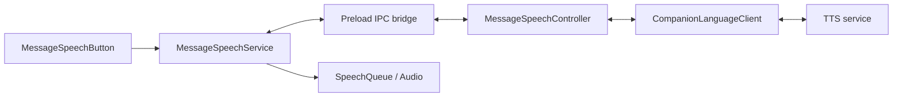

# 消息朗读技术设计

## 目标与交互

在主聊天已完成回复的操作区末尾增加朗读按钮，与分叉、复制并列。首次点击准备并播放音频，再次点击停止。播放直接发生在消息内，不打开悬浮卡片。

未登录时点击按钮展示登录提示，登录完成后由用户再次点击。正在生成、中止、失败以及子 Agent 回复不提供入口；待确认的计划消息也不提供入口。提示文案统一由中英文 i18n 字典管理。

## 模块与数据流

音频事件由主进程客户端经 `MessageSpeechController` 和 preload 桥转发回渲染进程。客户端复用悬浮球已有的鉴权、请求校验、服务调用和流式事件解析；消息朗读使用独立客户端实例，分别管理请求生命周期。

| 模块 | 职责 |
| --- | --- |
| `AssistantTurnBlock` / `AssistantMessageItem` | 将入口限定在合格回合的最后一条回复，子 Agent 默认不开启 |
| `MessageSpeechButton` | 提取可朗读文本，展示喇叭、加载与停止状态，处理点击 |
| `MessageSpeechSession` | 挂载会话连接，随账号变化重建连接，管理登录提示及错误提示 |
| `MessageSpeechService` | 保存当前消息和请求标识，协调单一播放器，处理事件及缓存重播 |
| `MessageSpeechController` | 校验 IPC 来源，维护主窗口请求，转发事件并响应窗口生命周期 |
| `CompanionLanguageClient` / `SpeechQueue` | 复用既有 TTS 请求与分段播放能力 |

## IPC 与请求归属

preload 暴露 `window.electron.messageSpeech`，通道名称集中定义在共享模块：

| 通道 | 方向 | 内容 |
| --- | --- | --- |
| `cowork:speech:start` | Renderer → Main | `requestId`、`sessionId`、`messageId`、正文文本 |
| `cowork:speech:stop` | Renderer → Main | 待停止的 `requestId` |
| `cowork:speech:event` | Main → Renderer | 带 `requestId` 的音频、完成或错误事件 |
| `cowork:speech:reset` | Main → Renderer | 已结束归属的 `requestId` |

主进程仅接受主窗口主 frame 的调用，窗口隐藏时拒绝开始请求。每次新播放生成独立 `requestId`；主进程与渲染进程均按当前归属过滤事件，旧请求的延迟音频、错误或停止操作不能影响新请求。

渲染进程的登录态用于展示交互，实际请求继续使用主进程现有鉴权链路。鉴权失败会停止播放并展示登录提示，不自动排队重试。

## 播放状态与资源释放

`MessageSpeechService` 挂在会话层，位于虚拟化消息行之外。消息滚出视口时，播放器不会随行组件卸载；切换会话或账号时，连接清理函数会终止请求并释放音频。

| 状态或操作 | 行为 |
| --- | --- |
| 点击可朗读消息 | 进入 `Loading`，发起 TTS 请求 |
| 音频分段到达 | 按序加入 `SpeechQueue`，开始或继续播放 |
| 准备中或播放中再次点击 | 停止请求，清空音源与缓存，恢复空闲状态 |
| 点击另一条消息 | 停止当前请求，再为新消息创建请求 |
| 全部音频自然播完 | 进入 `Ended`，保留当前连接内的音频缓存 |
| 同一消息、相同文本在 `Ended` 后再次点击 | 从内存重播，无需重新合成 |
| 服务或播放错误 | 停止并清理资源，展示对应提示 |

主窗口隐藏、关闭、重新加载、渲染进程退出以及应用退出时，主进程会中止请求并通知渲染进程重置。音频 URL 的释放与分段调度继续由既有 `SpeechQueue` 处理。

主聊天与悬浮球语音通过 `beforeStart` / `beforeSpeech` 回调互斥。新的 TTS 请求成功开始时，停止另一处的语音；悬浮球侧只终止语音请求，不影响翻译等其他操作。

## 回合结果与历史兼容

逐轮完成结果保存在现有消息 metadata 的 `turnOutcome` 字段中，取值为 `completed`、`stopped`、`failed`，不增加数据库表或迁移。

`bindCoworkTurnOutcomes` 监听运行时完成、中止和错误事件，将结果写入本轮用户消息及末尾助手消息，并广播增量更新。只有会话本身处于完成状态时，完成通知才记为成功；安全中止等会话仍为空闲的路径按中止处理。后续 metadata 更新保留已写入的回合结果。

入口判定优先读取用户消息的回合结果，分页导致用户消息不在当前页时可读取回复自身的结果。错误、超时、不完整、截断、流式状态及运行中子任务都会阻止入口显示。

旧消息缺少逐轮结果时，仅允许会话末轮且会话状态为 `completed` 的回复。更早的旧回合不根据 `isFinal` 推断成功，因为中止回复也可能带有该标记。

## 正文提取

使用已有 `unified`、`remark-parse`、`remark-gfm`、`remark-math` 解析 Markdown，再从语法树生成正文：

- 保留段落、标题、列表、引用、表格、链接标签、行内代码和公式文本。
- 跳过代码块、图片、HTML 节点、链接定义和脚注节点。
- 对标签与地址相同的自动链接，跳过 HTTP、文件及邮件 URL。
- 合并多余空白，保持必要的段落边界；没有可朗读正文时不显示按钮。

## 测试设计

单元测试覆盖 IPC 来源限制、窗口生命周期、过期请求隔离、加载阶段停止、消息切换、自然结束后缓存重播、登录提示、回合结果持久化、历史兼容和 Markdown 正文提取。既有 TTS 客户端、悬浮球与音频队列测试用于覆盖共享链路的兼容性。
