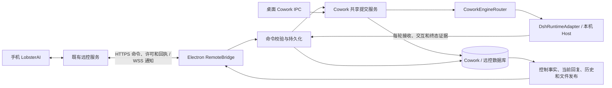

# 手机远程控制迁移到 DSH 的设计方案

状态为桌面主流程已实现，真机联调待验。实施分支为 `feat/dsh-remote-connect`（`002ca97d`），行为基线为 `feat/oc2026.8.1-remote-connect`（`5d54cecf`）。当前桌面锁定的运行时为 `@deepseek-ai/dsh@0.2.2-rc.5`。第 1 至 6 节记录迁移设计和验收条件，第 7 节记录本次桌面实现与验证范围。

## 1. 目标与范围

用户在手机 LobsterAI 中选择同账号在线的电脑和 Agent，能创建、继续或停止电脑上的任务，处理可远程决定的审批和提问，查看回复、附件、产物和积分。电脑上创建的可同步任务也能在手机接续。工作目录、模型执行、工具调用、权限策略和凭据都由这台电脑管理。

迁移沿用旧分支的服务端协议、设备身份、数据归属和同步账本。在 Electron 主进程接入当前 Cowork 提交链路，通过 `CoworkEngineRouter` 调用 DSH。手机继续使用已有的 HTTPS/WSS 服务。桌面仅建立出站连接，DSH Host 和应用的 loopback 工具桥继续限于本机。旧分支另有 OpenClaw 官方 App 直连 Gateway 的说明，属于不同接入方式。

### 用户场景

| 场景 | 用户操作 | 可观察结果 |
| --- | --- | --- |
| 首次使用 | 在电脑与手机登录同一账号，在侧栏查看连接状态，再在手机选择电脑和 Agent | 手机展示该 Agent 在电脑上的任务目录与可选模型。首条消息只出现一次，两端看到同一条任务 |
| 离开电脑 | 桌面发起任务，手机查看文件、回答问题、继续发送 | 两端按同一版本更新。若桌面已作答，手机得到已处理结果 |
| 运行中断网 | 电脑的远控连接断开，随后重连 | DSH 继续工作。手机先看到设备离线，重连后补齐原任务的结果 |
| 旧版升级或切换账号 | 原电脑从 OpenClaw 版升级，或从个人空间切到企业空间 | 可核验的历史保持原设备和任务 ID。新空间只看到属于它的数据。未确认的旧运行进入核对状态 |

## 2. 迁移清单

旧版资料可用 `git show 5d54cecf:<路径>` 在当前分支查看。`docs/server-integration/2026-09-08-mobile-remote-control.md` 记录早期协议，后续取同目录的 `2026-09-23-availability-first-sync.md`（控制/实时/历史）、`2026-10-29-remote-environment-isolation.md`（来源隔离）和 `2026-11-13-mobile-agent-settings-same-account.md`（同账号 Agent 设置），并以末版源码核对。

| 功能 | 从旧分支移植 | DSH 分支需要完成 |
| --- | --- | --- |
| 设备与设置 | `src/shared/remote/{constants,connections,syncTarget}.ts`、`remoteBridge.ts`、`installationIdentity.ts`、设备列表和设置组件 | 接入当前账号、有效服务地址、生命周期、防休眠及 IPC。保留默认值、配额、移除、恢复本机、重注册和状态刷新 |
| 归属与控制 | `remoteStore.ts`、`agentOwnership.ts`、`ownershipAssociation*.ts`、`sessionCommandService.ts`、`sessionDeletionService.ts` | 复用收件箱、运行锁、显式关联和删除协议。重写分发、接收、停止、终态及恢复取证 |
| 同步与历史 | `remoteAvailabilityPublisher.ts`、`remoteHistoryStore.ts`、`remoteLiveProjection*.ts`、`remoteSyncRecovery*.ts` | 对接当前 Cowork 消息事务、编辑/分叉及资料库变更。保留独立的控制、当前展示和历史恢复通道 |
| 模型、文件与产物 | `inputPreparationService.ts`、`remoteModelCatalog.ts`、`remoteFileSync.ts`、`remoteDeliveredFiles.ts`、`remoteArtifactProjection.ts` | 复用输入准备、文件策略、不可变分片和回执。从当前模型选择、媒体附件、交付文件和资料库取数 |
| 手机交互 | `src/shared/remote/{reply,questions,agentSettings,taskCredits}.ts`、旧审批决定服务、Agent 设置服务 | 将 DSH 审批/提问转换为现有协议，接入 Agent 协作策略、设置写入及当前用量账本 |
| 性能与诊断 | `remote-workers.config.ts`、`remoteWorkerPath.ts`、展示健康、日志及诊断模块 | 恢复独立 worker 的开发和安装包入口。远控失败时本地会话、输入和窗口仍可使用 |

## 3. 架构与端到端时序

### 3.1 连接、身份与启动

1. 主进程先安装账号切换屏障，完成本地数据升级和可信写保护。桌面窗口可先打开。认证用户、当前服务路由和初次 DSH 配置准备完成后启动远控连接。每条命令另查当时的模型、目录和 Host 可用性。设置页读取状态只返回快照。
2. 从受信账号资料取服务端数值 `users.id`（旧实现读取 `userId` 或 `id`），生成 `{userId, scopeKey}`，范围为 `personal` 或 `enterprise:<id>`。身份暂缺时等待资料就绪。保留创建时的来源环境、有效路由以及已核验的数据空间。昵称、YID、安装统计 ID 和媒体模块的账号键均不能证明远控归属。
3. 使用当前账号 Bearer 和有效 API 地址调用 `GET /api/remote/v1/capabilities`，检查协议 v1 与 `same_account_access`。按协商版本幂等调用 `/devices/register`，核对设备及 `sync_target_v1` 的 `dataSpaceId/dataGeneration` 后再使用该设备的凭据。普通设备请求带原设备凭据，已协商目标的请求带成对的目标头。旧服务缺少同账号能力时显示需要升级，已有关闭意图仍可按原协议收尾。
4. 用 `/connection-tickets` 申请一次性 ticket，只连接同一 API host 且路径属于 `/api/remote/v1/` 的 WSS。校验 hello、连接代次和心跳。WS 提醒有命令、设备状态或删除操作。权威内容、领取、执行许可、确认和重连核对均走认证 HTTP。设备管理可协商 HTTP v2，已有会话可使用 v3 同步，WS 协议仍为 v1。
5. 开启后沿用旧版带退避的重连、通知合并和周期核对。唤醒时重新取 ticket、核对连接代次及原操作，退出时释放 socket、timer 和 worker。远控初始值对已登录用户为开启，已保存的关闭选择优先。未登录时停用远控。防休眠复用全机 `prevent_sleep_enabled` 和现有 `powerSaveBlocker`，保留显式关闭。旧远控版对已登录且未设值的用户默认开启防休眠，登出释放。本分支现有防休眠默认值是 false，此处是有意的产品行为变更。
6. 切账号、企业范围、有效服务或数据代次时先撤销旧代次的新分发资格，取消旧请求与监听，清理 renderer 快照。对可能继续取模型 token 或执行委派的旧任务，先冻结旧范围的代理请求并核对 DSH 运行归属。无法按轮隔离时先使旧执行者停妥，再注入新账号配置。运行结果仍归原任务。普通远控掉线、关开关或设备被移除只撤销远控准入，不会触发这套账号切换停跑流程。

### 3.2 桌面与手机共用一个提交入口

当前 `src/main/main.ts` 的 `CoworkIpcChannel.SessionStart` 与 `continueCoworkSession` 同时承担 IPC 和业务准备。开始任务会创建会话、先记录用户消息，再以 `skipInitialUserMessage` 交给运行时。IPC 会在后台执行仍在进行时返回。直接复用 handler 会依赖 `event.sender.id`，直接调用 DSH 又会漏掉模型、目录、权限和媒体校验。

拟从上述两处提取 `src/main/libs/cowork/coworkSubmissionService.ts`。共享输入包含 Cowork 会话、来源、稳定提交 ID、账号快照、目录/Agent/模型、已解析的附件和执行许可复检函数。桌面 IPC 保留参数校验、窗口通知和 Companion 统计。手机把经过事务预建的会话和首条消息交给同一服务。两个入口均走现有模型/额度及 preset 检查、目录检查、技能和 Kit 解析、输入准备以及 `CoworkEngineRouter.startSession/continueSession`。

在同一会话的提交临界区检查版本并绑定当前轮。手机续发与桌面编辑、重试、切模型、停止、删除共享这份状态。保留桌面已有队列、steer、编辑、fork 和消息回显语义。手机遇到已有运行或版本冲突时按旧协议返回 busy/conflict 并刷新。每个被接收的排队输入都关联自己的提交 ID。分叉或切换消息版本导致 native 会话变化时，旧轮的回执仍以原绑定核对。

### 3.3 命令、标识与执行证据

| 标识 | 权威来源与用途 |
| --- | --- |
| `deviceId`、`commandId` | 设备 ID 经服务端注册确认。命令提交方生成幂等 ID，桌面沿用该 ID，按 owner、目标、设备和命令 ID 去重，并核对 canonical JSON 请求哈希 |
| 远端 `sessionId`、`runId` | 对手机创建/发送命令，使用服务端随 claim 返回的会话/运行映射。对电脑发起的任务或显式关联的历史，由本地先分配相应 ID 并持久化，随后发布并核对服务端绑定。因此电脑离线也可以新建任务 |
| `localSessionId`、用户消息 ID | 由 Cowork 持久保存，关联两端看到的会话与消息。重连复用原映射 |
| `dshSessionId` | DSH 原生会话 ID。Cowork 可能以 `dsh:<id>` 保存于 `claude_session_id`。当前 `getTurnRunIds()` 返回的也是这个可跨轮复用的 ID |
| `requestId`、原生事件序号/轮次 | 每次提交在首次派发前生成并持久化唯一的 DSH 请求 ID。同一命令复用原值。用 `source.rpcId` 定位原生输入事件，再按该轮的序号范围、turn number 和终态核对执行 |

以手机创建任务为例，续发沿用相同时序并校验 `expectedControlVersion`，v2 准备输入另查 `expectedInputVersion`。

1. `RemoteBridge` 在有效连接代次领取命令，校验请求哈希、租约、过期时间、owner、数据目标、设备、Agent 版本、目录映射及命令类型。文本遵守旧版 16 KiB UTF-8 上限，纯附件请求按 v2 规则验证。
2. 在核心 SQLite 的同一事务记录 inbox 的 `prepared`、远近端会话映射、服务端预分配的 run、预留的本地提交标识。提交成功后才能发 `received`。同 ID 不同哈希进入冲突。同请求重复到达则核对原收件箱和回执。
3. 首次领取用原 `claimId`、`claimToken`、`expectedStatusVersion` 发送确认，只有返回 `status=received` 且原 claim 仍有效才可执行。若服务器已是 applied/rejected/expired，只保存已知结果。执行前通过安全日志与核心事务持久保存 `executing`。在共享入口及实际 `promptSession` 前复检代次、租约、Agent、目录和开关。在副作用可能发生的时点进程退出，保留原 ID 和运行锁进入核对。
4. DSH 接收本轮后才上报 `applied / started`。给 start 和 continue 增加相同的、带绑定的接收回调。当前只有 continue 暴露 `onAccepted`，且不同路径可能在排队或本地处理时触发。远控需要能区分 Host 接收与这些本地结果。`@deepseek-ai/dsh-api-session-controller` 的 `hasPromptRequest` 会对原生会话自己的 user/retry 来源去重，包括已经出队的输入。接收证据为绑定请求的 `accepted:true`，或原生 `user/message`、`agent/inbox/spliced` 匹配 `source.rpcId` 的日志。过滤 `seq < inheritedEventCount` 的分叉继承段。这个证据只代表已入队。观察到该轮真正执行后更新 run 状态，禁止把请求改投分叉出的新 native 会话。先保存证据再发回执。桌面显示 running、首条消息入库和整个 turn Promise 完成都不能单独证明该时点。
5. 在 `dshTurnRecovery.ts` 现有 `admitDshPrompt`、`followDshTurn` 的基础上补持久恢复。活跃提交的传输重试沿用同一 `requestId` 和原许可校验。已被 Host 接收的轮次可以继续观测，不依赖手机保持在线。跨进程恢复先读原生事件并按已存序号补缺。仅当核心账本健康完整、原记录为 prepared 且有从未派发的证明时，才对非审批/提问命令通过 reconcile 申请新 `executionPermit`。已派发的命令按原决定或执行事实核对。执行结果未知只核对或重传相同回执，禁止定时器自动再发 prompt、工具、审批或提问。
6. 终态由绑定到该轮的 DSH 最终事件及 Cowork 持久写入确认后发布。自然结束、出错、主动取消和中断分别保留原远控语义。旧轮迟到的终态、掉线时的 UI error、未知 run、空历史页均不能结束后续轮次。

DSH 还会将文本中的 `/goal` 转入 `executeCommand`，创建和恢复目标可能连续跑多轮。该入口没有普通 `promptSession` 的每轮请求契约。首批在任何副作用前用同一解析规则识别手机的 `/goal` 命令，返回现有的需电脑处理提示。要在手机开放此能力，先为该操作补上稳定 ID、单次分发和多轮终态测试。

### 3.4 停止、删除、审批与提问

手机创建任务时由桌面解析当前的 DSH 权限预设。续发继承该会话的 `read-only`、`workspace-write` 或 `danger-full-access` 策略，远控连接不授予额外工具权限。手机给某一操作的一次性决定只适用于对应的请求。

| 操作 | 实施与确认规则 |
| --- | --- |
| `cancel_run` | 比对目标 run 和 native 请求，持久保存停止意图。旧 run 已有终态可回 `already_terminal`。尚在队列只按匹配的 `itemId` 移除并核对事件。运行中按下述 Host 条件停止，经 `cancel_requested` 后只用本轮匹配的 `turn/end` 等证据确认终态。超时进 `reconciling` |
| 双向删除 | 桌面和手机共用本地删除服务。远程 `delete`、`stop_and_delete` 走独立删除 claim、guard、permit、receipt 协议。保存 native ID、子任务范围和当前 run 后再删行。运行中先取得目标轮停止/终态证明，复查 guard。本地删除、墓碑与回执在同一事务提交，媒体、通知、IM 绑定及 DSH 观察者清理可重试。迟到发布不得复活任务 |
| `approval_response` | 沿用双端决定的版本、摘要、有效期。DSH waterfall 的 `eventId`、tool call、父/子原生会话和远程 run 共同绑定操作。桌面和手机用同一持久化条件更新竞争决定权。可安全展示并支持一次性操作的审批允许“本次允许/拒绝”，其他显示 `waiting_local`。手机不传 `updatedPermissions`、会话永久授权或全局权限预设 |
| `question_response` | 复用旧协议的问题 ID、版本、表单和答案校验，将手机按题 ID 的答案映射为 DSH 的 `{id, selected, custom?}[]`，与 `questionDockModel.ts` 共用纯转换。处理任选、多选、跳过、取消、过期与同时回答。秘密输入走本机。已保存浏览器凭据按旧版的专用选择题，只对绑定到该轮且符合选项限制的请求展示站点/账号选项，决定核验后由桌面取密使用 |

**停止须在 Host 校验目标轮。** 当前 `stopSession` 先清本地状态、发 `sessionStopped`，再异步调用 `session/cancel`。固定版 Host 只取 native 会话 ID，按 `keepInbox:true` 取消，随即返回 `accepted:true`。即使主进程将请求串行，A 自然结束后 Host 仍可能在取消到达前开始执行已入队的 B。为手机停止和 stop-and-delete 增加 Host 所有者侧的条件操作，在同一执行临界区验证预期 request/turn 后再取消。优先使用能保证原子性的现有 Host 接口，缺失时对固定 DSH 版本加小补丁。已完成返回原轮状态，无法核实则继续核对。严禁用“先查当前轮，再发无条件 cancel”填补空缺。

**双端决定须由 Host 证明。** 当前 `respondToPermission` 在本地解除等待后发 `permissionResolved`，找不到请求时可以直接返回。已核对固定版 `@deepseek-ai/dsh-api-gateway` 的 `dispatchRpc` 与 `receiveRemoteEventResult`。在有效连接上，`$events/result` 对已结束事件或失效投递可以返回成功空值。把这个回包经 `DshTypertClient.handleWaterfallFrame` 转发给手机仍会产生假成功。

决定服务需记录与 `eventId`、call、run、决定摘要及赢家对应的 Host 采纳事实。优先复用能同时证明这些字段的持久事件。若缺字段，则在 `scripts/dsh-patches/0.2.2-rc.5/` 增加最小补丁，在实际裁决点记录可查询、可重复读取的回执，保留旧客户端的应答契约。重复提交同一决定返回原回执。提交相反决定只返回原事件已处理。按旧协议区分 `confirmed`、`known_not_applied`、`unknown`。丢 ACK 或重启只查询原决定。未取得可靠证据前，对应交互显示需电脑处理。

## 4. 数据、展示与扩展能力

### 4.1 归属、升级与备份

| 存储 | 保存内容 | 升级约束 |
| --- | --- | --- |
| `userData/lobsterai.sqlite` | Cowork 会话和消息，以及旧版的 `cowork_session_ownership`、Agent 归属/墓碑、`remote_state`、`remote_sync`、执行与决定记录、来源版本 | 沿用旧键、映射和 ACK。新增 DSH 每轮绑定采用增量 schema 和唯一约束。创建会话时在同一事务写归属、创建来源和修订，即使远控关闭也要记录 |
| `userData/remote-control.sqlite`、`userData/remote-sync.sqlite` | 控制和实时发布请求/回执、历史恢复的封存操作和水位 | 沿用旧版侧库标识与迁移阶段，逐库核验。已启用的侧库丢失、错配或损坏时暂停依赖它的通道。独立的通道继续工作 |
| `appData/LobsterAI-remote-identity/<profile-hash>/` | OS 安全存储保护的安装身份、外部 checkpoint、安全日志和分环境注册凭据 | 沿用原 profile 的 `identity.bin`、`checkpoint.bin`、`security-v1/`、`registrations/`。原文件不可解密或数据库发生回滚时隔离远控，保留原材料供核对 |

对已确认归属的会话，桌面 IPC、手机命令、后台同步在访问和修改前均校验当前账号、scope 与来源。覆盖详情、历史、重命名、置顶、编辑、fork、停止和删除，避免只在侧栏过滤后还能凭本地 ID 修改其它账号的任务。真实运行输出依照启动时固定的归属落回原会话。

升级分三条路径执行。

1. **全新安装或只有 DSH 数据。** 建表后仅为新建任务记录可证明的 owner。已有无主会话和 Agent 留在本地，用户可从桌面预览关联范围、确认归属或发布。先校验子树、共享资源、版本和并发写入，再持久化关联。登录、继续旧对话或切换服务均不批量认领历史。fork 和子代理继承已核验的父来源。IM 与定时任务从创建时绑定的自动化来源继承，旧来源缺失则继续本地执行。
2. **同一安装从旧远控版原地升级。** 在任何启动写入前检测旧库的 `remote_write_context`、`agent_write_context` 和触发器。旧库对可信事务外的 Cowork 更改会隔离归属。将原生会话预填（`legacySessionSeeder.ts`）、权限预设迁移、历史图片元数据迁移和正常 Cowork/Agent 写入纳入既有受信事务，异常回滚并恢复标记，保留旧触发器及墓碑。复用当前离线迁移。`claude_session_id` 变为 `dsh:<id>` 只说明历史已绑定。旧 Gateway run/PID、未决输入补丁和审批绝不能据此视为 DSH 在途操作。冻结这些旧操作，按旧 ID 核对已存终态或回执，仅对经证明已结束的会话开放新轮次。已隔离记录保持原状。
3. **复制数据库、恢复备份或换机。** 在 DSH 数据恢复白名单、SQLite 快照与恢复清理流程中检查远控新增表和侧库。用户资料可恢复，设备凭据、有效许可和外部 checkpoint 不作为可移植执行权导出。核心库携带的旧 inbox/回执须按安装身份、数据库水位和同步目标重新核验。失配时关闭旧绑定的分发、上传和删除，保留可读历史。重新注册仅建立新设备关系，不能清空未知命令、重用旧 writer 或擅自重发历史。

### 4.2 同步、文件与模型

- **消息来源。** 从 Cowork 的持久消息增删改、工具状态、资料库关联和终态生成递增 revision，事务提交后唤醒发布。现有 `onSessionProjectionChanges` 只覆盖部分会话元数据。需接入消息写入和删除事务，兼顾桌面发起、手机发起、编辑、fork 和晚到产物。renderer 未打开或进程重启仍可补传。
- **发布与恢复。** 沿用每会话控制事实、当前展示、历史导入和删除的独立调度，保留 writerGeneration、streamEpoch、sourceSeq、importId、分片及 manifest hash。只有匹配身份、范围和水位的正式回执可推进 ACK 与清理。支持 `control_facts_v1` 及 `live_projections_v3` 时按旧协议接管，历史恢复再协商 `sync_recovery_v3`。已接管的 writer 保留原代次。坏历史、单文件失败或遥测失败单独退避，不应占用新命令领取或控制队列。
- **投影版本。** v1 给基础摘要。v2 增加输入/模型摘要。v3 增加文件版本与产物。v4 按桌面可见性提供分块回复、已公开的思考块、工具输入/输出、错误和模型标签。沿用旧过滤、脱敏、分片和超限 `desktop_only` 规则，屏蔽 DSH 隐藏指令、内部事件和凭据。v5 提供公开问题，支持 v6 reader 和 `task_credits_v1` 时附加按个人/企业区分的桌面账本快照，回复正文仍用 v4。账单缺失或未结算保留 partial/unavailable，不用 token 数估算积分。各能力按服务端、桌面实现和每任务就绪条件取交集。
- **输入与模型。** 复用准备、摘要、过期和版本校验。支持新任务继承 Agent、续发保留会话或显式选模型、预设和思考档。用当前 `dshModelSelection.ts` 及 preset 路由得到运行时选择，另存对用户展示的预设和模型名。当前 `patchSession` 可能先改本地模型、Host 未就绪即返回。需区分准备、本地已写、Host 已应用、prompt 已接收，在 Host 应用可证明后才发布配置成功。发送中断时如实公布已确认的配置，核对原 operation 和版本后才能继续。
- **目录与文件。** 每个 Agent 的有效任务目录由主进程解析、取 realpath、验证可用性，持久化只指向该目录的 `workspaceId`。目录变更须产生新的映射。服务器只拿目录展示名、可用性和 ID。选择了 Agent 时使用它已公布的默认目录，续发沿用原会话的 Agent/cwd。显式 Agent 或目录失效即提示刷新。选择器同步协商 `session_agent_v1`、`agent_catalog_v1` 与 `agent_selection_v1`，并核对该 Agent 的 `expectedAgentVersion`。旧手机未指定 Agent 时才走主助手的兼容路径。手机不得提供本机路径。任务 cwd 与 `userData/workspaces/<agentId>/` 的人格/记忆目录各有用途。输入资产通过现有认证文件网关按 preparation 下载或上传，检查 owner、设备、摘要、类型、大小和策略，在本地准备好后才能执行。关联产物在独立 worker 取不可变快照并核验路径及文件版本。回执确认后才展示可下载。保留原文件更改、符号链接越界、策略收紧和空间不足的失败语义。普通对话正文的显式路径按旧回复投影规则显示。

### 4.3 Agent、权限和桌面入口

- 同账号目录发布已授权 Agent 的名称、状态、版本、头像键（含已安装专家）、默认目录、模型和思考档。主助手 `main` 标明本机共享语义。其他 Agent 须核对归属与来源。新建和续发前重新验证 Agent 未删除、已启用、目录仍匹配。匿名、本就隔离或其他账号的 Agent 不可供手机选择。
- 手机 Agent 设置沿用 `agent_settings_v1` 的同账号自动绑定。按完整分页维护设备 grant、bindingVersion 和 accountEpoch。模型和协作按版本直接保存。身份、记忆、关于你按需读取，正文修改须经目标会话的提案、摘要、单次审批和持久回执。通过应用的 Agent 设置/记忆服务读写和刷新 DSH 配置。自定义 Agent 身份以应用记录为准。对话设置工具经 DSH host bundle 的现有工具桥接入，验证会话、Agent、run 和分区，验收前保持 `conversationUpdate=false`。
- 当前 `dsh-bundles/lobsterai-host/plugins/agent-delegation.mjs` 及其 helpers 从已同步的 Agent 配置解析委派。DSH 的协作模式为 `all / allowlist / disabled`，旧手机协议只表达已选 Agent 列表。显式 allowlist 可双向映射，并在读写时核对候选 Agent 版本。对不能无损表达的模式，保留本机值，按旧协议的受限/需本机处理语义回应。如手机需完整编辑三态，单列为需手机与服务端共同协商的兼容增量。运行时的候选目录与实际 `delegate_agent` 派发都取“本轮所有者可访问的 Agent ∩ 当前 DSH 协作策略”，子任务继承账号和目录约束。手机不借用 IM 或调度器的自动批准路径。
- 桌面恢复侧栏手机入口、连线说明和“远程设备”设置页。二维码打开 LobsterAI 官网，手机与电脑通过同账号登录建立连接。展示改名、远控/防休眠开关、查看与移除连接、恢复本机、额度/退役提示、日志和重试。任务详情展示实时/历史/文件同步健康，匿名历史可预览关联及发布结果。设备在线、任务运行、内容已同步分别用独立字段。renderer 经过 `services/`、preload 到 `ipcHandlers/remote/` 和归属 handler，沿用旧 IPC 常量与签名（含兼容 `remote:decide`），异步变更校验 `expectedAccountEpoch`，过期状态按 `stateRevision` 丢弃，中英文文案同步补全。

## 5. 实施顺序与代码落点

旧实现按模块和对应测试移入，主进程、迁移器、权限与构建配置按当前分支增量接线。旧 `advertisedCapabilities()` 会默认公告续发、取消和审批。需用同一份“本机已实现且已验证”的能力表约束设备注册、设置 PATCH、输入 `purposes`、WS 重连后的新命令领取和执行前校验。已接收操作仍保留原协议的核对入口。如果现网服务要求完整 v1 基础能力，阶段 2 使用停发新命令的测试服务验证只读流程，所有服务端必选能力均已实现并通过验收后再向真实账号开放。

| 阶段 | 涉及文件与交付 | 进入下一阶段的条件 |
| --- | --- | --- |
| 1　契约与升级 | 移植 `src/shared/{remote,ownership}/`、归属/身份、核心库与侧库，接入 `src/main/{coworkStore,sqliteStore,agentManager}.ts`、`migration/`、`libs/dataMigration/`。准备新 DSH、旧远控、回滚/复制三类脱敏 SQLite fixture 及固定协议样例 | 两次升级结果一致，confirmed owner、墓碑、ACK、旧 run 和禁用偏好保持。全新本地用户可照常使用 |
| 2　设备上线与只读同步 | 接入 `src/main/remote/`、建议新增的 `ipcHandlers/remote/handlers.ts`、`preload.ts`、`src/renderer/types/electron.d.ts`、`components/remote/`。在主进程装配账号、设置、发布与关闭流程。恢复 worker 构建 | 手机可发现设备、查看同源桌面任务和真实同步状态。跨账号/环境与后台故障不泄露数据，不影响本地任务 |
| 3　DSH 最小闭环 | 提取共享提交服务，在 `libs/agentEngine/{types,coworkEngineRouter,dshRuntimeAdapter}.ts` 接入每轮证据和停止时序。恢复逻辑放 `libs/dsh/`，命令账本留在 `remote/`。同时接入 Agent 目录/选择、模型目录和 v2 纯文本输入准备，并在 Host 完成 owner 约束与委派前复检 | 同一手机可选 Agent，在其绑定目录发文本、收到流式答复、续发、取消。桌面可接续。重复投递、断连和进程重启均不重复执行，不能委派给其他账号的 Agent |
| 4　功能对齐 | 补齐附件输入、文件、审批、提问、删除、Agent 设置及积分。适配 `dshTypertClient.ts`、`dshSubagentSessions.ts`、`dsh-bundles/lobsterai-host/`、资料库、浏览器凭据与用量模块 | 按能力逐项验收。双端决定、设置与删除竞争只有一个有效结果。所有已接受操作能核对 |
| 5　打包与灰度 | 对照旧 `remote-workers.config.ts` 在当前 Vite、`package.json` 开发等待脚本和 `electron-builder.json` 恢复 8 个独立 worker（文件快照、投影、实时投影、网络、展示健康、安全日志、导入快照、历史保护）。校验 `asarUnpack` 和 `better-sqlite3` 加载路径 | 开发与安装包均能运行，现有 DSH 启动与禁用上游遥测的检查通过，再进行真实手机灰度 |

**大文件抽取的评审范围。** `main.ts` 只保留 IPC、桌面专有回调和依赖装配。共享服务接管 start/continue 的参数准备、建会话/消息事务、权限与模型检查及引擎分发。`dshRuntimeAdapter.ts` 保留原生事件翻译，拟将每轮接收/终态关联及恢复查询提取为 `libs/dsh/dshRemoteTurnEvidence.ts`，以类型化回调交回命令服务。迁移顺序为先用桌面既有测试锁定 IPC 回包、首条消息、排队/编辑、权限和流事件，再抽取并接入手机测试。该提案供实施前确认。

## 6. 验收、发布与回退

| 验收项 | 操作与通过条件 |
| --- | --- |
| 协议与客户端兼容 | 用旧分支 golden 请求与回执比对 API 路径、字段、哈希、版本、错误码和缺能力时的行为。在测试服务用现有手机分别验证首次注册、同账号发现、移除与仅恢复本机、配额、旧服务、升级前显式关闭 |
| 一轮只执行一次 | `/goal start/resume/pause` 在手机不支持时须在分发前返回。另在普通文本命令的 claim、`received`、持久 `executing`、Host 接收、终态写库及 `applied` 应答前后逐点断连/杀进程。用 SQLite 和 DSH 日志核对同一 command 的本地会话、用户消息、原生请求和一次可计数的工具调用。未知结果停在核对，不产生第二次副作用 |
| 取消与删除竞争 | B 已入队时 A 自然结束且取消 RPC 晚到、分叉后回放 A 的继承输入、A 的迟到终态、双端同时停止/删除、删除提交后丢回执。只有匹配的轮次被停止，已删任务不会被晚到投影恢复，B 仍可执行 |
| 审批、问答与权限 | 覆盖三种 DSH 权限预设、桌面/手机同时决定、迟到或丢失 Host ACK、已过期、新旧请求复用场景、子代理及浏览器凭据选择。最多一个决定落地。过期事件即使收到 Host 成功空回包也不得确认。需本机处理的请求和密钥不会经手机协议执行或上传 |
| 归属与升级 | 实测旧版原地升级、已经跑过 DSH 迁移的旧库、已有禁用偏好、空/坏侧库、锁定的安全存储、恢复到另一安装。用两个账号及个人/企业、测试/生产交叉切换。晚到 HTTP、旧 Agent/IM/定时任务和子任务无跨域读写，原会话和本地历史可核对 |
| 输入与结果对齐 | 两端核对文本/纯附件、图片与普通文件、模型预设与 thinking、工具块、产物版本与下载、专家头像、任务积分、消息编辑/分叉、资料库晚到关联。对丢分片、版本冲突、缺额度和不可用目录展示具体失败，不误报已同步 |
| 本地回归与性能 | 断远控网络、慢历史导入、worker 崩溃、SQLite 锁定时，在桌面发任务、输入、切会话和打开设置。沿用旧 `remoteDisplayResponsiveness.test.ts` 的父进程定时器/loopback 测试阈值（p95 ≤ 100 ms，p99 ≤ 250 ms，最大 ≤ 500 ms）。验证故障局限于相应通道 |

实施后运行定向 Vitest，至少覆盖移植的 `remoteBridge`、`remoteStore`、`sessionCommandService`、`remoteWorkers.packaging`，以及当前 `dshTurnRecovery`、`dshRuntimeAdapter`、`agentManager.integration`、`legacyOpenClawMigrator`、`dshImInboundHandler`、`dshScheduledTurn` 和受影响的 renderer 纯逻辑。执行 `npm test`、`npm run compile:electron`、`npx tsc`、`npm run build` 和变更文件的 CI ESLint。使用隔离的测试 profile 在 `npm run electron:dev:dsh` 验证启动、配置、事件与接续。涉及 bundle 或运行时补丁时再跑 `npm run dsh:upgrade-check`、`npm run dsh:runtime:verify`、`npm run dsh:e2e`。用 macOS 和 Windows 安装包验证 worker、系统安全存储和真机端到端。

灰度先核验设备/任务可见性及旧库升级，再启用新命令，最后逐批公告已验证的扩展能力。观察命令重复/未知、执行接收与终态、ACK 积压、会话隔离和 worker 重启。诊断只记关联 ID、阶段、错误码、延迟与计数。发生协议或恢复问题时，先停止新命令准入，保留本地任务、匹配的原回执及已接管的同步账本。需要暂停某个扩展能力时单独撤销其准入。恢复服务后先核对原操作再续传。软件降级涉及数据库与本机安全 checkpoint 的配对，仅在升级 fixture 完成往返验证后允许使用旧版本接管。

**联调依赖。** 目标服务实际公告的 capabilities、现网手机 reader 版本、新补的 DSH 决定/取消证据能否覆盖丢 ACK 与重启，以及旧手机协作页面对受限模式的呈现。这四项分别决定各能力何时可开。前三阶段的桌面实现和故障注入测试可使用固定协议样例推进。

## 7. 本次实施与验收记录

| 部分 | 实际接入点与行为 |
| --- | --- |
| 登录和设备 | Electron 在离线迁移与 DSH 初始配置完成后读取当前账号的启用偏好。访客与明确禁用远控的账号启动时跳过远控身份及传输初始化。登录、企业空间与服务地址更新会重新核对归属；切换期间停止旧 Host，重新同步 DSH 配置。只有桌面主窗口主 frame 能调用设备配置、连接管理与本地归属 IPC。 |
| 手机与桌面执行 | 设备 claim/inbox 和桌面 IPC 共用 Cowork 提交入口。文件准备前预留 run，发送前在 SQLite 绑定手机 run、Cowork 会话、DSH 原生会话与固定 requestId。手机等待实际接收，桌面保持即时响应。队列清理、窗口完成通知或超时不能替代手机的原生终态证据。 |
| 运行与授权 | 注册、能力更新与新命令准入受固定版 Host 运行时探测约束。取消按原生轮次核对，委派前重新核对根 Agent 与目标 Agent 的归属、启用状态、版本和当前协作策略。远端审批、提问与桌面端共用仲裁。浏览器凭据和媒体确认保留本机交互。 |
| 数据与同步 | 复用原设备身份、命令账本、目标分区、回执、安全日志与文件同步机制。旧版远控数据不随 OpenClaw 退役模块归档。未归属数据通过显式关联处理。DSH 的 IM 和定时任务按配置来源核验账号。 |
| Agent 设置 | 模型和显式协作名单经版本、归属与写租约校验后应用。DSH 的“全部”和“禁用”协作模式在旧手机协议上按只读处理。远控会话的 DSH 工具可按绑定 grant 读取身份、记忆和用户资料。固定版 DSH 目前无法为工具执行中产生的提案签发匹配摘要的单次决定，因此保持 `conversationUpdate=false`，手机和工具均无法提交这类写入。 |
| 客户端与构建 | 恢复桌面侧栏、远控与设备管理页、审批状态和中英文文案。开发及打包配置生成 8 个独立 worker，远端传输继续通过既有服务端协议。 |

### 验证结果

| 验证范围 | 本次结果 |
| --- | --- |
| 仓库回归 | `npm test -- --maxWorkers=3` 运行 1,029 个测试文件，12,044 项通过，21 项跳过。Electron 主进程编译、前端类型检查、生产构建和变更文件的 CI ESLint 均通过。 |
| DSH | 锁定版本的 Host 构建、`dsh:runtime:verify`、`dsh:upgrade-check` 和 `dsh:e2e` 通过。使用真实 Host 与本地模型替身验证了同一 requestId 重送、两轮排队、第一轮迟到的取消、精确取消第二轮、重启后按原事件标识与摘要取回决定，以及按游标补齐回复且不重复。 |
| 桌面与打包 | 在临时用户目录启动 macOS Electron，实际打开侧栏入口、二维码和远程设备页，核对访客开关、页面重开及设备身份文件的创建条件。另生成未签名的 macOS arm64 `.app`，逐个确认 8 个 worker 在 ASAR 索引中的解包标记、运行时实际路径，以及与 Vite 产物一致的文件摘要。 |

### 联调与能力边界

- 真机同账号登录后发现电脑、手机发起任务、桌面接续，以及生产服务能力协商仍待联调。Windows 安装包的 worker 启动和系统安全存储，以及 macOS 签名、公证后的分发包仍待实机验收。
- 手机 `/goal` 和涉及敏感信息的审批留在桌面处理。遇到仍在运行的子任务、无法唯一定位取消目标时，保留待核对状态。身份、记忆和用户资料在远控会话中只读。
- DSH 模型切换发出后若回执丢失，且无法证明原写操作已结束，后续发送保持阻塞，直到取得原操作的证据。
