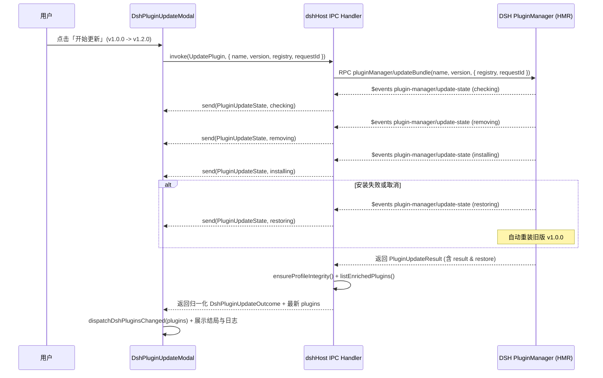

# DSH 插件检查更新与热更新设计文档

> 本文档为 LobsterAI 全面切换至 DeepSeek Harness（DSH）引擎后的插件更新方案设计，承接 [2026-11-20-openclaw-to-dsh-migration-design.md](../../refactors/deepseek-harness-migration/2026-11-20-openclaw-to-dsh-migration-design.md) 与 DSH 插件生态管理（commit `7e219ecb3`），替代旧 OpenClaw 时代的 [2026-05-28-plugin-update-check-design.md](./2026-05-28-plugin-update-check-design.md)。

---

## 1. 概述

### 1.1 问题/背景

LobsterAI 已完成 DSH 插件生态基础能力（列表展示、包预检、多源安装、取消安装、启停热切换、卸载、表面分类及侧边栏内嵌面板），但**尚未提供插件版本检查与更新能力**：

1. 用户通过 npm Registry 安装第三方 DSH 插件后，无法在 LobsterAI 原生界面得知是否有新版本发布，也无法得知新版本是否兼容当前内置 DSH 运行时版本（如 `0.2.2-rc.5`）。
2. 在启用 HMR 的 DSH Profile 中，直接原地覆盖安装已装插件会触发 `already-installed` 拒绝；若用户手动「先卸载再重装」，一旦新版安装失败或网络中断，旧版已丢失且无法自动恢复。
3. 用户在内置 `dsh` CLI 或「DSH 高级 Web 视图」中完成插件更新/变更后，LobsterAI 主窗口插件列表与侧边栏不会自动感知刷新。

另一方面，内置的 `@deepseek-ai/dsh@0.2.2-rc.5` 后端（`@deepseek-ai/dsh-plugin-manager`）已经原生提供 `pluginManager/listVersions` 与 `pluginManager/updateBundle` 两个 Typert RPC，以及 `plugin-manager/update-state`、`plugin-manager/changed` 实时推送事件；DSH 官方客户端（`@deepseek-ai/dsh-client-ui-plugin-manager`）亦沉淀了成熟的候选版本筛选、步骤状态机与失败回滚反馈交互。LobsterAI 无需重复造轮子（如自己拼 `npm view` 或手写卸载重装），只需在宿主侧补齐 RPC/事件桥接、完整性保护与原生 UI 即可。

### 1.2 目标与范围

**本期目标**：

- **聚焦第三方 npm Registry 插件**：仅针对用户通过 npm Registry 安装的第三方 DSH 插件提供版本检查与热更新；DSH 官方内置组件与 16 个随 `dsh-runtime` 打包的可选官方扩展随 LobsterAI 客户端升级自动更新，不在插件管理页提供单独更新入口。
- **手动触发版本检查**：支持在插件设置页一键批量检查所有可更新的第三方插件，以及对单个插件按需展开「版本」抽屉查看可用高版本列表与重新检查；不做后台静默轮询，避免无预期网络请求。
- **兼容性与稳定性过滤**：直接消费 DSH `pluginManager/listVersions` 的语义化版本、标签、`dsh.bundle` 声明、废弃标记与 `engines.dsh` / peer 兼容性评估结果，默认推荐最新兼容稳定版，并清晰说明被拦截版本的具体原因。
- **HMR 热更新与自动回滚**：通过 DSH `pluginManager/updateBundle` 实现「前置校验 → 卸载旧版 → 精确安装新版 → 失败自动回滚旧版」四步原子更新，全程实时推送步骤状态，多数场景免重启热生效；需要重启时给出明确原因与一键重启入口。
- **跨端变更联动与宿主保护**：订阅 DSH Host 的 `plugin-manager/changed` 事件，自动同步列表、失效过期版本缓存并刷新侧边栏内嵌入口；每次更新结算后确保 LobsterAI 托管层（`@lobsterai/dsh-bundle`、`@lobsterai/dsh-channels`）完整性。

**本期非目标**：

- 不修改 `@deepseek-ai/dsh` 源码，不新增运行时补丁。
- 不做定时/启动自动后台轮询检查。
- 本期不实现 DSH 官方包（含 2 个未随安装包内置的按需官方包 `@deepseek-ai/dsh-subagent-claude-code` / `@deepseek-ai/dsh-subagent-codex`）的独立更新分支：随 `dsh-runtime` 打包的官方组件随 LobsterAI 客户端升级自动更新；少数用户手动安装的按需官方包若后续版本滞后，可通过卸载重装或 DSH 高级 Web 视图处理，避免本期引入额外无回滚路径。
- 本期不引入 DSH 插件市场 Discover 页面（`pluginMarket`）及不兼容版本强行豁免（`setVersionExemption`）UI；但后端与 IPC 契约为后续 Git Pinned Commit 更新预留 `spec` 参数。
- 不支持 DSH Host 离线时通过外部 CLI 拼接离线更新（避免丢失前置兼容校验与自动回滚保障）。

### 1.3 不同来源插件的更新策略矩阵

| 插件类别 | 判定依据（`DshPluginBundleInfo`） | 检查更新机制 | 更新执行方式 |
|---|---|---|---|
| **LobsterAI 托管核心组件与随包官方扩展**（`dsh-base` / `dsh-web-app` / `@lobsterai/*` / `availability === 'installation'`） | `managed === true \|\| availability === 'installation'` | 随 LobsterAI 客户端发版自动更新 | 客户端升级后由 `ensureAppOwnedProfile` 自动刷新链接，不在插件页单独更新 |
| **npm Registry 第三方插件（本期核心）** | `!managed && !official && update === 'registry'` | 调用 `pluginManager/listVersions`（支持主源 + fallback 降级） | 调用 `pluginManager/updateBundle(name, version, { registry, requestId })`，HMR 四步热替换 + 失败自动回滚 |
| **DSH 官方按需包**（`dsh-subagent-claude-code` / `codex`） | `!managed && official && availability === 'profile'` | 本期不纳入检查更新 | 暂通过卸载重装或高级 Web 视图升级，视后续用量决定是否接入 `installTarget` 自动同步 |
| **Pinned Git 插件**（40 位完整 commit hash） | `!managed && !official && update === 'git'` | `listVersions` 不支持；需由未来市场索引提供目标 commit spec | 契约预留 `spec` 字段直通 `updateBundle`；本期不参与自动版本检测 |
| **普通 Git / 本地目录（`file:`/`link:`）/ Tarball** | `!managed && !update` | 不参与检查（无唯一可回滚版本源） | 界面不显示更新按钮；`link:` 本地开发直接改文件走 HMR，其余通过卸载重装更新 |

---

## 2. 用户场景

### 场景 1: 手动批量检查更新并发现新版本

**Given** 用户已安装第三方 npm 插件 `dsh-plugin-foo@1.0.0`（最新稳定版 `1.2.0`）与 `dsh-plugin-bar@2.0.0`（已是最新）  
**When** 用户在设置 → 插件生态页点击工具栏「检查更新」按钮  
**Then** 系统先刷新插件列表，再按包串行调用版本检查；工具栏显示汇总提示「发现 1 个可更新插件」，`dsh-plugin-foo` 卡片出现 `→ v1.2.0` 徽标与「更新」按钮，`dsh-plugin-bar` 保持简洁无多余提示。

### 场景 2: 一键热更新至最新稳定版

**Given** `dsh-plugin-foo` 显示可更新至 `v1.2.0`  
**When** 用户点击「更新」，在确认弹窗核对 `v1.0.0 → v1.2.0` 及来源 Registry 后点击「开始更新」  
**Then** 弹窗进入执行态并实时展示步骤条（校验目标版本 → 卸载旧版 `v1.0.0` → 安装新版 `v1.2.0`）；更新完成后提示「已更新至 v1.2.0 并热重载生效」，关闭弹窗后列表版本号刷新为 `v1.2.0`，若插件面板信息变化则侧边栏自动同步。

### 场景 3: 展开版本列表查看所有高版本与不兼容提示

**Given** `dsh-plugin-foo@1.0.0` 在 npm 上发布了 `1.1.0`（兼容）、`1.2.0-beta.1`（预发布）、`2.0.0`（声明 `engines.dsh: ">=0.3.0"`，不兼容当前 `0.2.2-rc.5`）  
**When** 用户展开该插件的「版本」抽屉  
**Then** 默认展示最新稳定推荐 `1.1.0` 和被拦截的 `2.0.0`（灰显，说明需要 `engines.dsh >=0.3.0`，当前为 `0.2.2-rc.5`）；勾选「显示预发布版本」后可见 `1.2.0-beta.1` 并允许手动点击对应行的「更新」。若所有稳定高版本均不兼容，摘要行明确提示「存在新版本但与当前 DSH 运行时不兼容」。

### 场景 4: 更新失败并自动回滚至旧版

**Given** 用户确认将 `dsh-plugin-foo` 从 `v1.0.0` 更新至 `v1.2.0`，卸载旧版后下载或启用新版失败  
**When** DSH Host 自动触发第 4 步 `restoring` 重装 `v1.0.0`  
**Then**
- 若回滚成功：弹窗步骤条标红 `installing`、标绿 `restoring`，明确提示「更新至 v1.2.0 失败，已自动恢复至原版本 v1.0.0」，并提供折叠面板查看失败步骤的原始 pnpm 日志。
- 若回滚也失败：弹窗显示红色严重告警，提示旧版未能自动恢复，引导查看日志并手动重新安装。

### 场景 5: 更新成功但需要重启引擎

**Given** 目标插件改动触及宿主模块或处于无法热替换状态，DSH `updateBundle` 返回 `application: 'restart-required'`  
**When** 更新完成  
**Then** 弹窗展示黄色提示「已更新至 v1.2.0，需重启 DSH 引擎后生效」并附带重启原因，同时主页面顶部展示「需要重启引擎」横幅与「立即重启」按钮。

### 场景 6: 网络故障与多源降级排查

**Given** 用户网络无法连接 `registry.npmjs.org`，或所有配置源均不可达  
**When** 用户点击「检查更新」  
**Then**
- 若主源失败但 fallback 源（如 `npmmirror`）成功：正常展示版本结果，并在版本抽屉元信息标注使用了回退源。
- 若所有源均失败：汇总栏提示检查失败，对应插件版本抽屉展示具体错误、每次尝试的 Registry 列表及「重试」按钮，且不影响其他插件的检查结果。

### 场景 7: 外部变更自动联动

**Given** 用户在设置页停留，同时在终端使用内置 `dsh` CLI 或在「DSH 高级 Web 视图」更新/卸载了某个插件  
**When** DSH Host 发出 `plugin-manager/changed` 事件  
**Then** LobsterAI 主进程将该事件广播至渲染层，插件列表自动重新拉取，已变化或已卸载插件的旧版本检查缓存立即清除，侧边栏面板入口同步更新。

---

## 3. 功能需求

### FR-1: 可更新能力识别与元数据透出

- `DshEnrichedPluginEntry` 与渲染层 `DshPluginEntry` 新增透出字段：
  - `availability?: DshPluginAvailability`（`'installation' | 'profile' | 'missing'`）
  - `update?: DshPluginUpdateKind`（`'registry' | 'git'`）
  - `source?: string`
- `listBundles` 不可用（降级读 `package.json`）时，上述字段留空，界面自动禁用检查更新与更新操作。
- 只有第三方 npm Registry 插件（`!plugin.managed && !plugin.official && plugin.update === 'registry'`）参与更新检查与更新操作。

### FR-2: 手动触发版本检查与缓存治理

- **批量检查入口**：工具栏提供独立「检查更新」按钮（当存在至少 1 个第三方 Registry 插件且引擎为 `ready` 时可用）。
  - 执行顺序：先拉取最新 `listPlugins()`，再对所有第三方 Registry 插件**逐包串行**调用 `checkPluginVersions(name)`（避免叠加单包内部 `versionLookupConcurrency = 4` 导致并发风暴）。
  - 正在执行更新的插件跳过检查，避免用旧版本结果覆盖状态。
- **单包检查入口**：用户展开任意第三方 Registry 插件的「版本」抽屉时，若尚未检查则懒加载执行一次 `ensureVersions(name)`；已检查的提供「重新检查」按钮。
- **过期缓存清理（`dropStaleVersions`）**：每次 `listPlugins()` 返回新列表后，自动移除满足以下任一条件的缓存条目：
  - 插件已不在列表中或不再属于第三方 Registry 插件；
  - 已完成的 `listed` 缓存中 `list.installed !== plugin.version`（说明插件已在其他入口完成升级/重装）。

### FR-3: 候选版本筛选与兼容性展示

- 完全对齐 DSH 客户端判定规则：
  - `isPluginVersionInstallable(version)`：`version.bundle === true && version.incompatible === undefined`。
  - `pickRecommendedPluginUpdate(list)`：在 `status === 'listed'` 的 `versions`（后端已按 `semver.rcompare` 降序排列）中取首个满足 `isPluginVersionInstallable(v) && !v.deprecated && !v.prerelease` 的版本。
- 版本抽屉展示（默认折叠，保持卡片列表清爽）：
  - 摘要行给出 5 种清晰状态：检查中 / 有推荐更新 `vX.Y.Z`（含发布日期）/ 已是最新（含检查时间 `HH:MM`）/ 有更新但不兼容或无可安装稳定版 / 检查失败。
  - 展开列表默认隐藏 `prerelease`，若存在预发布版本则提供「显示预发布版本」复选框；不可安装版本灰显并显示原因（`engines.dsh` / peer 需求、非 bundle、或 `deprecated` 提示）；底部展示已安装当前版本行、命中的 Registry（含回退标识）以及被截断的 `omitted` 数量提示。

### FR-4: 热更新执行、实时进度与自动回滚

- 通过 `pluginManager/updateBundle(name, version, { registry?, spec?, requestId })` 执行更新。
- 每次更新由渲染层生成唯一 `requestId`（如 `update-${Date.now()}-${rand}`），在弹窗内跟踪 `checking → removing → installing → restoring` 四个阶段。
- Host 通过 `$events` 推送 `plugin-manager/update-state`，主进程转发至渲染层；渲染层使用 `mergeSettledUpdateSteps(announced, result)` 将已收到的事件与最终返回结果隐含的步骤合并，确保断链或丢帧时不遗漏已跑步骤。
- 弹窗更新进行中（`phase === 'running'`）禁止通过遮罩点击、Esc 或关闭按钮关闭，防止用户误以为已中断。
- 结果分类覆盖 8 种结局：
  1. `applied`：热更新生效；
  2. `restart-required`：已更新，需重启引擎（附 `restartReason`）；
  3. `check-refused`：前置校验拒绝（旧版未动）；
  4. `remove-failed`：卸载旧版失败（旧版未动）；
  5. `install-failed-kept`：无 HMR 原地安装失败且回滚（旧版未动）；
  6. `install-failed-restored`：新版安装失败，但旧版已自动恢复；
  7. `install-failed-broken`：新版安装失败，且旧版恢复也失败（需手动重装）；
  8. `transport-lost`：IPC/连接异常导致响应丢失（提示刷新确认实际状态）。
- 若失败结果携带 `packageResult.output`，弹窗提供可折叠的「查看详细日志」区域展示完整输出。

### FR-5: 跨端事件联动与宿主完整性保护

- 每次 `UpdatePlugin` 结束后（无论成功、失败或回滚），主进程必须调用 `manager.ensureProfileIntegrity?.()` 守护 `@lobsterai/dsh-bundle` / `@lobsterai/dsh-channels` 依赖与符号链接。
- 更新后通过 `listEnrichedPlugins` 重算 `surface`、`isThemePlugin`、`panelId`、`panelLabel`，并在渲染层派发 `dispatchDshPluginsChanged(plugins)`，确保侧边栏内嵌入口实时更新。
- 主进程桥接 DSH Host 的 `remote:plugin-manager/changed` 到渲染层 `DshHostIpc.PluginsChanged`：`DshPluginEcosystemView` 与 `Sidebar.tsx` 在收到外部变更时自动触发列表刷新（带防抖/去重，避免自身操作重复拉取）。

### FR-6: 国际化与视觉风格

- 所有新增用户可见文案统一写入 `src/renderer/services/i18n.ts` 的 `zh` 与 `en` 词典，禁止硬编码。
- 按钮与弹窗样式遵循当前主题 Action Button Token（`bg-action` / `hover:bg-action-hover` / `text-action-foreground`）及 `SettingsTypography` 规范。

---

## 4. 实现方案

### 4.1 总体架构与时序

```mermaid
flowchart LR
    subgraph Renderer["Renderer Process"]
        View["DshPluginEcosystemView"]
        Modal["DshPluginUpdateModal"]
        VM["pluginUpdateViewModel (Pure)"]
        Svc["dshHostService"]
    end

    subgraph Preload["Preload Bridge"]
        API["window.electron.dshHost"]
    end

    subgraph Main["Main Process"]
        IPC["ipcHandlers/dshHost/handlers.ts"]
        Cls["pluginClassification.ts"]
        HostMgr["DshHostManager"]
        Typert["DshTypertClient"]
    end

    subgraph DSH["DSH Host (0.2.2-rc.5 + HMR)"]
        PM["@deepseek-ai/dsh-plugin-manager"]
        Ev["$events Stream"]
    end

    View --> VM
    Modal --> VM
    View --> Svc
    Modal --> Svc
    Svc --> API
    API -- "invoke: CheckPluginVersions / UpdatePlugin" --> IPC
    IPC --> Cls
    IPC --> HostMgr
    HostMgr --> Typert
    Typert -- "RPC: listVersions / updateBundle" --> PM
    PM -- "plugin-manager/update-state & changed" --> Ev
    Ev --> Typert
    Typert -- "remote:* EventEmitter" --> HostMgr
    HostMgr -- "webContents.send" --> API
    API -- "onPluginUpdateState / onPluginsChanged" --> Svc
```



单次 Registry 插件热更新时序：



### 4.2 共享常量与类型契约

文件：`src/shared/dshEngine/hostConstants.ts`

遵循仓库 `as const` 规范新增常量与 IPC 通道名：

```ts
export const DshPluginUpdateKind = {
  Registry: 'registry',
  Git: 'git',
} as const;
export type DshPluginUpdateKind = typeof DshPluginUpdateKind[keyof typeof DshPluginUpdateKind];

export const DshPluginAvailability = {
  Installation: 'installation',
  Profile: 'profile',
  Missing: 'missing',
} as const;
export type DshPluginAvailability = typeof DshPluginAvailability[keyof typeof DshPluginAvailability];

export const DshPluginUpdateStep = {
  Checking: 'checking',
  Removing: 'removing',
  Installing: 'installing',
  Restoring: 'restoring',
} as const;
export type DshPluginUpdateStep = typeof DshPluginUpdateStep[keyof typeof DshPluginUpdateStep];

export const DshPluginUpdateOutcomeKind = {
  Applied: 'applied',
  RestartRequired: 'restart-required',
  CheckRefused: 'check-refused',
  RemoveFailed: 'remove-failed',
  InstallFailedKept: 'install-failed-kept',
  InstallFailedRestored: 'install-failed-restored',
  InstallFailedBroken: 'install-failed-broken',
  TransportLost: 'transport-lost',
} as const;
export type DshPluginUpdateOutcomeKind =
  typeof DshPluginUpdateOutcomeKind[keyof typeof DshPluginUpdateOutcomeKind];
```

`DshHostIpc` 新增 4 个通道：

```ts
CheckPluginVersions: 'dshHost:checkPluginVersions',
UpdatePlugin: 'dshHost:updatePlugin',
PluginUpdateState: 'dshHost:pluginUpdateState',
PluginsChanged: 'dshHost:pluginsChanged',
```

### 4.3 DSH Typert 客户端与 Host 事件桥接

#### 1. `src/main/libs/dsh/dshTypertClient.ts`

新增类型定义（与 `@deepseek-ai/dsh-plugin-manager/src/types.ts` 保持字段一致）：
- `DshPluginRegistryAttempt`
- `DshPluginVersionInfo`（`version`, `publishedAt?`, `tags`, `prerelease`, `deprecated?`, `bundle`, `incompatible?`）
- `DshPluginVersionList`（`listed` | `refused` 联合类型）
- `DshPluginUpdateProgress`（`{ requestId: string; step: DshPluginUpdateStep }`）
- `DshPluginUpdateResult`（`{ from: string; to: string; step: 'check' | 'remove' | 'install'; result: DshPluginChangeResult; restore?: DshPluginChangeResult }`）
- `DshPluginUpdateBundleOptions`（`{ registry?: string | null; spec?: string; requestId?: string }`）

新增两个 RPC 方法：

```ts
listPluginVersions(
  name: string,
  options?: { registry?: string | null },
  signal?: AbortSignal,
): Promise<DshPluginVersionList> {
  return this.call<DshPluginVersionList>(
    'pluginManager/listVersions',
    { name, ...(options !== undefined ? { options } : {}) },
    signal,
  );
}

updatePluginBundle(
  name: string,
  version: string,
  options?: DshPluginUpdateBundleOptions,
): Promise<DshPluginUpdateResult> {
  return this.call<DshPluginUpdateResult>('pluginManager/updateBundle', {
    name,
    version,
    ...(options !== undefined ? { options } : {}),
  });
}
```

#### 2. `src/main/libs/dsh/dshHostManager.ts` 与 `src/main/main.ts`

- 在 `dshHostManager.ts` 绑定 `client` 生命周期的位置（`client.on('connected' / 'disconnected')` 旁），监听：
  - `client.on('remote:plugin-manager/update-state', (progress) => { if (this.client === client) this.emit('pluginUpdateState', progress); })`
  - `client.on('remote:plugin-manager/changed', (change) => { if (this.client === client) this.emit('pluginsChanged', change); })`
  - 复用 `if (this.client === client)` 守卫，防止重启 DSH Host 后旧客户端事件串扰或监听器泄漏。
- 在 `src/main/main.ts` 的 `dshBootstrap.hostManager.on('connectionChange', ...)` 旁添加同样的窗口广播（仅约 10 行，避免膨胀大文件）：
  - `pluginUpdateState` → `win.webContents.send(DshHostIpc.PluginUpdateState, progress)`
  - `pluginsChanged` → `win.webContents.send(DshHostIpc.PluginsChanged, change)`

### 4.4 主进程 IPC Handler 与分类层

#### 1. `src/main/ipcHandlers/dshHost/pluginClassification.ts`

- `DshEnrichedPluginEntry` 增加 `availability?`、`update?`、`source?`，并在 `buildEnrichedPluginEntries` 中从 `DshPluginBundleInfo` 透出。
- 新增纯函数 `normalizePluginUpdateOutcome(raw: DshPluginUpdateResult, plugins: DshEnrichedPluginEntry[]): DshPluginUpdateOutcome`：
  - 将 DSH 的 `PluginUpdateResult` 映射为渲染层可直接消费的归一化结构：
    - `ok: boolean`（仅当 `step === 'install'` 且 `result.application` 为 `applied | restart-required | overridden`）
    - `outcome: DshPluginUpdateOutcomeKind`（准确区分 7 种服务端结局）
    - `from`、`to`、`step`、`application`、`restartRequired`、`restartReason`
    - `errorCode`、`failureKind`、`error`、`incompatible`、`pendingBuilds`
    - `output`（按优先级从失败步 `result` 或 `restore` 的 `packageResult.output` 提取）
    - `restoreApplication`、`restoreError`
    - `plugins`（更新后重新分类的最新列表）

#### 2. `src/main/ipcHandlers/dshHost/handlers.ts`

- 新增 `DshHostIpc.CheckPluginVersions`：
  - 参数：`{ name: string; registry?: string | null }`（同时兼容直接传 `string`）。
  - 使用 `validatePluginPackageName` 与 `validateOptionalRegistryUrl` 做严格校验（拒绝托管包、非法字符和非法 registry）。
  - 检查 `getLivePluginClient(manager)` 就绪状态；未就绪返回 `{ ok: false, error: 'DSH host is not ready' }`。
  - 调用 `client.listPluginVersions(name, registryOpt)`，返回 `{ ok: true, checkedAt: Date.now(), list }`。
- 新增 `DshHostIpc.UpdatePlugin`：
  - 参数：
    ```ts
    export interface UpdatePluginPayload {
      name: string;
      version: string;
      registry?: string | null;
      spec?: string; // 预留给 Pinned Git 更新
      requestId?: string;
    }
    ```
  - 校验包名（`validatePluginPackageName`）、目标版本号（非空且无非法字符、不以 `-` 开头）、可选 `registry` 与可选 `spec`。
  - 检查 `getLivePluginClient(manager)` 就绪状态；调用 `client.updatePluginBundle(name, version, { registry, spec, requestId })`。
  - 在结算后调用 `manager.ensureProfileIntegrity?.()` 与 `listEnrichedPlugins(...)`，返回 `normalizePluginUpdateOutcome(raw, plugins)`。

### 4.5 Preload 与 Renderer Service

- `src/main/preload.ts`（`window.electron.dshHost`）新增：
  - `checkPluginVersions(request)`
  - `updatePlugin(request)`
  - `onPluginUpdateState(listener)`（返回 unsubscribe 函数）
  - `onPluginsChanged(listener)`（返回 unsubscribe 函数）
- `src/renderer/types/electron.d.ts` 同步补全类型签名。
- `src/renderer/services/dshHost.ts`：
  - 扩展 `DshPluginEntry` 类型，新增 `DshPluginVersionInfo`、`DshPluginVersionList`、`DshPluginUpdateOutcome`、`DshPluginUpdateProgress`。
  - 新增 `checkPluginVersions`、`updatePlugin`（更新结算后无论成功失败，只要携带 `res.plugins` 就触发 `dispatchDshPluginsChanged(res.plugins)`）、`onPluginUpdateState`、`onPluginsChanged`。

### 4.6 渲染层 ViewModel 与组件设计

#### 1. 纯函数逻辑模块：`src/renderer/components/dsh/pluginUpdateViewModel.ts`

保持零 React / DOM 依赖，便于 Vitest 单元测试 100% 覆盖：

- `isRegistryUpdatablePlugin(plugin)`：判断 `!plugin.managed && !plugin.official && plugin.update === 'registry'`。
- `isPluginVersionInstallable(version)`：判断 `version.bundle && !version.incompatible`。
- `pickRecommendedPluginUpdate(list)`：选择最新兼容非预发布非废弃版本。
- `dropStaleVersionChecks(plugins, checks)`：清理已卸载、非第三方 registry 或本地版本号已变更的检查缓存。
- `summarizeBatchUpdateCheck(plugins, checks, t)`：生成工具栏汇总状态（`available` / `up-to-date` / `failed` / `none`）。
- `mergeSettledUpdateSteps(announced, outcome)`：按固定顺序 `['checking', 'removing', 'installing', 'restoring']` 合并已收到的进度事件与结果隐含步骤，防止丢帧漏步。
- `resolveUpdateStepState(step, isRunning, isLast, outcome)`：计算每步展示状态（`running` / `done` / `failed` / `unknown`）。
- `formatIncompatibleRequirements(incompatible)`：将 `engines.dsh` 与 peer 要求格式化为可读短语（如 `engines.dsh >=0.3.0`）。

#### 2. `src/renderer/components/dsh/DshPluginEcosystemView.tsx`

- **顶部工具栏**：
  - 在「安装插件」按钮左侧新增次级按钮「检查更新」（有第三方 Registry 插件且引擎 `ready` 时显示；批量检查期间显示旋转动画并禁用重复点击）。
  - 若所有第三方 Registry 插件检查完成，在列表标题右侧展示简洁汇总文案（如「2 个插件可更新」/「所有插件已是最新」/「部分插件检查失败」）。
- **插件列表项**：
  - 检测到可更新时，在版本号旁展示 `→ v1.2.0` 强调色徽标，并在操作区开关左侧显示「更新」按钮。
  - 若存在更高版本但全部不兼容（或检查失败），展示轻提示状态标签，允许点击展开行内「版本」抽屉。
  - 对所有第三方 Registry 插件提供默认折叠的轻量「版本」展开入口（展开时按需 `ensureVersions(name)`，列出全部兼容/不兼容版本、预发布切换、来源 Registry、检查时间、单包「重新检查」及各行手动「更新」按钮；检查失败时可展开查看 `attempts` 排查多源情况）。
- **外部事件同步**：
  - 组件挂载时订阅 `dshHostService.onPluginsChanged`，在非本地并发操作期间防抖触发 `refresh()` 并跑 `dropStaleVersionChecks`；同时在 `Sidebar.tsx` 补挂主进程 `onPluginsChanged` 刷新，确保即使用户未打开设置页，在 CLI/Web 视图操作插件后侧边栏也能及时联动。

#### 3. 新建组件：`src/renderer/components/dsh/DshPluginUpdateModal.tsx`

参考 DSH [versions.tsx](file:///Users/wangning/Dev/test3/LobsterAI/vendor/dsh-runtime/mac-arm64/node_modules/@deepseek-ai/dsh-client-ui-plugin-manager/src/client/versions.tsx#L389-L471) 的三阶段交互，贴合 LobsterAI 现有 `Modal` 组件视觉规范：

1. **确认阶段（`confirm`）**：
   - 显示插件名、`v1.0.0 → v1.2.0` 版本变化、更新来源（如「npmmirror 镜像」「npm 官方源」）。
   - 简要说明更新期间插件会短暂停止并热重载，若安装失败将自动尝试恢复旧版。
   - 按钮：「取消」 / 「开始更新」。
2. **执行阶段（`running`）**：
   - 禁用遮罩关闭与 Esc 键。
   - 订阅 `dshHostService.onPluginUpdateState`，按 `requestId` 过滤，实时渲染有序步骤列表（校验目标版本 / 卸载旧版 / 安装新版 / 恢复旧版）。
3. **结果阶段（`done`）**：
   - 顶部结果卡片按 `DshPluginUpdateOutcomeKind` 展示图标、标题与详细说明（成功 / 需重启 / 前置拒绝 / 已自动恢复旧版 / 回滚失败严重告警 / 连接中断）。
   - 若有 `output`，提供可折叠的「查看详细日志」代码块。
   - 保留已执行步骤列表与每步最终态。
   - 按钮：「完成」（若 `restartRequired`，额外提供「立即重启引擎」按钮）。

### 4.7 参考 DSH 客户端逻辑的取舍说明

| DSH 客户端逻辑 | 本方案决策 | 原因 |
|---|---|---|
| `updateCandidate` / `installable` 筛选规则 | **直接沿用** | 语义完备，自动避开预发布、废弃与不兼容版本 |
| `checkAllVersions` 逐包串行检查 | **直接沿用** | 单包内已 4 并发 `pnpm view`，串行避免网络/进程拥塞 |
| `dropStaleVersions` 过期缓存清理 | **直接沿用** | 防止外部操作或升级后残留假更新状态 |
| `UpdateDialog` 4 步进度 + `settledSteps` 合并 + `outcomeOf` 结局分类 | **直接沿用** | 对 HMR 失败回滚的反馈极清晰，容忍事件丢帧 |
| `plugin-manager/changed` 自动刷新 | **直接沿用** | 打通 CLI / 高级 Web 视图 / 原生 UI 三端一致性 |
| `dsh-client-ui-slots` / `productAnalytics` / 全量官方实验扩展展示 | **不引入** | 不符合 LobsterAI 原生 React 架构与遥测禁用合规红线 |
| `ensureProfileIntegrity` + `classifyBundleSurface` 重算 | **LobsterAI 专属增强** | 保护 `@lobsterai/*` 托管层并同步侧边栏内嵌面板 |

---

## 5. 边界情况

| 场景 | 处理方式 |
|---|---|
| DSH Host 未就绪（`starting` / `restarting` / `failed` / `stopped`） | 禁用「检查更新」与各插件「更新」按钮；IPC 侧兜底返回 `ok: false`，不做离线 CLI 拼接更新 |
| 某插件正在更新时点击「检查更新」或对该插件单包检查 | 批量检查自动跳过正在更新的插件；更新弹窗打开期间禁用列表切换/卸载/重启操作 |
| 更新进行中用户试图关闭弹窗或按 Esc | `UpdateModal` 拦截关闭事件（与现有 `DshPluginInstallModal` 的 `handleGuardedClose` 一致） |
| 更新过程中 DSH Host 意外崩溃或 WebSocket 断开 | `updatePlugin` 捕获异常返回 `outcome: 'transport-lost'`，弹窗提示连接中断并自动刷新插件列表以反映真实磁盘状态 |
| `plugin-manager/update-state` 进度事件乱序或丢帧 | 客户端对 `steps` 去重保序，结算时用 `mergeSettledUpdateSteps` 结合最终 `result.step` 和 `restore` 补全步骤列表 |
| 更新的目标版本需要执行未授权的 pnpm lifecycle 脚本（`pendingBuilds`） | DSH 会安装失败并自动回滚旧版；结果卡片明确提示存在被拦截的构建脚本包名，引导用户在日志查看详情或通过高级方式批准 |
| 新版插件改变了 `surface`（例如从 `native` 变为 `hybrid` 或 `web-only` / 主题）或变更 `panelId` | 主进程在 `UpdatePlugin` 结束后强制重跑 `listEnrichedPlugins`（含 `classifyBundleSurface`）并派发 `DSH_PLUGINS_CHANGED_EVENT`，侧边栏立即更新 |
| 更新后用户仍停留在已移除面板的 `DshEmbeddedPluginView` | 已有 `Sidebar` / `App` 的插件列表变化监听会同步移除无效侧边栏入口；无需额外特判 |
| 单个插件检查超时或源不可达 | `checkPluginVersions` 捕获单包异常并记录为该包 `refused`，不中断其余插件的串行检查 |
| 全部新版本都是 `prerelease` 或均不兼容当前 DSH | 卡片不显示一键「更新」按钮，避免误点；摘要行与版本抽屉明确展示原因，勾选「显示预发布版本」后可按需手动升级 |
| 用户通过普通 Git URL、本地 `file:`/`link:` 或 `.tgz` 安装的插件 | `update` 为 `undefined`，不参与批量检查、不展示版本抽屉与更新按钮 |
| Windows 下旧版文件被占用导致 `removeBundle` 失败 | DSH `updateBundle` 在 `removing` 阶段终止并保持旧版未动；弹窗归类为 `remove-failed`，展示诊断输出，建议重启引擎后重试 |

---

## 6. 涉及文件

| 文件 | 改动内容 |
|---|---|
| `src/shared/dshEngine/hostConstants.ts` | 新增 `DshPluginUpdateKind`、`DshPluginAvailability`、`DshPluginUpdateStep`、`DshPluginUpdateOutcomeKind` 及 4 个 `DshHostIpc` 常量 |
| `src/main/libs/dsh/dshTypertClient.ts` | 新增版本与更新类型、`listPluginVersions()`、`updatePluginBundle()` |
| `src/main/libs/dsh/dshTypertClient.test.ts` | 补充 `listPluginVersions`、`updatePluginBundle` 及 `remote:plugin-manager/update-state` 事件派发单测 |
| `src/main/libs/dsh/dshHostManager.ts` | 转发 `remote:plugin-manager/update-state` 与 `remote:plugin-manager/changed` 到 `DshHostManager` 事件 |
| `src/main/main.ts` | 在 `dshBootstrap.hostManager` 上将 `pluginUpdateState` / `pluginsChanged` 广播给所有窗口 |
| `src/main/ipcHandlers/dshHost/pluginClassification.ts` | `DshEnrichedPluginEntry` 透出 `availability` / `update` / `source`；新增 `normalizePluginUpdateOutcome` |
| `src/main/ipcHandlers/dshHost/handlers.ts` | 新增 `CheckPluginVersions` 与 `UpdatePlugin` 两个 IPC handler（含参数校验、热更新与完整性保护） |
| `src/main/ipcHandlers/dshHost/handlers.test.ts` | 补充版本检查、热更新成功/需重启/回滚成功/回滚失败、参数校验与离线拦截单测 |
| `src/main/preload.ts` | 在 `window.electron.dshHost` 暴露 `checkPluginVersions`、`updatePlugin`、`onPluginUpdateState`、`onPluginsChanged` |
| `src/renderer/types/electron.d.ts` | 同步补充上述 preload 类型定义 |
| `src/renderer/services/dshHost.ts` | 扩展 `DshPluginEntry`，新增版本检查、更新与事件订阅封装 |
| `src/renderer/services/dshHost.test.ts` | 补充 `updatePlugin` 触发 `DSH_PLUGINS_CHANGED_EVENT` 等单测 |
| `src/renderer/components/dsh/pluginUpdateViewModel.ts` | **新建**：版本筛选、汇总文案、步骤状态机、过期缓存清理与不兼容信息格式化纯函数 |
| `src/renderer/components/dsh/pluginUpdateViewModel.test.ts` | **新建**：覆盖上述所有纯函数与边界场景的 Vitest 单测 |
| `src/renderer/components/dsh/DshPluginUpdateModal.tsx` | **新建**：更新确认 / 实时四步进度 / 多结局反馈与日志折叠弹窗 |
| `src/renderer/components/dsh/DshPluginVersionDrawer.tsx` | **新建**：插件行内可折叠版本抽屉（高版本列表、预发布开关、不兼容原因与多源排错） |
| `src/renderer/components/dsh/DshPluginEcosystemView.tsx` | 接入工具栏「检查更新」按钮、汇总文案、卡片更新徽标与「更新」按钮、行内版本抽屉及外部变更自动刷新 |
| `src/renderer/components/Sidebar.tsx` | 订阅 `dshHostService.onPluginsChanged` 以便外部变更时无需打开设置页即可同步侧边栏内嵌入口 |
| `src/renderer/services/i18n.ts` | 新增全部更新相关文案的 `zh` 与 `en` 词条 |

---

## 7. 验收标准与验证计划

### 7.1 自动化验证

- [ ] 新增/更新的 Vitest 单测全部通过：`npm test -- dshTypertClient handlers pluginUpdateViewModel pluginViewModel dshHost`
- [ ] 主进程与渲染层类型检查 0 错误：`npm run compile:electron && npx tsc`
- [ ] 修改文件严格 Lint 0 错误 0 警告：`npx eslint --ext ts,tsx --report-unused-disable-directives --max-warnings 0 --no-warn-ignored <changed-files>`

### 7.2 桌面实机验收（`npm run electron:dev`）

- [ ] 点击「检查更新」，能正确检测已安装 npm 第三方 DSH 插件的新版本并显示 `→ vX.Y.Z` 徽标与汇总提示。
- [ ] 所有插件已是最新时提示「所有插件已是最新版本」；无 Registry 第三方插件时不显示多余报错。
- [ ] 展开插件版本抽屉，可看到所有高于当前版本的列表；预发布版本默认折叠、勾选后显示；不兼容当前 DSH 运行时的版本灰显并展示具体 `engines.dsh` / peer 要求。
- [ ] 点击「更新」弹出确认框，确认后实时推进 `checking → removing → installing` 步骤条，完成后热重载生效、版本号更新，无需重启引擎。
- [ ] 模拟安装失败场景（如断网或无效目标），确认 DSH 自动进入 `restoring` 并恢复原版本，弹窗明确提示「已自动恢复至原版本」且可展开原始日志。
- [ ] 当更新返回 `restart-required` 时，弹窗与页面横幅正确提示并支持一键重启引擎。
- [ ] 当插件包含前端面板且更新后发生变化时，侧边栏嵌入入口自动同步。
- [ ] 在内置 `dsh` CLI 或「DSH 高级 Web 视图」更新/卸载插件后，LobsterAI 插件列表与侧边栏自动刷新，旧版本检查缓存被清除。
- [ ] 中英文界面切换下所有新增文案完整无缺失。
