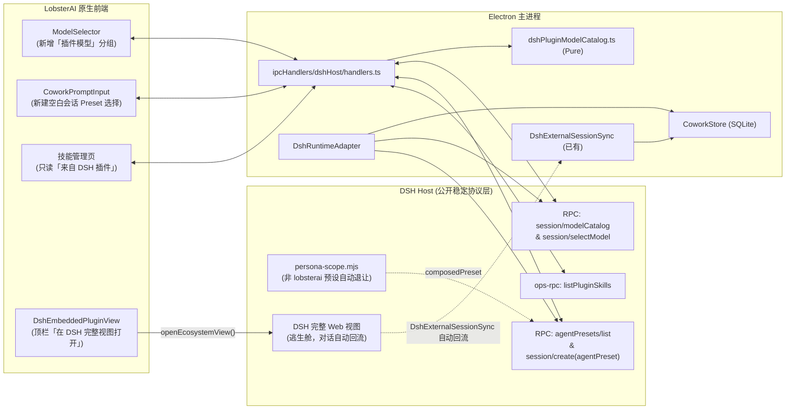
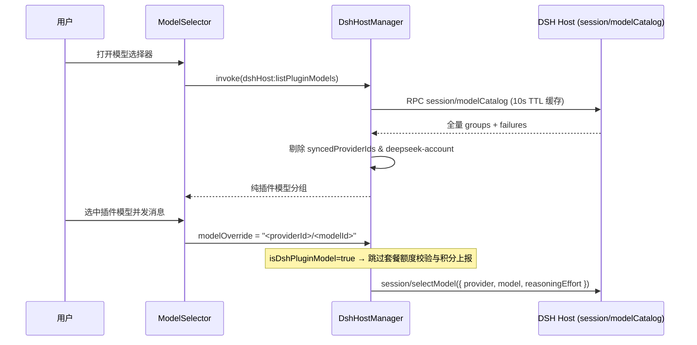

# DSH 插件生态兼容（薄协议边界与逃生舱闭环）设计文档

> 本文档为 LobsterAI 接入 DeepSeek Harness（DSH）生态后的插件兼容方案设计，承接 [2026-11-26-dsh-plugin-update-design.md](./2026-11-26-dsh-plugin-update-design.md) 以及已落地的 DSH 外部会话同步架构（`DshExternalSessionSync` + `traceId` 积分归因 + `session_projcache` 标题预热）。本方案遵循 **「薄协议边界 + 逃生舱闭环」** 原则，以最小、最耐 DSH 版本升级的改动，打通第三方高价值 DSH 插件在 LobsterAI 中的使用闭环。

---

## 1. 概述

### 1.1 问题/背景

DSH 原生采用 **「DSH Host（Cordis 后端）+ DSH Web（前端 80+ UI Slot）」** 一体架构，官方桌面端与社区启动器均直接套壳 `@deepseek-ai/dsh-web-frontend`。LobsterAI 拥有自研原生 Electron/React 产品界面（Office 实时编辑、Artifacts、皮肤、专家广场、有道套餐与企业管控），因此采用 **「DSH Host + LobsterAI 原生前端」** 架构。

当前 LobsterAI 已打通插件安装/热更新、独立面板去壳嵌入（`main` / `settings.section`）与外部端会话同步（如 `dsh-pocket`），但通过对你本机实际安装的 6 个代表性插件与 DSH `0.2.2-rc.5` 扩展点的分析，仍有以下三类高价值痛点未闭环：

1. **第三方模型插件不可选（如 `dsh-our-free-model`）**：插件通过 `ctx.llm.registerAdapter` 注册的模型仅存在于 DSH Host 的 `session/modelCatalog`，LobsterAI 的 `ModelSelector` 未消费该目录，导致插件配置好后在聊天框里根本找不到模型。
2. **第三方 Agent Preset 模式插件无入口且提示词打架（如 `dsh-pi-mode`）**：`dsh-pi-mode` 注册了 `pi` / `pi-plus` / `pi-im` 预设，但 LobsterAI 创建会话时从未透传 `agentPreset`；同时 `lobster-persona-scope` 会全局无条件注入 LobsterAI 身份与大段引导提示词，破坏第三方极简预设的 `complete: true` 语义。
3. **复杂前端交互类插件与 Skill 缺少直观闭环（如 `dsh-guizang-design`、`dsh-context`）**：
   - 依赖 DSH Web 内部对话动作（如 `dsh-guizang-design` 点按钮调 `uiWorkspace.startSession`）或对话内局部 Slot（如 `dsh-context` 的右侧栏 Tab / 消息操作栏）的插件，在去壳单面板 `webview` 中无法触达完整 DSH 界面；
   - 插件通过 `ctx.skills.registerProvider` 注册的 Skill 虽可被模型调用，但在 LobsterAI 技能管理页不可见。

### 1.2 核心架构原则（耐升级铁律）

DSH 处于高频迭代期（从 `0.1.0-rc.6` 到 `0.2.2-rc.5` 持续演进）。为避免后续升级 DSH 时陷入高维护成本，本方案严格恪守三条工程红线：

1. **只依赖 DSH 公开稳定的 Host 协议层**：仅调用官方正式 Typert RPC（`session/modelCatalog`、`agentPresets/list`、`session/create`、`session/selectModel`）及只读 Cordis 公开服务（`ctx.skills.list`、`ctx.agentPresets.composedPreset`），所有 Host 侧可选读取均 fail-soft。
2. **不入侵 DSH Web 私有前端内部实现**：不新增 `<webview>` preload 构建入口、不 Monkey-patch DSH 前端内部对象（如 `uiWorkspace.startSession`）、不复刻 DSH 的 80+ 对话内局部 Slot，也不编写脆弱的压缩 JS 源码正则扫描去猜测插件能力。
3. **用「DSH 完整视图逃生舱 + 外部会话自动回流」兜底一切复杂 UI 插件**：复用已存在的 `dshHost:openEcosystemView` 与刚刚落地的 `DshExternalSessionSync`——用户在完整 DSH 视图中操作 `dsh-guizang-design` / `dsh-context` 等复杂前端插件发起的任何对话，都会自动同步回 LobsterAI 侧边栏（含真实标题与积分归因），实现零魔改闭环。

### 1.3 目标与非目标

**本期目标（2 个克制、独立的实施阶段）**：

- **Phase 1 — DSH 动态模型目录桥**：
  - 消费 DSH `session/modelCatalog` 并剔除 LobsterAI 同步的 provider，得到纯第三方插件模型；
  - 在 `ModelSelector` 增量展示「插件模型」分组（未安装模型插件时零侵入隐藏，打开下拉框 10s TTL 懒刷新）；
  - 发送时原样透传 `{ provider, model, reasoningEffort }` 至 `session/selectModel`，跳过 LobsterAI 套餐额度校验与积分上报；模型下线时明确报错，不静默回退收费模型。
- **Phase 2 — 精简 Agent Preset 桥 + 插件 Skill 只读展示 + 完整视图逃生舱入口**：
  - **2A 精简 Preset 桥**：通过 `agentPresets/list` 发现可用第三方预设；仅当存在非 `lobsterai` 有效预设时，在新建空白会话工具栏显示轻量运行模式选择器，发首条消息时透传 `agentPreset` 至 `session/create` 并落库 `dsh_agent_preset`，首轮后以只读徽标展示；在 `persona-scope.mjs` 中新增约 10 行退让逻辑，识别非 `lobsterai` 预设时不强塞默认长提示词（安全护栏保留）。
  - **2B 插件 Skill 只读展示**：在 `ops-rpc.mjs` 增加 `listPluginSkills`（`ctx.skills.list` 过滤 `lobsterai-skills`），在技能管理页只读展示「来自 DSH 插件」分区。
  - **2C 完整视图逃生舱入口**：在 `DshEmbeddedPluginView.tsx` 顶栏复用现有 `dshHostService.openEcosystemView()` 增加「在 DSH 完整视图中打开」按钮，无缝衔接复杂前端插件与 `DshExternalSessionSync` 回流闭环。

**明确不做 / 暂缓项（降低升级风险）**：

- **不做** `dshEmbedPreload.ts` 及 `embed-shell` 拦截 `uiWorkspace.startSession`（耦合 DSH 前端内部实现，改由 2C 逃生舱闭环替代）。
- **不做** 空白会话中途热切 `agentPresets/select`（新建时选定即可，大幅简化状态机）。
- **暂缓** 第三方 Slash 命令双分支路由（避免加重 4,300 行 `dshRuntimeAdapter.ts` 与 4,500 行 `CoworkPromptInput.tsx` 负担，待社区出现高价值刚需命令插件后再按需接入）。
- **不做** 扫描插件压缩 JS 源码猜能力/局部 Slot/禁用依赖的复杂静态正则（易随打包方式误报，继续沿用现有 `isThemePlugin` 与运行时真实能力即可）。
- **不兼容** DSH 皮肤/主题插件（`@deepseek-ai/dsh-client-ui-theme`），保持现有红牌/提示引导使用 LobsterAI 原生皮肤。
- **不修改** `@deepseek-ai/dsh` 上游源码，不新增 `scripts/dsh-patches/` 补丁。

### 1.4 总体架构



---

## 2. 用户场景

### 场景 1: 直接选用 `dsh-our-free-model` 提供的免费/账号池模型（Phase 1）

**Given** 用户安装了 `dsh-our-free-model`，并在插件设置面板开启匿名通道或登录账号池  
**When** 用户打开 LobsterAI 聊天框的模型选择器  
**Then** 下拉框出现「插件模型」分组，展示 `Our Free Model` 下的可用模型及可选思考强度；选中并发送后直接经 DSH 路由至插件适配器流式回复，不校验也不消耗 LobsterAI 积分。

### 场景 2: 模型插件停用或卸载后的安全提示（Phase 1）

**Given** 某会话绑定了 `our-free-model/deepseek-v4-flash`，之后用户停用或卸载该插件  
**When** 收到 `plugin-manager/changed` 或用户在该会话发送消息  
**Then** 模型选择器自动移除已下线插件模型（无剩余插件模型时隐藏「插件模型」分组）；原会话发送前返回明确提示「所选插件模型当前不可用，请切换模型」，**绝不静默回退到付费套餐模型**。

### 场景 3: 在插件「...」菜单的高级运行模式中开启并切换预设（Phase 2A）

**Given** 用户在「设置 → 插件」右上角「...」更多菜单中点击「高级运行模式」，开启「启用 DSH 运行模式切换」（可选指定新建会话默认模式）  
**When** 用户在首页新建空白对话，通过输入框「+」菜单中的「运行模式」选择 `Pi+模式` 或 DSH 原生模式（`standard`/`ptc`/`minimal`/`cordis`）（或由默认模式自动带入）并发送首条消息  
**Then** 未发送前输入框浮出轻量胶囊 `[Pi+模式 ×]`（点 `×` 可一键复位回默认，默认模式下输入栏 0 占位）；发送后 DSH 以对应 `agentPreset` 创建会话，`lobster-persona-scope` 自动退让不注入 LobsterAI 默认长提示词，首轮发送后该会话预设锁定并展示只读徽标 `🔒 Pi+模式`。未开启该开关时，普通用户界面完全无感。

### 场景 4: 查看插件自带技能，以及在完整视图使用复杂工作台插件（Phase 2B & 2C）

**Given** 用户安装了 `dsh-guizang-design`（含 4 个 Skill 与画廊面板）和 `dsh-context`（含对话内右侧栏扩展）  
**When** 用户打开技能管理页，或在插件内嵌面板顶栏点击「在 DSH 完整视图中打开」  
**Then**
- 技能管理页「来自 DSH 插件」分区只读展示 `dsh-guizang-design` 的 4 个设计 Skill；
- 点击「在 DSH 完整视图中打开」弹出完整 DSH 窗口，用户可在其中使用「做同风格的下一份」或查看 `dsh-context` 对话内右侧栏；期间在完整视图发起的新对话会由 `DshExternalSessionSync` 自动同步回 LobsterAI 侧边栏，可无缝续聊。

---

## 3. 功能需求

### FR-1: DSH 动态模型目录桥（Phase 1）

1. **目录过滤与防重**：
   - 调用现有 `DshTypertClient.getModelCatalog()`（`session/modelCatalog`）；
   - 剔除由 `DshHostManager.syncProviders` 注册的 LobsterAI canonical provider ID 集合（含 `lobsterai-server`）以及被禁用的保留内置 provider（`deepseek-account`）；
   - 保留剩余 `groups`（`providerId`、`providerName`、`models` 含 `id`/`name`/`description`/`badge`/`reasoning`）与隔离的 `failures`。
2. **模型状态正交隔离**：
   - `modelSlice.ts` 的 `Model` 新增 `isDshPluginModel?: boolean`、`dshPluginBadge?: string`、`dshReasoningEfforts?: Array<{ id: string; name?: string }>`、`dshDefaultReasoningEffort?: string`；
   - 新增 `setDshPluginModels` / `clearDshPluginModels` reducer，确保套餐模型、自定义模型、插件模型三路刷新互不覆盖。
3. **选择器零侵入集成与懒刷新**：
   - `ModelSelectorGroup` 新增 `DshPlugin: 'dsh-plugin'`，仅当 `dshPluginModels.length > 0` 时展示；
   - DSH `ready`、`dshHost:pluginsChanged` 自动刷新；打开 `ModelSelector` 下拉框时触发 10s TTL 节流懒刷新，感知插件面板内刚登录出的新模型。
4. **运行时透传与计费豁免**：
   - 模型引用沿用 `<providerId>/<modelId>`；主进程识别命中已知 DSH 插件 provider 时，原样透传 `provider`/`model`/`reasoningEffort`，跳过本地 API Key 校验、套餐登录校验与有道积分预检/上报；
   - 发送前若插件模型已不在最新 catalog 中，明确报错拦截，不静默回退套餐模型。

### FR-2: 精简 Agent Preset 桥与宿主退让（Phase 2A）

1. **预设列表获取**：
   - `DshTypertClient` 新增 `listAgentPresets()`（调用 `agentPresets/list`）；
   - 主进程新增 `DshHostIpc.ListAgentPresets`，过滤 `broken` 项并按 `order` 排序，返回 `{ ok, presets, usablePresets, hasThirdPartyPresets, defaultPresetId }`。
2. **渐进式高级配置与会话创建透传（仅新建指定，不做热切）**：
   - `cowork_sessions` 幂等新增 `dsh_agent_preset TEXT` 列；`CoworkSession` 新增 `dshAgentPreset?: string`；
   - 在「设置 → 插件」右上角「...」更多菜单中提供「高级运行模式」弹窗（持久化至本地 store）：默认关闭总开关，开启后自动展示 DSH 原生模式（`standard`/`ptc`/`minimal`/`cordis`，带「内置」标签）及第三方插件预设（如 `Pi 模式`/`Pi+模式`），并支持配置「新建会话默认模式」；
   - 开启后在首页新建会话的「+」折叠菜单中提供「运行模式」子菜单；处于默认 `LobsterAI` 模式时一级输入栏 0 占位，仅当选中非默认模式时浮出可点击切换/一键 `×` 复位的轻量胶囊；
   - 首条消息发送时调用 `client.createSession({ cwd, ...(agentPreset && agentPreset !== 'lobsterai' ? { agentPreset } : {}) })`；已有消息且 `dshAgentPreset` 非默认时，仅展示只读徽标 `🔒 <preset>`，不提供修改入口。
3. **宿主提示词退让（fail-soft）**：
   - 在 `dsh-bundles/lobsterai-host/plugins/persona-scope.mjs` 中可选读取 `ctx.get('agentPresets')?.composedPreset?.(assemblyCtx?.agent?.ctx)`；
   - 仅当读到明确的第三方预设 ID（`presetId && presetId !== 'lobsterai'`）时：
     - `lobsterai:host-identity` 返回 `''`；
     - `lobsterai:workspace-persona` 仅返回用户显式填写的 `customSystemPrompt`（跳过默认工作区人格文件、Office/技能安装/规则长引导）；
   - `lobster-approval-guard`、用户 MCP 禁用列表与 `sideChat` 只读拦截对所有预设照常生效。

### FR-3: 插件 Skill 只读展示（Phase 2B）

1. 在 `dsh-bundles/lobsterai-host/plugins/ops-rpc.mjs` 新增 `DshOpsAction.ListPluginSkills`：调用 `ctx.get('skills')?.list({ cwd })`，过滤 `skill.provider !== 'lobsterai-skills'`，返回去重后的技能元数据列表。
2. 主进程新增 `DshHostIpc.ListPluginSkills`；技能管理页在列表底部（有数据时）展示只读「来自 DSH 插件」分组，注明随插件启停联动并提供跳转「设置 → 插件」链接。

### FR-4: 完整视图逃生舱入口（Phase 2C）

1. 在 `DshEmbeddedPluginView.tsx` 原生顶栏右侧工具区（刷新与插件管理按钮旁）增加「在 DSH 完整视图中打开」按钮，点击直接调用现有 `dshHostService.openEcosystemView()`。
2. 不改动 `embed-shell/client.js`，不新增任何前端 DOM/服务劫持；在完整 DSH 视图中产生的新会话与回复依赖既有 `DshExternalSessionSync` 自动回流至 LobsterAI。

---

## 4. 实现方案

### 4.1 共享常量扩展

文件：[src/shared/dshEngine/hostConstants.ts](file:///Users/wangning/Dev/test3/LobsterAI/src/shared/dshEngine/hostConstants.ts)

```ts
// DshOpsAction 新增
ListPluginSkills: 'listPluginSkills',

// DshHostIpc 新增
ListPluginModels: 'dshHost:listPluginModels',
ListAgentPresets: 'dshHost:listAgentPresets',
ListPluginSkills: 'dshHost:listPluginSkills',

export const DEFAULT_DSH_AGENT_PRESET_ID = 'lobsterai';
```

### 4.2 Phase 1：DSH 动态模型目录桥

1. **独立纯函数模块**：新建 `src/main/libs/dsh/dshPluginModelCatalog.ts`（零 Electron 依赖）：
   - `extractDshPluginModels(catalog, lobsterSyncedProviderIds)`: 从 `session/modelCatalog` 过滤出纯第三方插件模型分组与扁平条目，始终排除 `lobsterai-server`、`deepseek-account` 与 `lobsterSyncedProviderIds`。
   - `resolveDshPluginModelRef(ref, knownPluginProviderIds)`: 判断 `<provider>/<model>` 是否命中第三方插件模型，原样保留 provider ID（避免被 LobsterAI canonicalize 规则误改）。
2. **缓存管理（`src/main/libs/dsh/dshHostManager.ts`）**：
   - 在 `syncProviders` 成功后记录 `syncedProviderIds`；
   - 新增 `listPluginModels(forceRefresh?: boolean)`，维护 10s TTL 缓存与 `knownPluginProviderIds` 集合，在 `connected`、`syncProviders`、`pluginsChanged` 时自动失效缓存。
3. **模型解析与计费豁免（`src/main/main.ts` + `src/main/libs/agentEngine/dshRuntimeAdapter.ts`）**：
   - `resolveModelSelection` 先通过 `resolveDshPluginModelRef` 检查是否命中插件模型；命中后确认该模型仍在当前 `listPluginModels()` 结果内（否则抛出明确本地化错误，禁止静默切套餐模型），返回 `{ provider, model, reasoningEffort, isDshPluginModel: true }`；
   - `dshRuntimeAdapter.ts` 在 `isDshPluginModel === true` 时透传 `selectModel`，跳过套餐额度预检与 `CoworkTurnUsageService` 积分上报。
4. **渲染层（`modelSlice.ts` + `dshHost.ts` + `ModelSelector.tsx`）**：
   - `modelSlice.ts` 新增 `setDshPluginModels` / `clearDshPluginModels`，三个来源数组严格正交；
   - `dshHost.ts` 在 DSH `ready` 和 `onPluginsChanged` 时拉取并派发 `setDshPluginModels`，提供带 10s 节流的 `refreshPluginModelsIfStale()`；
   - `ModelSelector.tsx` 在 `dshPluginModels.length > 0` 时渲染「插件模型」Tab（按插件名分组 + 思考等级选项），打开下拉框时异步调用 `refreshPluginModelsIfStale()`。



### 4.3 Phase 2：精简 Preset 桥 + Skill 展示 + 完整视图逃生舱

1. **2A 精简 Preset 桥**：
   - `src/main/libs/dsh/dshTypertClient.ts`：新增 `listAgentPresets()`（`agentPresets/list`）。
   - `src/main/ipcHandlers/dshHost/handlers.ts`：注册 `DshHostIpc.ListAgentPresets`（过滤 `broken` 项并排序，DSH 未就绪时返回空数组不报错）。
   - `src/main/coworkStore.ts` & `src/renderer/types/cowork.ts`：`cowork_sessions` 幂等迁移新增 `dsh_agent_preset TEXT` 列并在 `createSession` / `getSession` 透出。
   - `src/main/libs/agentEngine/dshRuntimeAdapter.ts`：创建 DSH 会话时仅需 2 行透传 `...(session.dshAgentPreset && session.dshAgentPreset !== DEFAULT_DSH_AGENT_PRESET_ID ? { agentPreset: session.dshAgentPreset } : {})`。
   - `dsh-bundles/lobsterai-host/plugins/persona-helpers.mjs` & `persona-scope.mjs`：新增纯函数 `isDefaultLobsterPreset(presetId)`；在 `lobsterai:host-identity` 与 `lobsterai:workspace-persona` 回调头部检查 `ctx.get('agentPresets')?.composedPreset?.(assemblyCtx?.agent?.ctx)`，非 `lobsterai` 时直接退让。
   - `src/renderer/components/cowork/dshAgentPresetViewModel.ts`（新建纯函数）+ `CoworkPromptInput.tsx`：仅在 `hasThirdPartyPresets` 为真时渲染新建态模式下拉器，首轮发出后变为只读标签。
2. **2B 插件 Skill 只读展示**：
   - `dsh-bundles/lobsterai-host/plugins/ops-rpc.mjs`：新增 `listPluginSkills` action，调用 `ctx.get('skills')?.list({ cwd })` 并排除 `provider === 'lobsterai-skills'`。
   - `src/main/ipcHandlers/dshHost/handlers.ts`、`src/main/preload.ts`、`src/renderer/services/dshHost.ts`：透出 `listPluginSkills(cwd?)`。
   - 技能管理页新增只读「来自 DSH 插件」展示区块（无数据时不渲染）。
3. **2C 完整视图逃生舱入口**：
   - `src/renderer/components/dsh/DshEmbeddedPluginView.tsx`：在顶栏操作区增加「在 DSH 完整视图中打开」图标按钮，调用已有 `dshHostService.openEcosystemView()`。

---

## 5. 边界情况

| 场景 | 处理方式 |
|---|---|
| 用户在 `dsh-our-free-model` 面板刚登录新通道，立刻切回聊天框 | 打开 `ModelSelector` 时 10s TTL 懒刷新立即拉取最新 `modelCatalog`，无需重启。 |
| 某模型插件 `listModels()` 报错或超时 | DSH `modelCatalog` 已将单插件错误隔离至 `failures`，其他插件模型正常展示。 |
| 已选插件模型的会话在插件停用/卸载后发送消息 | 发送前实时校验失败并返回明确错误提示引导切换，**绝不静默回退收费套餐模型**。 |
| DSH Host 尚未就绪或重启中 | `ListPluginModels` / `ListAgentPresets` / `ListPluginSkills` 统一 fail-soft 返回空列表，不影响套餐模型、自定义模型与主流程。 |
| 某第三方 Preset 因配置错误在 DSH 中标记 `broken` | 从可选下拉中过滤掉，避免新建会话时报 `agent-preset/invalid`。 |
| 第三方 Preset（如 `pi`）会话触发危险命令或禁用 MCP 工具 | `lobster-approval-guard`、用户 MCP 禁用列表与 `sideChat` 只读守卫对所有预设一视同仁，安全底线不降级。 |
| 未来 DSH 升级变更了 `agentPresets.composedPreset` 签名或移除了该方法 | `persona-scope.mjs` 使用可选链调用，取不到值时安全回退默认行为，绝不导致启动或对话崩溃。 |
| 用户在 DSH 完整视图中用 `dsh-guizang-design` / `dsh-context` 新建或继续会话 | 由已有 `DshExternalSessionSync` 实时同步回 LobsterAI 会话列表（含真实标题与积分归因），实现双向闭环。 |

---

## 6. 涉及文件清单（高隔离、少大文件改动）

### Phase 1：DSH 动态模型目录桥

| 文件 | 改动内容 |
|---|---|
| `src/shared/dshEngine/hostConstants.ts` | 新增 `DshHostIpc.ListPluginModels` |
| `src/main/libs/dsh/dshPluginModelCatalog.ts`（新建） | 纯函数 `extractDshPluginModels`、`resolveDshPluginModelRef` + 同目录单测 |
| `src/main/libs/dsh/dshHostManager.ts` | 记录 `syncedProviderIds`，新增 10s TTL 缓存的 `listPluginModels()` |
| `src/main/ipcHandlers/dshHost/handlers.ts` | 注册 `DshHostIpc.ListPluginModels` |
| `src/main/preload.ts`、`src/renderer/types/electron.d.ts` | 暴露 `listPluginModels` |
| `src/main/main.ts`、`src/main/libs/agentEngine/dshRuntimeAdapter.ts` | 识别插件模型透传、失效拦截与计费豁免（逻辑收口在纯模块，最小化大文件改动） |
| `src/renderer/store/slices/modelSlice.ts` | `Model` 扩展字段 + 正交 `setDshPluginModels` reducer |
| `src/renderer/services/dshHost.ts` | 拉取、事件同步与 10s 懒刷新封装 |
| `src/renderer/components/ModelSelector.tsx` | 新增零侵入 `DshPlugin` Tab 分组与思考强度透出 |
| `src/renderer/services/i18n.ts` | 补充 `zh` / `en` 文案 |

### Phase 2：精简 Preset 桥 + 插件 Skill 展示 + 完整视图逃生舱

| 文件 | 改动内容 |
|---|---|
| `src/shared/dshEngine/hostConstants.ts` | 新增 `DshOpsAction.ListPluginSkills`、`DshHostIpc.ListAgentPresets`、`DshHostIpc.ListPluginSkills`、`DEFAULT_DSH_AGENT_PRESET_ID` |
| `src/main/libs/dsh/dshTypertClient.ts` | 新增 `listAgentPresets()` |
| `dsh-bundles/lobsterai-host/plugins/persona-helpers.mjs`、`persona-scope.mjs` | 新增约 10 行第三方预设提示词退让逻辑（fail-soft） |
| `dsh-bundles/lobsterai-host/plugins/ops-rpc.mjs` | 新增 `listPluginSkills` action |
| `src/main/coworkStore.ts`、`src/renderer/types/cowork.ts` | `cowork_sessions` 幂等新增 `dsh_agent_preset` 列 |
| `src/main/libs/agentEngine/dshRuntimeAdapter.ts` | `createSession` 透传 `agentPreset`（~2 行） |
| `src/main/ipcHandlers/dshHost/handlers.ts`、`preload.ts`、`dshHost.ts` | 透出 `listAgentPresets` 与 `listPluginSkills` |
| `src/renderer/components/cowork/dshAgentPresetViewModel.ts`（新建） | 预设筛选与展示纯函数 + 同目录单测 |
| `src/renderer/components/cowork/CoworkPromptInput.tsx` | 渐进式新建会话模式选择与只读徽标 |
| `src/renderer/components/skills/SkillsManager.tsx`（现有技能页） | 只读「来自 DSH 插件」技能分组 |
| `src/renderer/components/dsh/DshEmbeddedPluginView.tsx` | 顶栏新增「在 DSH 完整视图中打开」按钮 |
| `src/renderer/services/i18n.ts` | 补充 `zh` / `en` 文案 |

---

## 7. 验收标准与验证计划

### 7.1 自动化验证
- **Vitest 单元测试全通过**：覆盖 `dshPluginModelCatalog.test.ts`、`dshAgentPresetViewModel.test.ts`、`dshTypertClient.test.ts`、`handlers.test.ts`、`dshRuntimeAdapter.test.ts` 与 `persona-scope` 退让单测。
- **双端类型检查 0 错误**：`npm run compile:electron && npx tsc`。
- **修改文件严格 Lint 0 错误 0 警告**：`npx eslint --ext ts,tsx --report-unused-disable-directives --max-warnings 0 --no-warn-ignored <changed-files>`。
- **DSH 升级与合规门禁**：Phase 2 修改 `dsh-bundles/lobsterai-host/` 后必须通过 `npm run dsh:upgrade-check`。

### 7.2 实机验收（以 6 个真实已装插件为基准）
- [ ] **Phase 1（`dsh-our-free-model`）**：模型选择器出现「插件模型」分组，选中后正常流式对话、不扣 LobsterAI 积分；插件面板新增账号后重开选择器立即可见；停用插件后原会话发消息明确报错、不误切付费模型。
- [ ] **Phase 2A（`dsh-pi-mode`）**：新建空白对话工具栏可选 `Pi 模式` / `Pi+ 模式`，发首条消息后 `codemode` 可用且提示词不被默认长段污染，首轮后锁定为只读徽标；未装第三方预设插件时入口完全隐藏。
- [ ] **Phase 2B（`dsh-guizang-design`）**：技能管理页「来自 DSH 插件」分区只读可见其 4 个设计 Skill，停用插件后自动消失。
- [ ] **Phase 2C（`dsh-guizang-design` & `dsh-context`）**：内嵌面板顶栏点击「在 DSH 完整视图中打开」可打开完整 DSH 窗口，在其中使用画廊开聊或查看 `dsh-context` 局部面板后，新会话自动同步回 LobsterAI 侧边栏。
- [ ] **回归检查（`dsh-pocket` & `dsh-media-desk`）**：`dsh-pocket` 同步/积分/标题正常，`dsh-media-desk` 嵌入面板正常，中英文切换无缺失文案。
