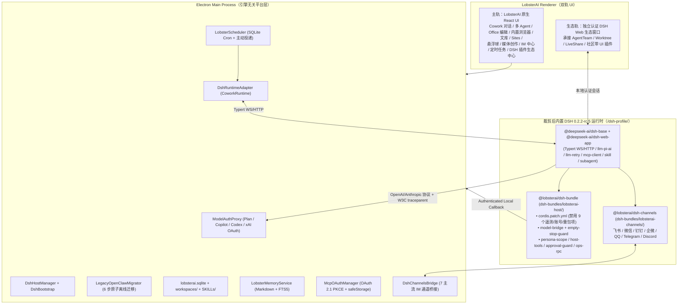

# OpenClaw 全面迁移至 DeepSeek Harness (DSH) 最终设计文档

> 本文档记录 LobsterAI 从 OpenClaw (`v2026.8.1`) 一次性切换至 DeepSeek Harness (`@deepseek-ai/dsh@0.2.2-rc.5`) 的最终定稿与落地实现方案。早期构思稿见同目录 [2026-11-19-engine-replacement-plan.md](2026-11-19-engine-replacement-plan.md) 与 [2026-11-19-single-upgrade-design.md](2026-11-19-single-upgrade-design.md)。

---

## 1. 概述

### 1.1 问题与动机

1. **维护债沉重**：LobsterAI 此前基于 OpenClaw 维护了数十个运行时补丁、6 个专用扩展与上万行适配代码（`openclawRuntimeAdapter.ts` 约 1.3 万行），每次上游升版均伴随高额适配与回归成本。
2. **资产与引擎强耦合**：旧版将 Agent 人设与记忆（`SOUL.md` / `MEMORY.md`）、定时任务主表、IM 白名单等混存在 `userData/openclaw/state/` 内部，导致升级或更换底座时风险极高。
3. **旧实验版 DSH 无法承接生产需求**：早期实验性 DSH 集成依赖首次启动在线下载约 160MB 运行时，与主对话/权限/计费/IM 割裂，无法作为主引擎交付。

### 1.2 目标

1. **单版本彻底切换**：移除全部 OpenClaw 运行时、扩展、补丁与双引擎分支，`CoworkAgentEngine` 收敛为 `'dsh'` 单一引擎，以 `@deepseek-ai/dsh@0.2.2-rc.5` 为基线并具备持续快速追版能力。
2. **一等公民生态宿主**：遵循 DSH App-Owned Profile 规范，以本地 Cordis Bundle（`@lobsterai/dsh-bundle`、`@lobsterai/dsh-channels`）零侵入承接全部宿主能力，不魔改 DSH 业务源码，同时保持与 DSH 插件市场、HMR、`dsh` CLI 及双轨 Web 生态视图的完全兼容。
3. **资产主权与引擎解耦**：将用户人设、记忆与 FTS5 索引迁出至 `<userData>/workspaces/`，定时任务、MCP OAuth 与多模型鉴权代理全部收口至主进程引擎无关平台层。
4. **老用户无损自动迁移**：首次升级启动时纯离线执行 6 步原子迁移与不兼容模块归档，支持异常自动回滚、历史对话懒桥接（Lazy Context Bridge）以及备份包 Manifest v2 自动兼容旧版 v1 备份。

---

## 2. 现状分析与核心决策矩阵

| 决策维度 | 最终落地结论 |
|---|---|
| **切换策略** | 代码一次性彻底移除 OpenClaw（零双引擎维护债）+ 离线 6 步原子迁移 + 不兼容模块归档备份 |
| **DSH 底座版本** | `@deepseek-ai/dsh@0.2.2-rc.5`（同步对齐 `@deepseek-ai/cordis` 家族版本），建立 `npm run dsh:upgrade-check` 追版门禁 |
| **目标平台** | macOS (`arm64` / `x64`) + Windows (`x64`)；本期不覆盖 Linux |
| **IM 策略（7 留 4 退）** | 保留 7 个主流平台（飞书/Lark、微信、钉钉、企业微信、QQ、Telegram、Discord），由 `@lobsterai/dsh-channels` 承载；下线并归档 4 个平台（POPO、NIM、网易小蜜蜂、Email），历史记录只读保留 |
| **记忆与人设** | 保留 `SOUL.md` / `IDENTITY.md` / `USER.md` / `MEMORY.md` / `memory/YYYY-MM-DD.md`，迁出至 `<userData>/workspaces/<agentId>/` + 主进程 `better-sqlite3` FTS5 检索；移除并归档 Dreaming 做梦与旧 Embedding 向量配置 |
| **消息编辑与分支（方案 B）** | 移除原地编辑与 `< 1 / 2 >` 版本树，统一为「从历史消息分支（Fork）新会话 + 编辑/撤回排队中的消息」，与 DSH Append-Only 日志模型完全对齐 |
| **浏览器能力** | 收口为内置浏览器（In-App Browser），移除外部受管 Chrome 相关配置 |
| **皮肤/换肤说明** | 本期不将 DSH 前端皮肤插件直接作用于 LobsterAI 原生主窗口；带 UI 的 DSH 生态插件可在内嵌生态轨窗口中直接使用 |

---

## 3. 方案设计

### 3.1 总体分层架构



### 3.2 磁盘目录布局

```text
<userData>/
├── lobsterai.sqlite                # 主业务权威库（账号/设置/模型/Agent/会话/消息/定时任务/IM/MCP/文库等）
├── workspaces/                     # 引擎无关用户资产目录
│   ├── main/                       #   SOUL.md, IDENTITY.md, USER.md, MEMORY.md, memory/*.md, AGENTS.md
│   ├── <agentId>/                  #   各自定义/预设 Agent 独立人设与记忆
│   └── memory-fts.sqlite           #   主进程 FTS5 索引（可随时重建）
├── SKILLs/                         # 技能目录（原地保留）
├── dsh-profile/                    # LobsterAI 专属 App-Owned Profile（与 ~/.dsh 隔离）
│   ├── package.json                #   声明 bundles 依赖
│   ├── cordis.patch.yml            #   留给用户与 dsh-plugin-manager，LobsterAI 不覆写
│   ├── sessions/                   #   DSH v4 zstd JSONL 运行态会话日志
│   ├── attachments/                #   DSH 附件存储
│   └── bin/dsh(.cmd)               #   内置 dsh CLI shim
└── legacy-openclaw-backup/         # 升级老用户生成的一次性安全保险箱
    └── <timestamp>/
        ├── lobsterai.pre-v2.sqlite
        ├── incompatible-modules-backup.tar.gz
        ├── legacy-openclaw-state.tar.gz
        └── migration-report.json
```

### 3.3 DSH 运行时裁剪、补丁与追版门禁

1. **构建与裁剪**（`scripts/build-dsh-runtime.cjs`）：
   - 锁定 `@deepseek-ai/dsh@0.2.2-rc.5`，剔除体积庞大的 `libreoffice-kit` 与 `sherpa-onnx`（由 LobsterAI 原生能力替代），保留完整 CLI、Web 控制面、插件市场与 HMR。
   - 仅保留 1 个最小启动补丁：`scripts/dsh-patches/0.2.2-rc.5/01-app-boot-expose-internals-fallback.cjs`。
2. **隐私与合规红线**（`dsh-bundles/lobsterai-host/cordis.patch.yml`）：
   - 强制禁用 9 个组件：7 个 DeepSeek 遥测/账号插件（`session-log-deepseek`、`plugin-package-inventory-deepseek`、`session-telemetry-otel`、`deepseek-account`、`llm-deepseek-account`、`desktop-product-telemetry`、`product-analytics`）+ `office-kit` + `web-deepseek-api`（避免非 DeepSeek 路由误走未授权 DeepSeek Search API）。
3. **追版门禁脚本**（`scripts/dsh-upgrade-check.cjs`）：
   - 自动校验运行时包清单与裁剪结果、`dsh --dump-config` 9 项禁用断言、实机启动 App-Owned Profile、`/connect` 鉴权、5 个宿主插件就绪状态、`syncProviders` / `modelCatalog` / `bindSessionContext` / `syncSkillsPolicy` / `syncHostTools` 以及 7 个 IM 通道清单。

### 3.4 一等公民宿主 Bundle（`@lobsterai/dsh-bundle`）

位于 `dsh-bundles/lobsterai-host/`，由 5 个 Cordis 插件与辅助模块组成：

| 模块 | 职责 |
|---|---|
| `plugins/model-bridge.mjs` | 内存中热注册/替换全部 LobsterAI Provider 与 `PiAiAdapter`（API Key 永不落盘），注入 `thinkingLevelMap`、实例头与 W3C `traceparent`（对齐主进程按轮积分统计），支持虚拟模型别名解析，并挂载 `llm/stream` 空回复守卫与默认重试策略 |
| `plugins/empty-stop-guard.mjs` | 拦截“仅输出 reasoning 或空白文本却提前返回 `stop`”的异常 completion，将其重分类为 `EMPTY_RESPONSE`，交由 DSH 内置 `dsh-llm-retry` 自动重试（`DEFAULT_LOBSTER_RETRY_POLICY` 覆盖 `EMPTY_RESPONSE`、`STREAM_CLOSED`、`MALFORMED_RESPONSE`、`RATE_LIMIT`、`SERVER`、`TIMEOUT`、`TRANSPORT`） |
| `plugins/persona-scope.mjs` | 按 `agentId` 动态加载 `<userData>/workspaces/<agentId>/` 人设与记忆，并结合 `skills_state` / `agents.skill_ids` 过滤可用技能 |
| `plugins/host-tools.mjs` | 将 LobsterAI 原生能力（Office、内置浏览器、凭据、Computer Use、媒体生成、Decision、记忆读写等）经认证本地回调注册为 DSH 工具 |
| `plugins/approval-guard.mjs` | 拦截 `tools/pre-execute`，携带完整工具名与参数交由主进程审批并支持 `allow-always` 规则 |
| `plugins/ops-rpc.mjs` | 暴露 `/api/lobsterai/ops` 本地 RPC，支持 `syncProviders`、`syncMcpServers`、`syncSkillsPolicy`、`syncHostTools`、`bindSessionContext`（含 `traceId`）、会话文件删除与健康探测 |

### 3.5 主进程平台层与流式适配

1. **`DshRuntimeAdapter`**（`src/main/libs/agentEngine/dshRuntimeAdapter.ts`）：
   - 通过 `DshTypertClient` 对接 `session/create`、`session/selectModel`（含 `reasoningEffort` 不支持时自动降级重试）、`session/prompt`、`session/follow`、`session/cancel`、`session/fork`、`session/updateQueue` 与 `session/projections`。
   - **流式协议与思考块约定**：正确消费 DSH `0.2.2-rc.5` 的 `chunk.text`、`assistant/message` 的 `data.message.content`、`tool/result` 的 `message.callId`；将 `reasoning-delta` 写成 LobsterAI 原生独立思考消息（`type: 'assistant', metadata: { isThinking: true }`），按需延迟创建消息行避免纯工具调用步骤产生空行。
   - **失败重试与终态处理**：识别 `assistant-stream` `end` 的 `assistant/attempt` / `abandoned`，重试时原地清空复用槽位并在最终未用或失败时调用 `deleteMessage` 清理残留占位；正确解析 `turn/end` 的 `reason.kind === 'error'` / `'aborted'`，避免失败轮次被误报为 `completed`。
   - **按轮积分归因**：每轮生成并写入 `metadata.llmTrace`，注册 `registerLlmUsageContext`，并通过 `bindSessionContext.traceId` 透传给 `model-bridge.mjs` 注入 W3C `traceparent`，与 `OpenClawTokenProxy` / `CoworkTurnUsageService` 无缝衔接。
   - **历史会话懒桥接（Lazy Context Bridge）**：续聊旧 OpenClaw 会话时提取 `cowork_session_capsules` 与最近非思考消息构造 `<previous_conversation_context>`，首次续聊自动创建 DSH 会话；新建会话 `skipInitialUserMessage: true` 时正确跳过当轮首条用户消息，不误触发桥接。
2. **引擎无关业务服务**：
   - `src/main/memory/lobsterMemoryService.ts`：Markdown 人设与记忆 CRUD + `better-sqlite3` FTS5 检索。
   - `src/main/scheduledTask/lobsterScheduler.ts`：SQLite 权威 `scheduled_tasks` / `scheduled_task_runs` 调度与会话/IM 投递。
   - `src/main/mcp/mcpOAuthManager.ts`：Remote MCP OAuth 2.1 PKCE 授权与 `safeStorage` 加密管理；MCP 配置同步至 DSH 时展开 `gatewayEnvRefs`（含 `LOBSTER_MCP_BRIDGE_SECRET`）。
   - `src/main/libs/modelAuthProxy.ts` & `src/main/libs/providerSelection.ts`：统一 OAuth / 套餐代理与全量启用 Provider 解析。
   - `src/main/im/dshChannelsBridge.ts` & `dsh-bundles/lobsterai-channels/`：7 个保留 IM 平台桥接，自动跳过已下线平台（`popo` / `nim` / `netease-bee`）。

### 3.6 离线原子迁移与跨机备份兼容

1. **`LegacyOpenClawMigrator`**（`src/main/migration/legacyOpenClawMigrator.ts`）：
   - 检测存在旧 `openclaw/state` 且未完成 `engine.migration.v2.completed` 时自动执行 6 步原子迁移：在线快照 `lobsterai.pre-v2.sqlite` → 离线提取工作区/定时任务/IM/模型映射 → 归档不兼容模块（旧插件、`openclaw.user.json`、`.dreams/`、4 个下线 IM 配置等）→ 完整性校验与原子标记 → 精简归档旧目录 → 生成结构化 `migration-report.json` 供 `MigrationReportModal.tsx` 展示。
   - 动态探测生产 SQLite 表结构（`PRAGMA table_info` 兼容 `mcp_launch_resolutions` 与 `im_config` 真实列布局），任意异常自动回滚 pre-v2 快照并保留源目录不动。
2. **跨机备份恢复**（`src/main/libs/dataMigration/dataMigrationService.ts`）：
   - 升级至 Manifest v2（含 `lobsterai.sqlite`、`workspaces/`、`SKILLs/`、`dsh-profile/`），导入旧版 v1 备份时自动触发离线迁移升级。

### 3.7 渲染层与打包安装改造

1. **渲染层**：
   - 新增 `src/renderer/components/dsh/DshPluginEcosystemView.tsx` 与 `src/renderer/components/migration/MigrationReportModal.tsx`。
   - `CoworkSessionDetail.tsx` 按方案 B 收口为历史消息 Fork 分支；`regionFilter.ts` 过滤至 7 个保留 IM 平台；`BrowserWebAccessSettings.tsx` 收口为内置浏览器。
   - `Settings.tsx` 移除已废弃的 `coworkAgentEngine`、`email`、`coworkDreaming` 入口，将数据备份/恢复迁入「通用 → 数据与隐私」，并移除 `EngineRepairOverlay`。
2. **安装包与 Windows NSIS**：
   - `electron-builder.json`、`scripts/electron-builder-config.cjs`、`scripts/electron-builder-hooks.cjs` 改为打包 `dsh-runtime/` 与 `dsh-bundles/`。
   - 新增 `scripts/pack-dsh-win-resources.cjs` 与 `scripts/unpack-dsh-resources.cjs`，更新 `scripts/nsis-installer.nsh` 将 Windows 资源解包与 Defender 排除目录切换为 `resources\dsh-runtime\`，升级安装自动清理旧 `resources\cfmind\`。

---

## 4. 边界情况处理

| 场景 | 处理方式 |
|---|---|
| 推理模型输出部分 `reasoning_content` 后无正文/无工具调用直接 `stop` | `empty-stop-guard.mjs` 重分类为 `EMPTY_RESPONSE`，`dsh-llm-retry` 自动重试；`dshRuntimeAdapter` 原地复用占位消息行，避免空白回复或重复思考块 |
| 重试耗尽或下游返回 `turn/end { reason: { kind: 'error' } }` | 清理未使用的占位行，更新会话为 `error` 并向前端抛出明确错误，不静默标记 `completed` |
| 模型不支持前端所选 `reasoningEffort` 档位 | `selectModelWithReasoningFallback` 自动去掉 `reasoningEffort` 重试一次，保证切模型成功 |
| 生产库旧表列结构与测试库存在差异（如 `mcp_launch_resolutions` / `im_config`） | `legacyOpenClawMigrator.ts` 运行时通过 `PRAGMA table_info` 动态探测列名后再执行读写，避免迁移回滚 |
| 首次升级中途崩溃或磁盘异常 | `lobsterai.pre-v2.sqlite` 在线快照与源 `openclaw/state/` 未被破坏，自动回滚并保留诊断日志 |
| 导入旧版 v1 跨机备份包 | `dataMigrationService` 识别 v1 Manifest 后自动调用 `LegacyOpenClawMigrator` 升级至 v2 布局 |
| OpenClaw 旧会话首次在 DSH 中续聊 | 不强行改写旧日志；触发一次 Lazy Context Bridge 注入摘要与近期非思考轮次后建立新 DSH 会话 |

---

## 5. 涉及文件概览

- **DSH 运行时、补丁与 Bundle**：
  - `dsh-bundles/lobsterai-host/`（`cordis.patch.yml`、`plugins/{model-bridge,empty-stop-guard,persona-scope,host-tools,approval-guard,ops-rpc,shared-state}.mjs`）
  - `dsh-bundles/lobsterai-channels/`（7 个主流 IM 平台驱动）
  - `scripts/build-dsh-runtime.cjs`、`scripts/dsh-patches/0.2.2-rc.5/01-app-boot-expose-internals-fallback.cjs`、`scripts/dsh-upgrade-check.cjs`
  - `scripts/pack-dsh-win-resources.cjs`、`scripts/unpack-dsh-resources.cjs`、`scripts/nsis-installer.nsh`、`electron-builder.json`、`scripts/electron-builder-{config,hooks}.cjs`
- **主进程核心模块**：
  - `src/main/libs/dsh/*`、`src/main/libs/agentEngine/dshRuntimeAdapter.ts`、`src/main/libs/agentEngine/{coworkEngineRouter,types}.ts`
  - `src/main/memory/lobsterMemoryService.ts`、`src/main/scheduledTask/lobsterScheduler.ts`、`src/main/mcp/mcpOAuthManager.ts`
  - `src/main/im/dshChannelsBridge.ts`、`src/main/im/imGatewayManager.ts`
  - `src/main/migration/legacyOpenClawMigrator.ts`、`src/main/libs/dataMigration/dataMigrationService.ts`
  - `src/main/libs/{modelAuthProxy,providerSelection}.ts`、`src/main/ipcHandlers/{dshHost,migrationV2}/*`、`src/main/main.ts`、`src/main/preload.ts`
- **渲染层与共享契约**：
  - `src/shared/dshEngine/hostConstants.ts`、`src/shared/migration/*`
  - `src/renderer/components/dsh/DshPluginEcosystemView.tsx`、`src/renderer/components/migration/MigrationReportModal.tsx`
  - `src/renderer/components/Settings.tsx`、`src/renderer/components/cowork/{CoworkSessionDetail,CoworkView,EngineFailureOverlay}.tsx`、`src/renderer/components/settings/BrowserWebAccessSettings.tsx`、`src/renderer/utils/regionFilter.ts`
- **彻底清理的旧代码**：
  - 移除 `openclaw-extensions/`、`scripts/patches/`、40 个 OpenClaw 构建/运维脚本、47 个 OpenClaw 专项测试以及 245+ 个已不可达的 OpenClaw / 旧实验 DSH 源码文件。

---

## 6. 验收标准与验证结果

1. **自动化测试**：
   - `npm test`（Vitest 全量测试套件）与新增单测（`dshRuntimeAdapter.test.ts`、`emptyStopGuard.test.ts`、`legacyOpenClawMigrator.test.ts`、`dshHostManager.test.ts`、`dshProviderSync.test.ts`、`dshChannelsBridge.test.ts`、`mcpOAuthManager.test.ts`、`windowsInstallerContract.test.ts` 等）全部通过。
2. **类型检查、构建与 Lint**：
   - `npm run compile:electron`、`npx tsc`、`npm run build` 均 0 错误；
   - CI 严格 `eslint --max-warnings 0` 对所有新增/修改的 TS/TSX 文件 0 错误 0 警告。
3. **DSH 运行时与合规门禁**：
   - `node scripts/dsh-upgrade-check.cjs` 全部通过（确认 9 个隐私/裁剪项禁用、5 个宿主插件就绪、provider/session/skills/tools/IM 通道校验通过）。
4. **桌面实机验证**：
   - 新建任务流式回复与思考块展示正常、切模型与 `reasoningEffort` 降级正常、每轮积分归因显示正常、MCP 桥接无崩溃、推理模型空回复自动重试、设置页无冗余旧引擎项。
