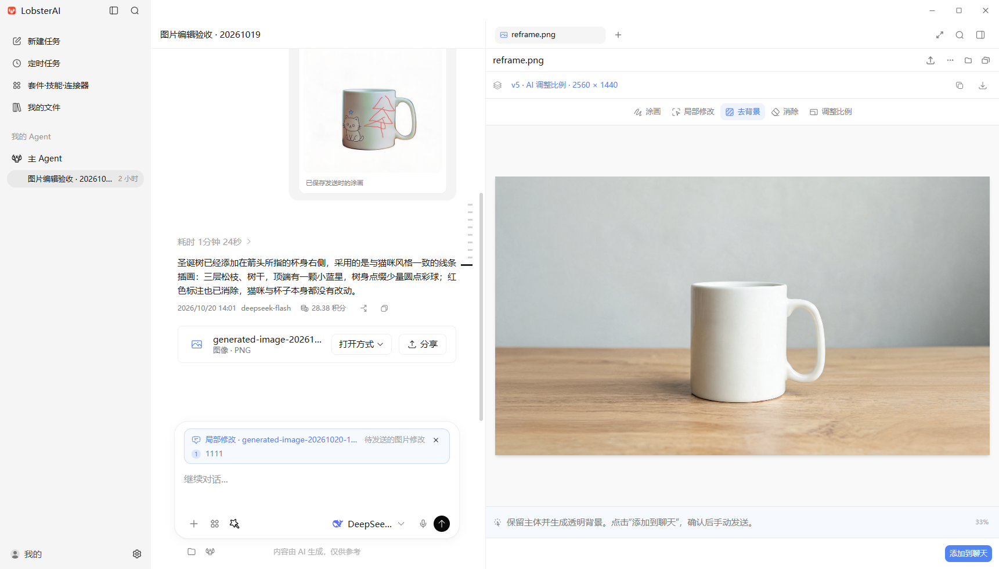

# Artifact 图片编辑与验收

图片成果在原有右侧 artifact 面板内进入专用编辑器。涂画支持本地保存；局部修改、去背景、消除和 AI 调整比例复用聊天中的图片模型、计费、任务恢复与成果展示。



客户端分支为 `feat/artifact-image-editor`，2026 年 10 月 20 日已同步到 `origin/release/2026.10.19` 的 `a9f63b729`（首次实现基底为 `2b464d63b`）。服务端同名分支基于 `0e90cffc`，只增加测试启动器，生产接口保持现有实现。

## 功能逻辑

| 入口 | 操作与结果 |
| --- | --- |
| 涂画 Markup | 画笔、箭头、方框、原地文字框、连续橡皮擦、撤销与重做；文字框可移动和调整大小。保存为新 PNG，也可把涂画作为第二张参考图交给 AI。 |
| 局部修改 Comment | 在原图上框选并填写说明，添加到聊天草稿；支持多处选区。点击草稿中的编号可回到对应位置，发送聊天后统一生成。 |
| 去背景 Remove BG | 先把固定说明与源图添加到聊天草稿，由用户手动发送。生成主体蒙版后，本地应用到原始像素，输出带真实 alpha 的 PNG。模型原始蒙版留在私有缓存，不作为图片成果展示。 |
| 消除 Erase | 涂抹要去掉的物体，模型根据第二张黑白参考蒙版补全背景。与标注里的橡皮擦不同，它修改原图中的内容。 |
| 调整比例 Reframe | 选择 1:1、3:4、9:16、4:3、16:9，由 AI 生成并扩展画面。主界面不再提供像素宽高输入；历史本地缩放版本仍可查看和导出。 |

AI 选区和消除蒙版作为模型参考输入，当前服务端没有独立的硬约束局部重绘接口，因此未选区域也可能有细微变化。当前已实测模型为 `doubao-seedream-5-0-260128`。提交前检查模型是否支持图片编辑及足够的参考图数量。

每次保存与 AI 修改都生成新版本。版本列表保留父子关系，支持原图对比与导出。进入生成队列时冻结输入图片，避免后续切换版本或改写文件改变正在执行的请求。未保存的画笔与撤销栈保存在当前应用进程内，需保存副本才能在重启后保留绘制结果。

目前编辑静态 PNG、JPEG、WebP，限制为 20 MB、2000 万像素；其他格式继续使用原预览器。坐标按原图尺寸归一化，缩放和平移不改变选区含义。

## 实现边界

- `src/shared/imageEditing` 定义操作、IPC、坐标、固定提示词和中英文文案。
- `src/main/libs/imageEditing.ts` 管理快照、版本与模型参数；`imageEditingMatte.ts` 处理预乘颜色与透明度，清除蒙版中的低置信度背景残线。
- `src/renderer/components/artifacts/imageEditor` 管理画布交互及聊天草稿卡片。局部修改与去背景先加入草稿，保留文字和普通附件；不同图片或不同操作之间切换时，确认后只替换图片修改卡片。其余工具栏提交复用 Cowork 的发送回调和待发送队列。
- `main.ts` 的媒体任务链路保存编辑请求，生成结束后登记版本；恢复轮询也使用同一请求。无效主体蒙版显示交付失败，不持续重试或展示黑白蒙版。

## 验证命令

在客户端仓库执行：

```powershell
npm test -- imageEditing geometry.test coworkPromptPayload mediaGenerationReferences mediaTaskStore mediaMentionUtils --maxWorkers=2
npm run compile:electron
npm run build
$changed = @(git diff --name-only -- '*.ts' '*.tsx') + @(git ls-files --others --exclude-standard -- '*.ts' '*.tsx')
npx eslint --ext ts,tsx --report-unused-disable-directives --max-warnings 0 @changed
```

真实模型验证使用服务端测试启动器。在 `D:/project/lobsterai-server` 执行：

```powershell
$env:IMAGE_EDITING_DATABASE_TEST='true'
.\gradlew.bat imageEditingLocalServer
```

启动器只监听 `127.0.0.1:18919`，校验测试库地址，关闭无关定时任务，并只处理自己创建的测试账号的图片任务。账号复用，不删除账号、任务、扣费或图片记录。测试库仍由集群共享，其他实例也可能领取这些持久化任务，启动器不保证独占执行。

客户端 `tests/image-editing` 内的脚本用于分层验收：

- `live-models.cjs` 使用留存的 `source.png` 调用真实模型，保存请求、结果和任务编号；相同请求使用幂等键。`IMAGE_EDITING_CASES` 可限定 `comment,background,erase,reframe`。
- `desktop-fixture.cjs` 在专用 Electron profile 内验证原生解码、透明度、颜色保持、尺寸与版本幂等，并写入可在界面打开的测试会话。须先执行 `compile:electron`。
- `electron-driver.cjs` 通过 Playwright 驱动 Electron 的 DOM、渲染进程事件与 IPC；`electron-launcher.cjs` 使用离屏渲染，阻止窗口显示和抢焦点，全程不用系统键鼠。

这些脚本都需要 `IMAGE_EDITING_DATABASE_TEST=true`。`IMAGE_EDITING_EVIDENCE_DIR` 指定证据目录，`IMAGE_EDITING_DESKTOP_PROFILE` 指定独立客户端数据目录。驱动器还支持 `IMAGE_EDITING_RENDERER_URL`，默认 `http://localhost:5191`，Playwright 通过 `NODE_PATH` 提供。它从标准输入接收 JSON 行，例如 `{"code":"return await page.title();"}`；截图和断言结果写入证据目录。

原生测试使用 `node node_modules/electron/cli.js tests/image-editing/desktop-fixture.cjs`，以等待 Electron 子进程并检查退出状态。界面测试先启动前端服务，再执行 `node tests/image-editing/electron-driver.cjs`。正式构建可用 `node node_modules/vite/bin/vite.js preview --host 127.0.0.1 --port 5191 --strictPort` 提供。

## 留存的测试记录

2026 年 10 月 19 日的测试账号为 `23014`，数据保存在测试库。证据目录为 `D:/project/lobsterai-server/build/image-editing-acceptance`：

- `session.private.json` 保存测试账号凭据，仅留在忽略的 build 目录中。
- `ledger.json` 保存账号、任务与扣费快照。
- `desktop-evidence.json` 保存最近一次原生验收的会话、profile、图片路径与透明度指标。
- `ui-steps.jsonl` 保存已完成的客户端断言，`ui-*.png` 保存对应截图。

真实模型结果包括局部改色、去背景、消除杯子与精确 16:9 扩图。透明图检查覆盖杯子内部不被掏空、把手孔透明，以及不透明区域颜色与原图一致。客户端断言覆盖标注、撤销重做、评论与草稿联动、尺寸保存、导出、窄窗口深色布局和原图对比。

最终构建验证通过：相关 Vitest 共 101 项、全部改动 TypeScript 文件的 ESLint（零警告）、`compile:electron` 和完整 `build`。离屏验收使用正式构建，网关使用当前 release 的 OpenClaw 补丁重新构建；没有修改用户已有的兄弟 OpenClaw 工作区。

2026 年 10 月 20 日同步 release 后，图片编辑及重叠的运行时、配置、扩展同步和用量模块共 597 项 Vitest 通过，改动文件 ESLint、`compile:electron` 与完整 `build` 通过。人工验收复用 `desktop-profile-final`，以普通可见 Electron 窗口启动；通过仅监听本机的调试接口打开会话和图片，不使用系统键鼠。启动脚本、进程记录与 `manual-release-sync.png` 留在上述证据目录。

完整聊天链路已验证两处选区一起发送、选区更新后编号不变、Ctrl 滚轮缩放，以及执行期间把去背景加入现有队列并保留另一段输入草稿。任务 `350` 的真实改色结果自动保存为同一图片的第 7 个版本，父版本仍为原图。界面截图见 `ui-final-comment.png`、`ui-final-queued.png` 和 `ui-final-comment-result.png`。

任务 `352` 完成了去背景的完整聊天与 artifact 链路，登记为第 8 个版本。输出为 2048×2048 PNG，透明像素占约 84%，杯口内部 alpha 为 255，把手孔与背景采样点为 0；所有不透明像素与原图颜色一致，原文件逐字节未变，聊天草稿仍在。`live-background-verification.json` 保存这些断言，`ui-final-background-result.png` 保存最终界面。验收完成时没有渲染进程异常。

测试账号累计保留 11 个图片任务：9 个成功，实际图片费用共 198 积分；任务 `349` 和 `351` 超时退款，另有对话模型用量按正常流程记录。专用客户端数据目录为 `desktop-profile-final`，会话 ID 为 `817f641a-db05-45eb-9e78-67f08fb452d6`，标题为“图片编辑验收 · 20261019”。

验收曾遇到测试集群的上游网络失败：任务 `349` 在 `2026-10-19 18:39:42 +08:00` 由 `lobsterai-server-6bc8f7c854-tdhvn` 领取，连接火山图片服务时收到 `Connection reset by peer`，随后超时并退款；下一次任务 `350` 成功。通过 `query-service-logs` 查询 `lobsterai-server-test2`、`indexPrefix=elk-component-log`，返回实际索引 `elk-component-log-2026.10.19-1`；18:39–18:43 的任务过滤返回 1 条记录，18:39:36–18:39:44 的实例工作线程过滤返回 37 条记录。CSV 留在证据目录，不包含在提交内容中。

## 发送快照与交互调整（2026 年 10 月 20 日）

局部修改发送后，用户消息中的图片卡片保留源图版本和编号选区；展开“查看坐标”可查看相对原图左上角的左、上、宽、高百分比及原图像素。点击缩略图打开只读放大预览，不改变右侧正在编辑的草稿。消息元数据保存独立的选区与说明，图像读取已冻结的输入副本；后续切换版本或修改草稿不会改写已发消息。历史消息仅通过原始附件的精确路径补全，不按文件名或时间猜测。对话模型与生图模型复用同一坐标格式。

文件列表展开后，切换文件保留列表和搜索条件。消除模式显示笔刷名称、原图直径及随大小和缩放变化的圆形光标，底部操作提示增大。右击 artifact 标签可关闭当前、其他或右侧标签，复用文件、浏览器等原有标签的关闭流程；没有可关闭对象时禁用对应项。

本次相关 Vitest 共 347 项（6 个文件）通过，改动 TypeScript 文件 ESLint 零警告，`tsc --noEmit`、`compile:electron`、完整 `build` 与 diff 检查通过。Playwright 离屏验收覆盖历史恢复、快照放大时草稿不变、文件列表连续切换、笔刷直径四倍变化、15 px 消除提示和混合标签批量关闭。

同一测试账号的真实任务 `365` 仅调用一次生图，基于源图 v14 的两处选区添加蓝星、红星，输出另存为 v15。已从 OpenClaw 实际用户输入记录核实对话模型收到 `[35.0, 43.0, 12.0, 8.0]` 和 `[50.0, 43.0, 12.0, 8.0]`，模型回复也复述了这两组坐标；源图与发送快照的 SHA-256 一致。消息 `db2d8030-32bf-4c2a-ac8a-6bef3e4e4512` 的选区快照已写入 SQLite。`snapshot-new-message-verification.json`、`snapshot-live-model-verification.json` 和 `ui-snapshot-*.png` 保存在上述证据目录，账号、任务及费用记录均保留。

## 涂画与草稿体验调整（2026 年 10 月 20 日）

“标注”入口改为“涂画”，工具显示图标与文字，并按所选工具展示操作提示。颜色与线宽/字号/橡皮大小单独分组；文字使用 T 图标，拖出文本框后直接输入，支持换行、移动、调整大小、Ctrl/⌘+Enter 完成和 Escape 取消。橡皮擦使用连续圆形笔刷，擦除仅作用于透明涂画层，再与原图合成，因此保留原图和透明通道；每次笔划可撤销、重做。

去背景仅建立待发送卡片，不自动发送或排队。已有输入与普通附件保持不变；遇到另一项图片修改时显示确认弹框，取消保留原草稿，确认只替换图片修改卡片。替换授权绑定具体草稿 ID，避免确认期间新草稿被误覆盖。同一源图的同类操作可以更新。

尺寸调研：[Seedream 官方接口](https://docs.volcengine.com/docs/LakeAIService/ImagegenerationSeedreamseriesmodels?lang=zh) 支持指定宽高，但限制总像素和宽高比；[Gemini 官方文档](https://ai.google.dev/gemini-api/docs/image-generation#aspect_ratios_and_image_size) 使用比例与分辨率档位。原像素输入实际为本地 Canvas 缩放，不受模型限制。本轮按产品简化方向移除该入口，仅保留比例选择与现有模型适配逻辑；未删除历史 Resize 操作数据。

相关 Vitest 共 89 项通过，改动文件 ESLint、类型检查和完整生产构建通过。Electron 调试接口验证原地文字输入与文本框缩放、橡皮擦连续轨迹和直径变化、撤销重做、导出后像素与 alpha、五种比例、去背景不自动发送，以及草稿保留和冲突确认。此轮没有调用真实生图模型；`drawing-refinements-verification.json` 与 `ui-drawing-*.png` 保存在原证据目录。

## 消除快照与输入核对（2026 年 10 月 20 日）

消除使用原图尺寸的黑白蒙版：白色表示涂抹范围，黑色表示要求保留的区域。客户端冻结原图和蒙版，按此顺序作为两张参考图发送，服务端将该数组传给 Seedream；没有独立的硬约束 inpainting 参数，未涂抹区域仍可能发生生成式变化。

聊天缩略图以粉色叠加显示发送时的消除范围；放大后可切换消除范围、原图、黑白蒙版，并查看白色/黑色含义。显示直接读取请求 ID 对应的冻结蒙版，不重新根据当前笔刷重建，不复制大图到消息元数据；已有消除消息也可恢复。原图与蒙版使用相同缩放尺寸，蒙版丢失或尺寸不匹配时明确提示只显示原图。对话模型收到已准备蒙版的说明、完整源图和蒙版路径，避免把未标记原图误当作涂抹图。

人工任务 `367` 已保留。核对本地持久化的实际请求，参考图数量为 2，原图与第二张蒙版的字节分别与冻结文件完全一致；2048×2048 蒙版与右侧两笔实际轨迹逐像素一致。白色范围边界为左 884、上 1036、右 1324、下 1439（右/下不包含），结果另存为 v17。证据见 `erase-live-verification.json`，本轮无需重复调用模型。

相关 Vitest 共 409 项通过，改动文件 ESLint 零警告，类型检查及完整生产构建通过。重启后的实际 Electron 客户端通过调试协议验证历史消除快照、全尺寸/缩略图原图与蒙版对齐、三种预览、键盘焦点与 Escape、撤销重做不改变历史消除范围，以及 Comment 编号坐标回归；没有渲染异常。原有六份编辑草稿及完整撤销记录已恢复，验收结果与截图保存在 `erase-snapshot-ui-verification.json`、`ui-erase-snapshot-*.png` 和 `manual-erase-snapshot-acceptance.png`。

## 涂画发送快照（2026 年 10 月 20 日）

涂画聊天卡片默认展示请求中冻结的涂画参考图，包含发送时的笔迹、文字、颜色和橡皮擦处理后的效果，图标与右侧涂画入口一致。点击放大可切换涂画图与原图，查看原始修改说明；后续编辑画布或说明不会改写历史快照。原图与涂画图采用相同缩放规则，缺失或尺寸异常的涂画文件会显示明确提示，旧消息复用已保存的请求恢复。

人工任务 `368` 的原图和涂画参考图分别与实际提交请求逐字节一致，源图为 v17，修改说明为“在这个地方加一个圣诞树”。证据保存在 `markup-live-verification.json`，本轮没有额外调用模型。

相关 Vitest 共 88 项通过，改动 TypeScript 文件 ESLint 零警告，完整生产构建通过。重启后的实际 Electron 客户端通过调试协议验证历史涂画缩略图、全尺寸涂画图与原图切换、原始说明、键盘焦点与 Escape，以及后续修改画布或说明不改变历史快照；消除蒙版与局部修改编号坐标回归通过，没有渲染异常。原有八份编辑草稿及完整撤销记录保持一致，客户端停留在圣诞树涂画消息处。验收结果与截图保存在 `markup-snapshot-ui-verification.json`、`ui-markup-snapshot-*.png` 和 `manual-markup-snapshot-acceptance.png`。

## 历史图片诊断提示修复（2026 年 10 月 20 日）

验收会话中的 `[session:history] omitted image payload: missing data or mimeType` 来自 OpenClaw 的历史图片校验：已生成图片的展示描述包含 artifact ID 和访问链接，不包含 base64，却被当作模型图片输入处理。诊断文字进入模型上下文后，被后续回答复述。

`openclaw-managed-image-replay.patch` 在模型回放副本中排除可明确识别的展示描述，并清理旧回答中独占一行的这条诊断；保留用户图片、工具返回图片和真实图片数据。客户端同时处理已有回复的展示、流式结果、历史提取与同步比较，不改写原始消息。引用、代码块、其他诊断与正常 SVG 保持原样。

真实会话只读验证覆盖 4 个展示描述、2 处旧诊断及 11 个实际图片输入，确认输入和原始记录未变；证据为 `image-history-replay-verification.json`。客户端相关 Vitest 共 381 项、OpenClaw 回放测试 52 项通过，改动 TypeScript 文件 ESLint 零警告，完整生产构建和主进程编译通过。本轮不额外调用生图模型。

修复已包含在验收专用源码目录重新构建的运行时中，网关启动与配置同步正常。实际 Electron 验收确认旧诊断不再出现在正文，圣诞树回复、图片文件卡片与涂画发送快照保持正常。185 条原始消息的 SHA-256 与修复前一致，八份编辑草稿及撤销记录完整恢复；证据为 `image-history-ui-verification.json`、`image-history-local-records-verification.json` 与 `manual-image-history-fix.png`。

## 操作提示与去背景入口（2026 年 10 月 20 日）

所有图片工具的底部提示统一使用相同字号、字重、留白和浅色背景。“去背景”先切换到独立操作页，展示操作说明和右下角“添加到聊天”按钮；进入该页不会更改聊天草稿，画布支持平移。点击按钮后才建立待发送卡片，用户仍需手动发送。

复用已有草稿合并逻辑：保留文字与普通附件；遇到其他图片编辑任务时，确认后只替换图片编辑卡片，取消保留原草稿。同一源图的去背景任务可更新，打开该草稿也会定位到去背景页。

相关 Vitest 33 项、改动文件 ESLint 和完整生产构建通过。实际 Electron 调试接口验收确认五个工具提示均为 15 px、相同字重、留白和背景，进入去背景页不更改草稿，拖动不会产生笔迹；取消替换、确认仅替换图片编辑、保留文字与普通附件、无冲突直接加入及不自动发送均通过。验收后恢复用户原草稿，没有渲染异常；证据为 `image-editor-tabs-verification.json`、`ui-remove-background-staged.png` 与 `manual-remove-background-page.png`。
